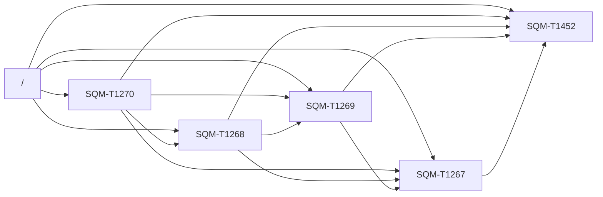

# Анализ результатов

## Эталонная последовательность выполнения пяти тестов по мнению руководителя отдела тестирования с многолетним опытом работы над проектом

### Таблица

| #   | Key       | Name                             |
| --- | --------- | -------------------------------- |
| 1   | SQM-T1452 | [Smoke] Модуль Диспетчер         |
| 2   | SQM-T1269 | [Smoke] Диспетчер. Блок Фильтры  |
| 3   | SQM-T1267 | [Smoke] Диспетчер. Блок Политики |
| 4   | SQM-T1268 | [Smoke] Диспетчер. Блок Очередь  |
| 5   | SQM-T1270 | [Smoke] Диспетчер. Блок Отправка |

## Эталонная последовательность выполнения пяти тестов по количеству провалов в предыдущих запусках

### Таблица


| #   | Key | Name |
| --- | --- | ---- |
|     |     |      |


### Возможные комбинации


## Запуск 1 (SQM-SR8)

### Таблица

| #   | Key       |
| --- | --------- |
| 1   | SQM-T1269 |
| 2   | SQM-T1452 |
| 3   | SQM-T1268 |
| 4   | SQM-T1270 |
| 5   | SQM-T1267 |

### Возможные комбинации


### Совпадения

#### 2 из 5 точность 40%
`[SQM-T1452; SQM-T1267]`
`[SQM-T1452; SQM-T1268]`
`[SQM-T1452; SQM-T1270]`
`[SQM-T1269; SQM-T1267]`
`[SQM-T1269; SQM-T1268]`
`[SQM-T1269; SQM-T1270]`
`[SQM-T1268; SQM-T1270]`

#### 3 из 5 точность 60%
`[SQM-T1452; SQM-T1268; SQM-T1270]`
`[SQM-T1269; SQM-T1268; SQM-T1270]`

#### Лучший результат

`[SQM-T1452; SQM-T1268; SQM-T1270]`

Точность 60%

## Запуск 2 (SQM-SR9)

### Таблица

| #   | Key       |
| --- | --------- |
| 1   | SQM-T1269 |
| 2   | SQM-T1452 |
| 3   | SQM-T1270 |
| 4   | SQM-T1268 |
| 5   | SQM-T1267 |

### Возможные комбинации


### Совпадения

#### 2 из 5 точность 40%
`[SQM-T1452; SQM-T1267]`
`[SQM-T1452; SQM-T1268]`
`[SQM-T1452; SQM-T1270]`
`[SQM-T1269; SQM-T1267]`
`[SQM-T1269; SQM-T1268]`
`[SQM-T1269; SQM-T1270]`

#### Лучший результат

`[SQM-T1452; SQM-T1267]`

Точность 40%

## Запуск 3 (SQM-SR10)

### Таблица

| #   | Key       |
| --- | --------- |
| 1   | SQM-T1452 |
| 2   | SQM-T1270 |
| 3   | SQM-T1269 |
| 4   | SQM-T1268 |
| 5   | SQM-T1267 |

### Возможные комбинации


### Совпадения

#### 2 из 5 точность 40%
`[SQM-T1452; SQM-T1269]`
`[SQM-T1452; SQM-T1267]`
`[SQM-T1452; SQM-T1268]`
`[SQM-T1452; SQM-T1270]`
`[SQM-T1269; SQM-T1267]`
`[SQM-T1269; SQM-T1268]`

#### 3 из 5 точность 60%
`[SQM-T1452; SQM-T1269; SQM-T1267]`
`[SQM-T1452; SQM-T1269; SQM-T1268]`

#### Лучший результат

`[SQM-T1452; SQM-T1269; SQM-T1267]`

Точность 60%

## Запуск 4 (SQM-SR11)

### Таблица

| #   | Key       |
| --- | --------- |
| 1   | SQM-T1269 |
| 2   | SQM-T1267 |
| 3   | SQM-T1452 |
| 4   | SQM-T1270 |
| 5   | SQM-T1268 |

### Возможные комбинации


### Совпадения

#### 2 из 5 точность 40%
`[SQM-T1452; SQM-T1268]`
`[SQM-T1452; SQM-T1270]`
`[SQM-T1269; SQM-T1267]`
`[SQM-T1269; SQM-T1268]`
`[SQM-T1269; SQM-T1270]`
`[SQM-T1267; SQM-T1268]`
`[SQM-T1267; SQM-T1270]`

#### 3 из 5 точность 60%
`[SQM-T1269; SQM-T1267; SQM-T1268]`
`[SQM-T1269; SQM-T1267; SQM-T1270]`

#### Лучший результат

`[SQM-T1269; SQM-T1267; SQM-T1268]`

Точность 60%

## Запуск 5 (SQM-SR12)

### Таблица

| #   | Key       |
| --- | --------- |
| 1   | SQM-T1269 |
| 2   | SQM-T1267 |
| 3   | SQM-T1452 |
| 4   | SQM-T1270 |
| 5   | SQM-T1268 |

### Возможные комбинации


### Совпадения

#### 2 из 5 точность 40%
`[SQM-T1452; SQM-T1268]`
`[SQM-T1452; SQM-T1270]`
`[SQM-T1269; SQM-T1267]`
`[SQM-T1269; SQM-T1268]`
`[SQM-T1269; SQM-T1270]`
`[SQM-T1267; SQM-T1268]`
`[SQM-T1267; SQM-T1270]`

#### 3 из 5 точность 60%
`[SQM-T1269; SQM-T1267; SQM-T1268]`
`[SQM-T1269; SQM-T1267; SQM-T1270]`

#### Лучший результат

`[SQM-T1269; SQM-T1267; SQM-T1268]`

Точность 60%

## Запуск 6 (SQM-SR13)

### Таблица

| #   | Key       |
| --- | --------- |
| 1   | SQM-T1268 |
| 2   | SQM-T1269 |
| 3   | SQM-T1270 |
| 4   | SQM-T1267 |
| 5   | SQM-T1452 |

### Возможные комбинации


### Совпадения

#### 2 из 5 точность 40%
`[SQM-T1269; SQM-T1267]`
`[SQM-T1269; SQM-T1270]`
`[SQM-T1268; SQM-T1270]`

#### Лучший результат

`[SQM-T1269; SQM-T1267]`

Точность 40%

## Запуск 7 (SQM-SR14)

### Таблица

| #   | Key       |
| --- | --------- |
| 1   | SQM-T1452 |
| 2   | SQM-T1269 |
| 3   | SQM-T1270 |
| 4   | SQM-T1268 |
| 5   | SQM-T1267 |

### Возможные комбинации


### Совпадения

#### 2 из 5 точность 40%
`[SQM-T1452; SQM-T1269]`
`[SQM-T1452; SQM-T1267]`
`[SQM-T1452; SQM-T1268]`
`[SQM-T1452; SQM-T1270]`
`[SQM-T1269; SQM-T1267]`
`[SQM-T1269; SQM-T1268]`
`[SQM-T1269; SQM-T1270]`

#### 3 из 5 точность 60%
`[SQM-T1452; SQM-T1269; SQM-T1267]`
`[SQM-T1452; SQM-T1269; SQM-T1268]`
`[SQM-T1452; SQM-T1269; SQM-T1270]`

#### Лучший результат

`[SQM-T1452; SQM-T1269; SQM-T1267]`

Точность 60%

## Запуск 8 (SQM-SR15)

### Таблица

| #   | Key       |
| --- | --------- |
| 1   | SQM-T1269 |
| 2   | SQM-T1268 |
| 3   | SQM-T1270 |
| 4   | SQM-T1452 |
| 5   | SQM-T1267 |

### Возможные комбинации


### Совпадения

#### 2 из 5 точность 40%
`[SQM-T1452; SQM-T1267]`
`[SQM-T1269; SQM-T1267]`
`[SQM-T1269; SQM-T1268]`
`[SQM-T1269; SQM-T1270]`
`[SQM-T1268; SQM-T1270]`

#### 3 из 5 точность 60%
`[SQM-T1269; SQM-T1268; SQM-T1270]`

#### Лучший результат

`[SQM-T1269; SQM-T1268; SQM-T1270]`

Точность 60%

## Запуск 9 (SQM-SR16)

### Таблица

| #   | Key       |
| --- | --------- |
| 1   | SQM-T1269 |
| 2   | SQM-T1452 |
| 3   | SQM-T1270 |
| 4   | SQM-T1267 |
| 5   | SQM-T1268 |

### Возможные комбинации


### Совпадения

#### 2 из 5 точность 40%
`[SQM-T1452; SQM-T1267]`
`[SQM-T1452; SQM-T1268]`
`[SQM-T1452; SQM-T1270]`
`[SQM-T1269; SQM-T1267]`
`[SQM-T1269; SQM-T1268]`
`[SQM-T1269; SQM-T1270]`
`[SQM-T1267; SQM-T1268]`

#### 3 из 5 точность 60%
`[SQM-T1452; SQM-T1267; SQM-T1268]`
`[SQM-T1269; SQM-T1267; SQM-T1268]`

#### Лучший результат

`[SQM-T1452; SQM-T1267; SQM-T1268]`

Точность 60%

## Запуск 10 (SQM-SR17)

### Таблица

| #   | Key       |
| --- | --------- |
| 1   | SQM-T1269 |
| 2   | SQM-T1270 |
| 3   | SQM-T1268 |
| 4   | SQM-T1452 |
| 5   | SQM-T1267 |

### Возможные комбинации


### Совпадения

#### 2 из 5 точность 40%
`[SQM-T1452; SQM-T1267]`
`[SQM-T1269; SQM-T1267]`
`[SQM-T1269; SQM-T1268]`
`[SQM-T1269; SQM-T1270]`

#### Лучший результат

`[SQM-T1452; SQM-T1267]`

Точность 40%

## Запуск 11 (SQM-SR18)

### Таблица

| #   | Key       |
| --- | --------- |
| 1   | SQM-T1269 |
| 2   | SQM-T1270 |
| 3   | SQM-T1452 |
| 4   | SQM-T1267 |
| 5   | SQM-T1268 |

### Возможные комбинации


### Совпадения

#### 2 из 5 точность 40%
`[SQM-T1452; SQM-T1267]`
`[SQM-T1452; SQM-T1268]`
`[SQM-T1269; SQM-T1267]`
`[SQM-T1269; SQM-T1268]`
`[SQM-T1269; SQM-T1270]`
`[SQM-T1267; SQM-T1268]`

#### 3 из 5 точность 60%
`[SQM-T1452; SQM-T1267; SQM-T1268]`
`[SQM-T1269; SQM-T1267; SQM-T1268]`

#### Лучший результат

`[SQM-T1452; SQM-T1267; SQM-T1268]`

Точность 60%

## Запуск 12 (SQM-SR19)

### Таблица

| #   | Key       |
| --- | --------- |
| 1   | SQM-T1269 |
| 2   | SQM-T1270 |
| 3   | SQM-T1452 |
| 4   | SQM-T1267 |
| 5   | SQM-T1268 |

### Возможные комбинации


### Совпадения

#### 2 из 5 точность 40%
`[SQM-T1452; SQM-T1267]`
`[SQM-T1452; SQM-T1268]`
`[SQM-T1269; SQM-T1267]`
`[SQM-T1269; SQM-T1268]`
`[SQM-T1269; SQM-T1270]`
`[SQM-T1267; SQM-T1268]`

#### 3 из 5 точность 60%
`[SQM-T1452; SQM-T1267; SQM-T1268]`
`[SQM-T1269; SQM-T1267; SQM-T1268]`

#### Лучший результат

`[SQM-T1452; SQM-T1267; SQM-T1268]`

Точность 60%

## Запуск 13 (SQM-SR20)

### Таблица

| #   | Key       |
| --- | --------- |
| 1   | SQM-T1270 |
| 2   | SQM-T1268 |
| 3   | SQM-T1269 |
| 4   | SQM-T1267 |
| 5   | SQM-T1452 |

### Возможные комбинации



### Совпадения

#### 2 из 5 точность 40%
`[SQM-T1269; SQM-T1267]`

#### Лучший результат

`[SQM-T1269; SQM-T1267]`

Точность 40%

## Запуск 14 (SQM-SR21)

### Таблица

| #   | Key       |
| --- | --------- |
| 1   | SQM-T1270 |
| 2   | SQM-T1452 |
| 3   | SQM-T1269 |
| 4   | SQM-T1267 |
| 5   | SQM-T1268 |

### Возможные комбинации


### Совпадения

#### 2 из 5 точность 40%
`[SQM-T1452; SQM-T1269]`
`[SQM-T1452; SQM-T1267]`
`[SQM-T1452; SQM-T1268]`
`[SQM-T1269; SQM-T1267]`
`[SQM-T1269; SQM-T1268]`
`[SQM-T1267; SQM-T1268]`

#### 3 из 5 точность 60%
`[SQM-T1452; SQM-T1269; SQM-T1267]`
`[SQM-T1452; SQM-T1269; SQM-T1268]`
`[SQM-T1452; SQM-T1267; SQM-T1268]`
`[SQM-T1269; SQM-T1267; SQM-T1268]`

#### 4 из 5 точность 80%
`[SQM-T1452; SQM-T1269; SQM-T1267; SQM-T1268]`

#### Лучший результат

`[SQM-T1452; SQM-T1269; SQM-T1267; SQM-T1268]`

Точность 80%

## Запуск 15 (SQM-SR22)

### Таблица

| #   | Key       |
| --- | --------- |
| 1   | SQM-T1270 |
| 2   | SQM-T1267 |
| 3   | SQM-T1452 |
| 4   | SQM-T1269 |
| 5   | SQM-T1268 |

### Возможные комбинации


### Совпадения

#### 2 из 5 точность 40%
`[SQM-T1452; SQM-T1269]`
`[SQM-T1452; SQM-T1268]`
`[SQM-T1269; SQM-T1268]`
`[SQM-T1267; SQM-T1268]`

#### 3 из 5 точность 60%
`[SQM-T1452; SQM-T1269; SQM-T1268]`

#### Лучший результат

`[SQM-T1452; SQM-T1269; SQM-T1268]`

Точность 60%

## Запуск 16 (SQM-SR23)

### Таблица

| #   | Key       |
| --- | --------- |
| 1   | SQM-T1269 |
| 2   | SQM-T1452 |
| 3   | SQM-T1270 |
| 4   | SQM-T1268 |
| 5   | SQM-T1267 |

### Возможные комбинации


### Совпадения

#### 2 из 5 точность 40%
`[SQM-T1452; SQM-T1267]`
`[SQM-T1452; SQM-T1268]`
`[SQM-T1452; SQM-T1270]`
`[SQM-T1269; SQM-T1267]`
`[SQM-T1269; SQM-T1268]`
`[SQM-T1269; SQM-T1270]`

#### Лучший результат

`[SQM-T1452; SQM-T1267]`

Точность 40%

## Запуск 17 (SQM-SR24)

### Таблица

| #   | Key       |
| --- | --------- |
| 1   | SQM-T1269 |
| 2   | SQM-T1270 |
| 3   | SQM-T1452 |
| 4   | SQM-T1267 |
| 5   | SQM-T1268 |

### Возможные комбинации


### Совпадения

#### 2 из 5 точность 40%
`[SQM-T1452; SQM-T1267]`
`[SQM-T1452; SQM-T1268]`
`[SQM-T1269; SQM-T1267]`
`[SQM-T1269; SQM-T1268]`
`[SQM-T1269; SQM-T1270]`
`[SQM-T1267; SQM-T1268]`

#### 3 из 5 точность 60%
`[SQM-T1452; SQM-T1267; SQM-T1268]`
`[SQM-T1269; SQM-T1267; SQM-T1268]`

#### Лучший результат

`[SQM-T1452; SQM-T1267; SQM-T1268]`

Точность 60%

## Запуск 18 (SQM-SR25)

### Таблица

| #   | Key       |
| --- | --------- |
| 1   | SQM-T1270 |
| 2   | SQM-T1452 |
| 3   | SQM-T1268 |
| 4   | SQM-T1267 |
| 5   | SQM-T1269 |

### Возможные комбинации


### Совпадения

#### 2 из 5 точность 40%
`[SQM-T1452; SQM-T1269]`
`[SQM-T1452; SQM-T1267]`
`[SQM-T1452; SQM-T1268]`

#### Лучший результат

`[SQM-T1452; SQM-T1269]`

Точность 40%

## Запуск 19 (SQM-SR26)

### Таблица

| #   | Key       |
| --- | --------- |
| 1   | SQM-T1268 |
| 2   | SQM-T1270 |
| 3   | SQM-T1267 |
| 4   | SQM-T1452 |
| 5   | SQM-T1269 |

### Возможные комбинации


### Совпадения

#### 2 из 5 точность 40%
`[SQM-T1452; SQM-T1269]`
`[SQM-T1268; SQM-T1270]`

#### Лучший результат

`[SQM-T1452; SQM-T1269]`

Точность 40%

## Запуск 20 (SQM-SR27)

### Таблица

| #   | Key       |
| --- | --------- |
| 1   | SQM-T1269 |
| 2   | SQM-T1452 |
| 3   | SQM-T1267 |
| 4   | SQM-T1268 |
| 5   | SQM-T1270 |

### Возможные комбинации

```mermaid
flowchart LR
    root["/"]
    root --> A1[SQM-T1269]
    root --> A2[SQM-T1452]
    root --> A3[SQM-T1267]
    root --> A4[SQM-T1268]
    root --> A5[SQM-T1270]
        A1 --> A2
        A1 --> A3
        A1 --> A4
        A1 --> A5
        A2 --> A3
        A2 --> A4
        A2 --> A5
        A3 --> A4
        A3 --> A5
        A4 --> A5
```

### Совпадения

#### 2 из 5 точность 40%
`[SQM-T1452; SQM-T1267]`
`[SQM-T1452; SQM-T1268]`
`[SQM-T1452; SQM-T1270]`
`[SQM-T1269; SQM-T1267]`
`[SQM-T1269; SQM-T1268]`
`[SQM-T1269; SQM-T1270]`
`[SQM-T1267; SQM-T1268]`
`[SQM-T1267; SQM-T1270]`
`[SQM-T1268; SQM-T1270]`

#### 3 из 5 точность 60%
`[SQM-T1452; SQM-T1267; SQM-T1268]`
`[SQM-T1452; SQM-T1267; SQM-T1270]`
`[SQM-T1452; SQM-T1268; SQM-T1270]`
`[SQM-T1269; SQM-T1267; SQM-T1268]`
`[SQM-T1269; SQM-T1267; SQM-T1270]`
`[SQM-T1269; SQM-T1268; SQM-T1270]`
`[SQM-T1267; SQM-T1268; SQM-T1270]`

#### 4 из 5 точность 80%
`[SQM-T1452; SQM-T1267; SQM-T1268; SQM-T1270]`
`[SQM-T1269; SQM-T1267; SQM-T1268; SQM-T1270]`

#### Лучший результат

`[SQM-T1452; SQM-T1267; SQM-T1268; SQM-T1270]`

Точность 80%

## Запуск 21 (SQM-SR28)

### Таблица

| #   | Key       |
| --- | --------- |
| 1   | SQM-T1269 |
| 2   | SQM-T1270 |
| 3   | SQM-T1452 |
| 4   | SQM-T1268 |
| 5   | SQM-T1267 |

### Возможные комбинации

```mermaid
flowchart LR
    root["/"]
    root --> A1[SQM-T1269]
    root --> A2[SQM-T1270]
    root --> A3[SQM-T1452]
    root --> A4[SQM-T1268]
    root --> A5[SQM-T1267]
        A1 --> A2
        A1 --> A3
        A1 --> A4
        A1 --> A5
        A2 --> A3
        A2 --> A4
        A2 --> A5
        A3 --> A4
        A3 --> A5
        A4 --> A5
```

### Совпадения

#### 2 из 5 точность 40%
`[SQM-T1452; SQM-T1267]`
`[SQM-T1452; SQM-T1268]`
`[SQM-T1269; SQM-T1267]`
`[SQM-T1269; SQM-T1268]`
`[SQM-T1269; SQM-T1270]`

#### Лучший результат

`[SQM-T1452; SQM-T1267]`

Точность 40%

## Запуск 22 (SQM-SR29)

### Таблица

| #   | Key       |
| --- | --------- |
| 1   | SQM-T1269 |
| 2   | SQM-T1270 |
| 3   | SQM-T1452 |
| 4   | SQM-T1268 |
| 5   | SQM-T1267 |

### Возможные комбинации

```mermaid
flowchart LR
    root["/"]
    root --> A1[SQM-T1269]
    root --> A2[SQM-T1270]
    root --> A3[SQM-T1452]
    root --> A4[SQM-T1268]
    root --> A5[SQM-T1267]
        A1 --> A2
        A1 --> A3
        A1 --> A4
        A1 --> A5
        A2 --> A3
        A2 --> A4
        A2 --> A5
        A3 --> A4
        A3 --> A5
        A4 --> A5
```

### Совпадения

#### 2 из 5 точность 40%
`[SQM-T1452; SQM-T1267]`
`[SQM-T1452; SQM-T1268]`
`[SQM-T1269; SQM-T1267]`
`[SQM-T1269; SQM-T1268]`
`[SQM-T1269; SQM-T1270]`

#### Лучший результат

`[SQM-T1452; SQM-T1267]`

Точность 40%

## Запуск 23 (SQM-SR30)

### Таблица

| #   | Key       |
| --- | --------- |
| 1   | SQM-T1269 |
| 2   | SQM-T1270 |
| 3   | SQM-T1452 |
| 4   | SQM-T1267 |
| 5   | SQM-T1268 |

### Возможные комбинации

```mermaid
flowchart LR
    root["/"]
    root --> A1[SQM-T1269]
    root --> A2[SQM-T1270]
    root --> A3[SQM-T1452]
    root --> A4[SQM-T1267]
    root --> A5[SQM-T1268]
        A1 --> A2
        A1 --> A3
        A1 --> A4
        A1 --> A5
        A2 --> A3
        A2 --> A4
        A2 --> A5
        A3 --> A4
        A3 --> A5
        A4 --> A5
```

### Совпадения

#### 2 из 5 точность 40%
`[SQM-T1452; SQM-T1267]`
`[SQM-T1452; SQM-T1268]`
`[SQM-T1269; SQM-T1267]`
`[SQM-T1269; SQM-T1268]`
`[SQM-T1269; SQM-T1270]`
`[SQM-T1267; SQM-T1268]`

#### 3 из 5 точность 60%
`[SQM-T1452; SQM-T1267; SQM-T1268]`
`[SQM-T1269; SQM-T1267; SQM-T1268]`

#### Лучший результат

`[SQM-T1452; SQM-T1267; SQM-T1268]`

Точность 60%

## Запуск 24 (SQM-SR31)

### Таблица

| #   | Key       |
| --- | --------- |
| 1   | SQM-T1268 |
| 2   | SQM-T1269 |
| 3   | SQM-T1267 |
| 4   | SQM-T1270 |
| 5   | SQM-T1452 |

### Возможные комбинации

```mermaid
flowchart LR
    root["/"]
    root --> A1[SQM-T1268]
    root --> A2[SQM-T1269]
    root --> A3[SQM-T1267]
    root --> A4[SQM-T1270]
    root --> A5[SQM-T1452]
        A1 --> A2
        A1 --> A3
        A1 --> A4
        A1 --> A5
        A2 --> A3
        A2 --> A4
        A2 --> A5
        A3 --> A4
        A3 --> A5
        A4 --> A5
```

### Совпадения

#### 2 из 5 точность 40%
`[SQM-T1269; SQM-T1267]`
`[SQM-T1269; SQM-T1270]`
`[SQM-T1267; SQM-T1270]`
`[SQM-T1268; SQM-T1270]`

#### 3 из 5 точность 60%
`[SQM-T1269; SQM-T1267; SQM-T1270]`

#### Лучший результат

`[SQM-T1269; SQM-T1267; SQM-T1270]`

Точность 60%

## Запуск 25 (SQM-SR32)

### Таблица

| #   | Key       |
| --- | --------- |
| 1   | SQM-T1269 |
| 2   | SQM-T1268 |
| 3   | SQM-T1270 |
| 4   | SQM-T1452 |
| 5   | SQM-T1267 |

### Возможные комбинации

```mermaid
flowchart LR
    root["/"]
    root --> A1[SQM-T1269]
    root --> A2[SQM-T1268]
    root --> A3[SQM-T1270]
    root --> A4[SQM-T1452]
    root --> A5[SQM-T1267]
        A1 --> A2
        A1 --> A3
        A1 --> A4
        A1 --> A5
        A2 --> A3
        A2 --> A4
        A2 --> A5
        A3 --> A4
        A3 --> A5
        A4 --> A5
```

### Совпадения

#### 2 из 5 точность 40%
`[SQM-T1452; SQM-T1267]`
`[SQM-T1269; SQM-T1267]`
`[SQM-T1269; SQM-T1268]`
`[SQM-T1269; SQM-T1270]`
`[SQM-T1268; SQM-T1270]`

#### 3 из 5 точность 60%
`[SQM-T1269; SQM-T1268; SQM-T1270]`

#### Лучший результат

`[SQM-T1269; SQM-T1268; SQM-T1270]`

Точность 60%

## Запуск 26 (SQM-SR33)

### Таблица

| #   | Key       |
| --- | --------- |
| 1   | SQM-T1269 |
| 2   | SQM-T1452 |
| 3   | SQM-T1270 |
| 4   | SQM-T1267 |
| 5   | SQM-T1268 |

### Возможные комбинации

```mermaid
flowchart LR
    root["/"]
    root --> A1[SQM-T1269]
    root --> A2[SQM-T1452]
    root --> A3[SQM-T1270]
    root --> A4[SQM-T1267]
    root --> A5[SQM-T1268]
        A1 --> A2
        A1 --> A3
        A1 --> A4
        A1 --> A5
        A2 --> A3
        A2 --> A4
        A2 --> A5
        A3 --> A4
        A3 --> A5
        A4 --> A5
```

### Совпадения

#### 2 из 5 точность 40%
`[SQM-T1452; SQM-T1267]`
`[SQM-T1452; SQM-T1268]`
`[SQM-T1452; SQM-T1270]`
`[SQM-T1269; SQM-T1267]`
`[SQM-T1269; SQM-T1268]`
`[SQM-T1269; SQM-T1270]`
`[SQM-T1267; SQM-T1268]`

#### 3 из 5 точность 60%
`[SQM-T1452; SQM-T1267; SQM-T1268]`
`[SQM-T1269; SQM-T1267; SQM-T1268]`

#### Лучший результат

`[SQM-T1452; SQM-T1267; SQM-T1268]`

Точность 60%

## Запуск 27 (SQM-SR34)

### Таблица

| #   | Key       |
| --- | --------- |
| 1   | SQM-T1269 |
| 2   | SQM-T1267 |
| 3   | SQM-T1452 |
| 4   | SQM-T1268 |
| 5   | SQM-T1270 |

### Возможные комбинации

```mermaid
flowchart LR
    root["/"]
    root --> A1[SQM-T1269]
    root --> A2[SQM-T1267]
    root --> A3[SQM-T1452]
    root --> A4[SQM-T1268]
    root --> A5[SQM-T1270]
        A1 --> A2
        A1 --> A3
        A1 --> A4
        A1 --> A5
        A2 --> A3
        A2 --> A4
        A2 --> A5
        A3 --> A4
        A3 --> A5
        A4 --> A5
```

### Совпадения

#### 2 из 5 точность 40%
`[SQM-T1452; SQM-T1268]`
`[SQM-T1452; SQM-T1270]`
`[SQM-T1269; SQM-T1267]`
`[SQM-T1269; SQM-T1268]`
`[SQM-T1269; SQM-T1270]`
`[SQM-T1267; SQM-T1268]`
`[SQM-T1267; SQM-T1270]`
`[SQM-T1268; SQM-T1270]`

#### 3 из 5 точность 60%
`[SQM-T1452; SQM-T1268; SQM-T1270]`
`[SQM-T1269; SQM-T1267; SQM-T1268]`
`[SQM-T1269; SQM-T1267; SQM-T1270]`
`[SQM-T1269; SQM-T1268; SQM-T1270]`
`[SQM-T1267; SQM-T1268; SQM-T1270]`

#### 4 из 5 точность 80%
`[SQM-T1269; SQM-T1267; SQM-T1268; SQM-T1270]`

#### Лучший результат

`[SQM-T1269; SQM-T1267; SQM-T1268; SQM-T1270]`

Точность 80%

## Запуск 28 (SQM-SR35)

### Таблица

| #   | Key       |
| --- | --------- |
| 1   | SQM-T1270 |
| 2   | SQM-T1269 |
| 3   | SQM-T1268 |
| 4   | SQM-T1452 |
| 5   | SQM-T1267 |

### Возможные комбинации

```mermaid
flowchart LR
    root["/"]
    root --> A1[SQM-T1270]
    root --> A2[SQM-T1269]
    root --> A3[SQM-T1268]
    root --> A4[SQM-T1452]
    root --> A5[SQM-T1267]
        A1 --> A2
        A1 --> A3
        A1 --> A4
        A1 --> A5
        A2 --> A3
        A2 --> A4
        A2 --> A5
        A3 --> A4
        A3 --> A5
        A4 --> A5
```

### Совпадения

#### 2 из 5 точность 40%
`[SQM-T1452; SQM-T1267]`
`[SQM-T1269; SQM-T1267]`
`[SQM-T1269; SQM-T1268]`

#### Лучший результат

`[SQM-T1452; SQM-T1267]`

Точность 40%

## Запуск 29 (SQM-SR36)

### Таблица

| #   | Key       |
| --- | --------- |
| 1   | SQM-T1270 |
| 2   | SQM-T1452 |
| 3   | SQM-T1269 |
| 4   | SQM-T1267 |
| 5   | SQM-T1268 |

### Возможные комбинации

```mermaid
flowchart LR
    root["/"]
    root --> A1[SQM-T1270]
    root --> A2[SQM-T1452]
    root --> A3[SQM-T1269]
    root --> A4[SQM-T1267]
    root --> A5[SQM-T1268]
        A1 --> A2
        A1 --> A3
        A1 --> A4
        A1 --> A5
        A2 --> A3
        A2 --> A4
        A2 --> A5
        A3 --> A4
        A3 --> A5
        A4 --> A5
```

### Совпадения

#### 2 из 5 точность 40%
`[SQM-T1452; SQM-T1269]`
`[SQM-T1452; SQM-T1267]`
`[SQM-T1452; SQM-T1268]`
`[SQM-T1269; SQM-T1267]`
`[SQM-T1269; SQM-T1268]`
`[SQM-T1267; SQM-T1268]`

#### 3 из 5 точность 60%
`[SQM-T1452; SQM-T1269; SQM-T1267]`
`[SQM-T1452; SQM-T1269; SQM-T1268]`
`[SQM-T1452; SQM-T1267; SQM-T1268]`
`[SQM-T1269; SQM-T1267; SQM-T1268]`

#### 4 из 5 точность 80%
`[SQM-T1452; SQM-T1269; SQM-T1267; SQM-T1268]`

#### Лучший результат

`[SQM-T1452; SQM-T1269; SQM-T1267; SQM-T1268]`

Точность 80%

## Запуск 30 (SQM-SR37)

### Таблица

| #   | Key       |
| --- | --------- |
| 1   | SQM-T1269 |
| 2   | SQM-T1267 |
| 3   | SQM-T1270 |
| 4   | SQM-T1452 |
| 5   | SQM-T1268 |

### Возможные комбинации

```mermaid
flowchart LR
    root["/"]
    root --> A1[SQM-T1269]
    root --> A2[SQM-T1267]
    root --> A3[SQM-T1270]
    root --> A4[SQM-T1452]
    root --> A5[SQM-T1268]
        A1 --> A2
        A1 --> A3
        A1 --> A4
        A1 --> A5
        A2 --> A3
        A2 --> A4
        A2 --> A5
        A3 --> A4
        A3 --> A5
        A4 --> A5
```

### Совпадения

#### 2 из 5 точность 40%
`[SQM-T1452; SQM-T1268]`
`[SQM-T1269; SQM-T1267]`
`[SQM-T1269; SQM-T1268]`
`[SQM-T1269; SQM-T1270]`
`[SQM-T1267; SQM-T1268]`
`[SQM-T1267; SQM-T1270]`

#### 3 из 5 точность 60%
`[SQM-T1269; SQM-T1267; SQM-T1268]`
`[SQM-T1269; SQM-T1267; SQM-T1270]`

#### Лучший результат

`[SQM-T1269; SQM-T1267; SQM-T1268]`

Точность 60%

## Итог

Точность 56%
