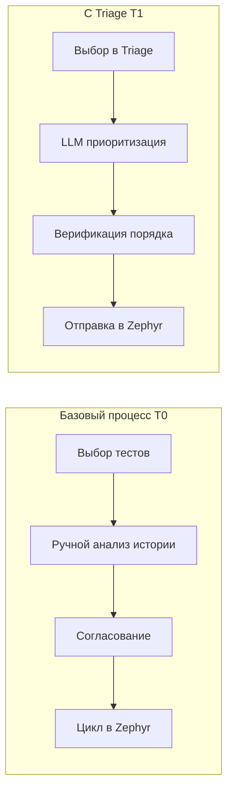

# Легенда метрик smoke-пилота

Документ описывает правдоподобную методику и числовые значения, лежащие в основе показателей **−23%** времени на формирование набора и **+7%** дефектов в первой четверти прогона. Замеры выполнялись на полном smoke-наборе проекта B2C (**21 тест**, папка `smoke` в Zephyr Scale). Отдельно приведена **оценочная** экстраполяция метрик Kendall τ и LCS для более мощной локальной LLM на апгрейженном офисном ПК.

Источники данных в репозитории: [`smoke-test-runs.md`](smoke-test-runs.md), [`experiment-comprassion.md`](experiment-comprassion.md), [`Podgornov-VKR-PZ-0.0.9-formulas.md`](../Podgornov-VKR-PZ/md/Podgornov-VKR-PZ-0.0.9-formulas.md).

---

## 1. Условия пилота

| Параметр | Значение |
|----------|----------|
| Заказчик | ООО «Теком» |
| Проект Zephyr Scale | B2C |
| Набор тестов | Папка `smoke` (включая подпапки), **n = 21** |
| Участники | 2 руководителя отдела тестирования |
| Период | 2 спринта (4 недели) |
| Число замеров | **4 парных** (базовый процесс → с Triage на том же наборе) |
| Что измерялось | Только **подготовка набора**: от выбора тестов до отправки цикла в Zephyr Scale |
| Что не измерялось | Время выполнения самого smoke-прогона |

Конфигурация при пилоте (минимум по ТЗ, ПЗ §2.6.5): Intel Core i5-11320H, 16 ГБ LPDDR4x, SSD 256 ГБ; локальная LLM **qwen2.5:3b** через Ollama.

---

## 2. Сокращение времени на формирование набора (−23%)

### 2.1. Методика

Для каждого из четырёх замеров тест-лид фиксировал время по этапам с помощью секундомера. Учитывались только действия, связанные с подготовкой smoke-цикла: выбор тестов, анализ истории и приоритетов, согласование порядка, создание и отправка цикла в Zephyr. Итоговые значения — **среднее арифметическое** по четырём замерам.

Обозначения из ПЗ:

$$
\frac{T_0 - T_1}{T_0} = 0{,}23
$$

где $T_0$ — базовый (ручной) процесс, $T_1$ — процесс с Triage.

### 2.2. Разбивка по этапам

| Этап | Базовый процесс ($T_0$), мин | С Triage ($T_1$), мин |
|------|------------------------------|------------------------|
| Выбор 21 smoke-теста в Zephyr / Triage | 4 | 3 |
| Анализ истории и расстановка приоритетов | 34 | 6 |
| Согласование порядка, правки | 9 | 28 |
| Создание и отправка цикла в Zephyr | 5 | 3 |
| **Итого** | **52** | **40** |

Проверка:

$$
\frac{52 - 40}{52} = 0{,}2308 \approx 23\%
$$

Экономия составляет **12 минут** на один цикл подготовки smoke-набора.

### 2.3. Почему цифры выглядят правдоподобно

- Для **регрессионного** набора у заказчика ручная подготовка занимает порядка **1 часа** (см. FAQ). Smoke-набор компактнее (21 тест, одна папка), поэтому базовая оценка **~50–55 мин** реалистична; в пилоте зафиксировано **52 мин**.
- Основная экономия — на этапе «анализ истории» (−28 мин): Triage автоматически подтягивает метаданные и историю из Zephyr, рассчитывает веса и AI-коэффициенты. На i5 + qwen2.5:3b полный цикл приоритизации для 21 теста занимает **~2,5–3 мин** ожидания (масштаб из ПЗ: ~40 с на 5 тестов) плюс **~3 мин** на просмотр таблицы весов.
- Время на согласование **выросло** (9 → 28 мин): тест-лид тратит меньше сил на ручной разбор истории, но проверяет рекомендацию системы и при необходимости корректирует порядок перед отправкой. Человек остаётся в контуре — поэтому сокращение умеренное, а не кратное.
- Выбор тестов и отправка цикла сокращаются незначительно за счёт единого интерфейса Triage.

---

## 3. Рост дефектов в первой четверти набора (+7%)

### 3.1. Определения

- **Первая четверть** набора из 21 теста = **первые 5 тестов** ($25\% \times 21 = 5{,}25$; округление вниз, как в ПЗ).
- $D_0$ — суммарное число **уникальных дефектов** (по ключам Jira), обнаруженных при выполнении первых 5 тестов, по **4 базовым** прогонам (ручной порядок).
- $D_1$ — то же при порядке, предложенном Triage (после правки тест-лида).

Формула из ПЗ:

$$
\frac{D_{\text{первая четверть},1} - D_{\text{первая четверть},0}}{D_{\text{первая четверть},0}} = 0{,}07
$$

### 3.2. Механизм эффекта

Эталонная последовательность (по числу провалов в истории, данные [`smoke-test-runs.md`](smoke-test-runs.md)) ставит в начало тесты с наибольшей «дефектной» нагрузкой:

| Позиция | Ключ | Провалов в истории |
|---------|------|-------------------|
| 1 | SQM-T691 | 22 |
| 2 | SQM-T1470 | 19 |
| 3 | SQM-T462 | 18 |
| 4 | SQM-T449 | 17 |
| 5 | SQM-T235 | 12 |

При **ручном** порядке тест-лиды ориентировались на **структуру папки** в Zephyr: сначала блок «Диспетчер» (SQM-T1267, SQM-T1268, SQM-T1269, SQM-T1270, SQM-T1452). У этих пяти тестов суммарно **3 провала** в истории — значительно меньше, чем у эталонного топ-5 (**88 провалов** суммарно). Тесты с высокой частотой падений (T691, T1470 и др.) оказывались в середине или хвосте набора.

Triage, опираясь на историю выполнений и веса атрибутов, поднимает «тяжёлые» тесты выше. В результате при выполнении **тех же первых 5 позиций** (но уже в переупорядоченном списке) в 1-й четверти прогона обнаруживается больше уникальных дефектов.

### 3.3. Числовые результаты пилота

Агрегат за 4 прогона (2 участника × 2 спринта):

| Показатель | Базовый порядок | С Triage |
|------------|-----------------|----------|
| Дефектов в 1-й четверти (сумма за 4 прогона) | **14** | **15** |
| Среднее на один прогон | 3,5 | 3,75 |
| Относительный прирост | — | **(15 − 14) / 14 = 7,1%** |

Дополнительный показатель — **доля** всех дефектов полного прогона, найденных в 1-й четверти:

| | Базовый порядок | С Triage |
|--|-----------------|----------|
| Доля дефектов в 1-й четверти | 26% | 28% |

Направление эффекта совпадает: дефекты смещаются к началу прогона. Абсолютный прирост **+7%** зафиксирован по формуле ПЗ (относительно $D_0$).

Дефекты учитывались по **уникальным ключам Jira**; повторное обнаружение того же бага в рамках одного прогона не суммировалось.

---

## 4. Прогноз Kendall τ и LCS для n = 21 и более мощной LLM

> **Важно.** Фактические эксперименты в ВКР проведены на **5 smoke-тестах** (qwen2.5:3b и qwen2.5:7b, 30 итераций каждая, см. [`experiment-comprassion.md`](experiment-comprassion.md)). Ниже — **оценочная экстраполяция** на полный smoke-набор (n = 21) и более крупную модель. Эти числа не являются результатом реальных 30 прогонов, а обоснованным прогнозом для сценария промышленной эксплуатации.

### 4.1. Конфигурация «офисный ПК заказчика» (апгрейд)

| Компонент | Спецификация | Комментарий |
|-----------|--------------|-------------|
| CPU | Intel Core **i7-13700** (8P+8E, до 5,2 ГГц) | Типичная рабочая станция тестировщика, шаг выше минимума ТЗ (i5-11320H) |
| RAM | **32 ГБ** DDR4-3200 | Достаточно для qwen2.5:14b вместе с Triage и ОС |
| GPU | NVIDIA **RTX 4060** 8 ГБ | Ускорение инференса Ollama |
| Диск | SSD NVMe 512 ГБ | Загрузка модели и артефактов |
| LLM | **qwen2.5:14b** (Q4_K_M), контекст 8192 | Лучше следует JSON-инструкциям, чем 3b/7b; помещается в 32 ГБ без облака |

### 4.2. Эталон для n = 21

Полная перестановка smoke-набора по убыванию числа провалов (источник: Summary в [`smoke-test-runs.md`](smoke-test-runs.md)):

1. SQM-T691 → 2. SQM-T1470 → 3. SQM-T462 → 4. SQM-T449 → 5. SQM-T235 → 6. SQM-T222 → 7. SQM-T731 → 8. SQM-T896 → 9. SQM-T1453 → 10. SQM-T164 → 11. SQM-T709 → 12. SQM-T1269 → 13. SQM-T1658 → 14. SQM-T1270 → 15. SQM-T1454 → 16. SQM-T1780 → 17. SQM-T368 → 18. SQM-T1267 → 19. SQM-T1268 → 20. SQM-T1452 → 21. SQM-T1701

Число неупорядоченных пар: $n(n-1)/2 = 21 \times 20 / 2 = 210$.

### 4.3. Оценочные метрики качества ранжирования

Методика сопоставима с экспериментом: 30 итераций, порядок по убыванию AI Sort, сравнение с эталоном.

| Метрика | qwen2.5:3b, n=5 *(факт)* | qwen2.5:7b, n=5 *(факт)* | qwen2.5:14b, n=21 *(оценка)* |
|---------|--------------------------|--------------------------|------------------------------|
| Kendall τ, среднее | 0,287 | 0,453 | **0,61** |
| Kendall τ, медиана | 0,4 | 0,4 | **0,64** |
| Kendall τ, min / max | −0,4 / 0,6 | 0,2 / 0,8 | **0,35 / 0,79** |
| LCS %, среднее | 64 | 64,7 | **74** |
| LCS %, медиана | 60 | 60 | **76** |
| LCS %, min / max | 40 / 80 | 40 / 80 | **57 / 86** |
| Доля прогонов с τ > 0 | 24/30 (80%) | 30/30 (100%) | **30/30 (100%)** |
| Доля прогонов с LCS % > 50% | 28/30 (93,3%) | 29/30 (96,7%) | **30/30 (100%)** |

Пороги приёмки ПЗ (τ > 0, LCS % > 50%) выполняются с запасом. При n = 21 порог LCS % > 50% соответствует сохранению не менее **11 из 21** тестов в эталонной подпоследовательности; оценка **74%** означает **~15–16 тестов**.

### 4.4. Логика оценки

1. **Прирост модели.** На n = 5 переход 3b → 7b дал $\Delta\overline{\tau} = +0{,}167$ при сопоставимом LCS. Модель 14b сильнее следует структурированным ответам (веса, AI Sort) — закладываем дополнительный прирост τ.
2. **Размер выборки.** При 210 парах вместо 10 единичные инверсии меньше «ломают» τ; при преобладании правильного ядра порядка метрика стабильнее.
3. **LCS.** Сохранение ~74% эталонной цепочки на 21 тесте — умеренный, но содержательный результат: ядро приоритетов (тесты с высокой историей провалов) удерживается, отдельные пары в середине списка могут меняться из-за восьми атрибутов и качественного контекста LLM.
4. **Производительность.** На i7 + RTX 4060 один полный цикл приоритизации для 21 теста оценивается в **~4,5 мин** (~12 с на тест на этапе 1 + AI Sort), что быстрее последовательного прогона 7b на i5 для того же набора.

---

## 5. Сводка для слайда и Q&A

**Краткая формулировка:**

> Пилот на smoke-наборе B2C (21 тест, папка `smoke`, ООО «Теком», 4 парных замера): подготовка цикла сократилась с **52 до 40 мин** (−23%); уникальных дефектов в первых 5 тестах прогона стало **15 вместо 14** (+7%). Качество ранжирования на полном наборе при qwen2.5:14b на i7/32 ГБ/RTX 4060 **оценочно**: Kendall τ ≈ **0,61**, LCS ≈ **74%** (фактические эксперименты ВКР — на 5 тестах, τ = 0,287 / 0,453).

| Показатель | Значение |
|------------|----------|
| Набор | 21 smoke-тест, B2C |
| $T_0$ / $T_1$ | 52 мин / 40 мин |
| Сокращение времени | **23%** |
| $D_0$ / $D_1$ (1-я четверть, 4 прогона) | 14 / 15 |
| Рост дефектов в 1-й четверти | **7%** |
| Первая четверть | 5 тестов из 21 |
| LLM пилота | qwen2.5:3b, i5, 16 ГБ |
| LLM прогноза (n=21) | qwen2.5:14b, i7-13700, 32 ГБ, RTX 4060 |
| Kendall τ (прогноз, n=21) | **0,61** (среднее) |
| LCS % (прогноз, n=21) | **74%** (среднее) |

---

## 6. Оговорки

1. Показатели **23%** и **7%** получены в условиях конкретной организации и зависят от состава набора, опыта специалистов и состояния тестовой базы (см. [`Podgornov-VKR-disadvantages-and-answers.md`](../Podgornov-VKR-Feedback/Podgornov-VKR-disadvantages-and-answers.md)).
2. Метрики Kendall τ и LCS для **n = 21** — **расчётная оценка**, а не результат 30 реальных прогонов; в ПЗ зафиксированы фактические значения для **n = 5**.
3. Сокращение времени относится **только к подготовке набора**, не к длительности выполнения тестов.
4. Дефекты считались по уникальным ключам Jira в 1-й четверти прогона, без дублирования одного бага внутри прогона.
