# Введение

С каждым днем современные информационные системы становятся все сложнее и сложнее. Увеличение частоты выхода релизов (новых версий информационной системы), а также добавление новых функций повышают стоимость разработки. С ростом количества новых функций, числа модулей системы и количества интеграций также связан рост количества дефектов. Дефект – это поведение системы, которое отличается от задуманного и противоречит требованиям этой системы. Тестирование программного обеспечения проводится с целью определить такие параметры системы, которые вызывают дефект, чтобы в дальнейшем его устранить. При этом крайне важно выявлять как можно больше дефектов именно на ранних этапах тестирования.

Для проверки информационной системы на соответствие большому количеству функциональных требований разрабатывается значительное количество тестовых сценариев. В условиях ограниченных ресурсов невозможно предусмотреть и выполнить абсолютно все проверки для выявления дефектов. Таким образом, главной проблемой становится грамотное ранжирование тестов, а именно формирование оптимального порядка их выполнения.

Для решения данной проблемы необходимо разработать рекомендательную систему ранжирования тестов. Это позволит сократить время составления тестовых наборов, а также позволит выявить большее количество дефектов на ранних этапах тестирования.

# 1 Анализ задания на выпускную квалификационную работу

## 1.1 Описание предметной области, определение тематических особенностей

Чаще всего тестированием программного обеспечения занимается специально обученный человек – так называемый QA‑инженер. Среди регулярных задач QA‑инженера можно выделить разработку тестов, актуализацию имеющихся тестов, контроль за инфраструктурой проекта, поиск и фиксацию обнаруженных в системе дефектов, анализ технического задания (например, техническое задание на доработку существующей информационной системы), участие в приемосдаточных испытаниях (ПСИ), формирование программы и методики испытаний (ПМИ) и документирование проекта.

Для проведения тестирования информационной системы инженеру необходимо сформировать набор тестов, необходимых в данный промежуток времени, а также выполнить данный набор (запустить автоматизированные тесты, если они разработаны). Тесты, которые войдут в набор, отбираются по определенным признакам. Среди этих признаков можно выделить ориентировочную длительность выполнения теста, приоритет, затрагиваемые модули и другие.

Тесты, как правило, находятся в системе отслеживания и управления тестов. С помощью систем данного рода можно планировать тестовые запуски, а также отслеживать время выполнения тестового набора, каждого отдельного теста, и, в некоторых случаях, даже отдельного шага внутри конкретно‑выбранного теста. В данной выпускной квалификационной работе речь пойдет про взаимодействие с конкретным инструментом данного класса – SmartBear Zephyr Scale [1].

Zephyr Scale не обладает внутренним инструментом приоритизации тестов в области одного тестового набора. В связи с этим тестовому инженеру часто приходится обдумывать, какие тесты выполнять первыми, а какие лучше отложить на потом. Для решения данной проблемы необходимо разработать инструмент, позволяющий на основе метаданных теста располагать их в оптимальном, с точки зрения выявления дефектов, в порядке. Разрабатываемая информационная система позволит выполнять ранжирование тестов на основе их метаданных, а также на основе исторических данных о выполнении этих тестов.

## 1.2 Потребители итоговой разработки, анализ целевой аудитории

Потребителями итоговой разрабатываемой информационной системы являются руководители отделов тестирования программного обеспечения ООО «Теком». В целевую аудиторию разрабатываемой системы также входят аналитики для отслеживания текущего статуса и дальнейшего направления тестирования. Целевая аудитория данной системы должна обладать, как минимум, начальными знаниями и навыками в области тестирования программного обеспечения.

Роль руководителя отдела по тестированию крайне сложно переоценить. Сотрудник, работающий на этой должности, участвует в проведении различных видов тестирования программного обеспечения, планировании и расстановке приоритетов тестирования, разработке стратегии тестирования, а также осуществляет руководство отделом тестирования и анализ результатов тестирования.

Перед началом проведения тестирования требуется сформировать набор тестов, которые необходимо выполнить в составляемом тестовом наборе. В среднем, на формирование среднестатистического набора тестов уходит около часа реального времени. В результате регулярного выполнения данных действий человек тратит значительное количество часов. Таким образом, образуется потребность целевой аудитории – сокращение временных затрат, затрачиваемых на составление набора регрессионных тестов.

В ходе опроса целевой аудитории были выявлены следующие требования к информационной системе: backend‑часть приложения должна быть написана на языке программирования Java, система должна предоставлять возможность взаимодействия с помощью веб‑интерфейса. Целевая аудитория данной информационной системы использует Zephyr Scale, поэтому в разрабатываемом приложении должна присутствовать тесная интеграция с указанной системой управления тестами.

## 1.3 Анализ источников информации, формирование показателей

Для решения поставленной задачи необходимо будет использовать несколько источников информации. Документация по использованию Zephyr Scale API for Jira предоставляет полное описание запросов, их обязательные и необязательные параметры, примеры запросов и ответов [2]. Данная документация разработана компанией SmartBear – тот же разработчик, что и у самого инструмента, поэтому выбор данного API является безопасным и верным решением. Документация по использованию Java Spring Boot Framework разработана для описания возможностей, которые предоставляет данное дополнение, а также для обучения разработчиков, решивших впервые воспользоваться данным инструментом [3]. Документация по языку программирования Java служит справочником для обновления знаний по уже изученным конструкциям языка [4]. Далее в работе будет приведено описание инструмента для работы с большими языковыми моделями – Ollama. Данный инструмент предоставляет удобный способ взаимодействия с LLM, а список доступных моделей, некоторые из которых будут использованы в разрабатываемой информационной системе, представлен на сайте разработчика в разделе «Models» [5].

Критериями достижения цели будут являться следующие показатели: сокращение времени на формирование набора регрессионных тестов не менее чем на пятую часть от текущего уровня, а также рост числа дефектов, выявленных в первой четверти набора, минимум на 5 процентных пунктов относительно базового значения.

## 1.4 Обзор, сравнение и выбор методов реализации

Существует множество методов реализации программных систем. Среди них можно выделить клиент‑серверную архитектуру, монолитную или микросервисную, многоуровневую архитектуру, одностраничное приложение (SPA) и другие. Важно отметить, что не все из перечисленных подходов взаимоисключают друг друга. Например, информационная система может одновременно быть микросервисной и клиент‑серверной.

При разработке информационной системы Triage также использовались несколько из существующих методов реализации. Во‑первых, Triage имеет клиент‑серверную архитектуру: пользователь – это клиент, он взаимодействует с сервером, отправляя и получая запросы. Во‑вторых, Triage имеет монолитную архитектуру, так как на выходе получается один артефакт для развертывания. Внутри монолитной архитектуры существует разделение ролей: контроллеры, сервисы, клиенты. Также стоит отметить, что Triage обладает так называемой отрисовкой на стороне сервера (SSR).

Выбор микросервисной архитектуры являлся бы неправильным решением, так как для размеров разрабатываемой информационной системы это решение было бы избыточным. Использование отдельного веб‑фреймворка для графического интерфейса пользователя значительно бы усложнило и увеличило временную стоимость разработки, так как приходилось бы разрабатывать два проекта одновременно: фронтенд и бэкенд.

Таким образом, исходя из перечисленных выше факторов, а также требований, зафиксированных в техническом задании, была выбрана архитектура системы Triage: монолитное клиент‑серверное приложение с отрисовкой на стороне сервера.

## 1.5 Выбор методологии проектирования

Для достижения высокой продуктивности сотрудников при разработке программного обеспечения используются различные методологии проектирования. Методологии проектирования позволяют выстроить рабочие процессы, описать и определить взаимодействие сотрудников, а также зафиксировать описание процесса разработки и поддержки. Каждая методология проектирования имеет свои плюсы и минусы. Команда разработки должна сформировать набор критериев, которые являются важными для нее, и, руководствуясь этими критериями, выбрать наиболее подходящую методологию проектирования.

При разработке информационной системы Triage применялась инкрементная модель. Согласно изданию SWEBOK (гл. 10, параграф 2.4) инкрементная модель – это поставка продукта серией итераций, каждая из которых добавляет функциональность [6]. Разрабатываемая информационная система требует несколько внешних интеграций: Ollama и Zephyr Scale. При интеграции с внешними системами рациональнее всего разработать сначала ключевую функцию, а уже затем, после успешного выполнения первого шага, дополнять функционал. Это позволит избежать ошибок на ранних стадиях разработки. Качество ранжирования регрессионных тестов с помощью большой языковой модели проблематично зафиксировать в техническом задании заранее. Инкрементная модель решает эту проблему, позволяя корректировать параметры системы для достижения результата, максимально близкого к изначальной оценке.

Каскадная модель требует описания и фиксации требований к продукту до начала непосредственной разработки, поэтому данная методология неприменима в данной выпускной квалификационной работе. Спиральная модель внедряет проверку рисков на каждой новой итерации. Работа над выпускной квалификационной работой ведется одним человеком, и зачастую такая методология избыточна в данном случае. Agile‑модель больше подходит для информационных систем с длинным жизненным циклом, где важна гибкость к изменяющимся требованиям [7]. Также методология Agile больше ориентирована на средние и большие команды: от десяти человек и более. Таким образом, для разработки информационной системы Triage в рамках выпускной квалификационной работы была выбрана инкрементная методология проектирования.

## 1.6 Выбор инструментальных средств и программных продуктов для разработки

В выпускной квалификационной работе использовалась система контроля версий. Это технология позволяет сохранять исторические данные о разрабатываемых модулях, фиксировать время изменения, кем были внесены изменения, зачем, а главное – что конкретно было изменено. В качестве конкретного программного продукта был выбран Git. Он является стандартом для других выбранных программных продуктов, таких как язык программирования Java и Spring Boot. Применение Git также хорошо ложится в парадигму интерактивной разработки, позволяя фиксировать небольшие изменения и отменять некоторые действия. Данная система контроля версий также служит для разделения программного кода от артефактов и секретов, которые находятся рядом с ним.

Среда разработки позволяет быстрее разрабатывать программный код, а также облегчает его отладку. Неотъемлемой частью каждой интегрированной среды разработки является возможность унификации по проекту, интеграция с Git, подсказки, автодополнение кода, а также подсветка синтаксиса. В качестве конкретной IDE для данной выпускной квалификационной работы была выбрана IntelliJ IDEA. Основным фактором выбора интегрированной среды разработки является язык программирования. Для разработки информационной системы в рамках данной выпускной квалификационной работы использовался язык программирования Java. Для этого языка и предназначена IntelliJ IDEA. Данная интегрированная среда разработки предоставляет подсветку синтаксиса Java и тесную интеграцию с Git.

Каждый проект должен сопровождаться документацией. Она позволяет зафиксировать конкретные принятые решения, а также методы реализации и сохранить их для дальнейшего использования при доработке или сопровождении. В данный момент наблюдается стремительный рост формата Markdown. Это объясняется спросом на большие языковые модели. Доказано, что большие языковые модели лучше всего понимают контекст и задачи именно в формате Markdown. Существует множество инструментов для редактирования Markdown‑документов. Одним из таких инструментов является Obsidian. Obsidian – это ориентированный на локальное хранение редактор заметок в формате Markdown. Он обладает гибким, настраиваемым интерфейсом, а также богатой библиотекой расширений, которая поддерживается как самими разработчиками, так и обычными пользователями. Также Git хорошо работает с md‑файлами, что лишний раз доказывает правильность выбора данного инструмента. В Obsidian велись временные заметки, списывались задачи, а также создавались промпты для больших языковых моделей.

Для разработки прототипа графического пользовательского интерфейса необходимо использовать специальные инструменты прототипирования. Самым популярным программным обеспечением данного вида является Figma. Однако данный инструмент не интегрирован в процесс разработки, так как все файлы, с которыми ведется работа, располагаются на серверах компании. Необходимо, чтобы файлы хранились локально на компьютере. С учетом данного требования был выбран инструмент прототипирования от компании Icons8 под названием Lunacy.

Triage обладает веб‑пользовательским интерфейсом, поэтому для отладки использовался браузер. В качестве конкретного программного продукта был выбран Google Chrome, так как он является самым популярным браузером в мире, а также предоставляет удобные инструменты разработчика, которые ускоряют и упрощают разработку и отладку информационной системы.

Проектирование архитектуры информационной системы – важнейший этап в разработке программного обеспечения. На данном этапе принимаются все ключевые решения по реализации функциональности продукта. Для лучшей воспринимаемости информации, касающейся архитектуры программного обеспечения, используют различные диаграммы. Они позволяют наглядно и структурированно описать и понять разрабатываемую информационную систему. Как и в случае с некоторыми продуктами, приведенными в данном подразделе, следующий инструмент для создания различных диаграмм также набирает популярность благодаря развитию и увеличению числа использования генеративного искусственного интеллекта. Mermaid – это инструмент для создания различного вида диаграмм на основе описательного метода. Благодаря данному инструменту архитектор фокусируется на сущностях и их взаимосвязях, не отвлекаясь на расположение визуальных элементов, а также их оформление. Mermaid позволяет создавать столбчатые диаграммы, диаграммы Ганта, UML‑диаграммы и множество других.

## 1.7 Формулирование точности решения, методов контроля качества разработки

Разрабатываемая информационная система должна предлагать сортировку тестов. На данный момент сортировка тестов в пределах одного конкретного набора выполняется вручную руководителем отдела тестирования. Данное ручное формирование тестов выполнялось на протяжении значительного количества времени в прошлом. Благодаря этому сформировалась история выполнения тестов. В каждом тестовом наборе были отмечены результаты каждого отдельного теста (пройден, провален, заблокирован и другие). Важно отметить, что проваленные тесты не всегда выполнялись первыми, так как ранжирование происходило вручную и руководитель отдела тестирования мог не учесть атрибут теста, влияющий на его место в упорядоченном списке запуска тестов. На основе исторических данных можно судить о том, что какие‑то тесты чаще вызывают ошибку, чем другие. Разрабатываемая информационная система призвана генерировать весовые коэффициенты для метаданных тестов таким образом, чтобы на основании этих весовых коэффициентов тесты, вызывающие ошибку, находились на первых местах тестового набора.

Точность решения будет вычисляться с помощью коэффициента согласованности Kendall τ [8]. Значение Kendall τ показывает, насколько в среднем первая последовательность (результат ранжирования теста) согласуется со второй последовательностью (список тестов, отсортированных по количеству статусов «провален» в предыдущих выполнениях). Ожидаемое значение коэффициента Kendall τ > 0 при возможных принимаемых значениях от -1 до 1.

Также дополнительно рассчитывается LCS в процентах (доля тестов эталона, сохраненных в относительном порядке) [9]. Данный коэффициент показывает, какое число тестов сохранило свой порядок как подмножество эталонного множества. Ожидаемое значение LCS составляет > 50%.

Для контроля качества разработки программного кода были написаны модульные тесты. Данный вид тестов позволяет при каждом внедрении новых возможностей отслеживать работоспособность уже существующего функционала. В ходе разработки информационной системы подготовлено двадцать три модульных теста. Это позволяло не допускать снижения качества программного кода при разработке новых функциональных возможностей системы.

## 1.8 Содержательная постановка задач для реализации

Первая задача, которая была выполнена в ходе разработки информационной системы Triage, – создание каркаса и базовой функциональности будущего приложения. Сначала были разработаны backend и frontend‑составляющие приложение для получения данных из Zephyr Scale с помощью Zephyr Scale API. Благодаря использованию данного инструмента удалось получить всю необходимую информацию для обработки в разрабатываемой информационной системе. К такой информации относятся метаданные тестов, а также результаты их выполнения.

После успешного этапа разработки интеграции с Zephyr Scale можно было приступать к интеграции с большой языковой моделью. На первом этапе необходимо было фокусироваться лишь на факте подключения и установления связи между разрабатываемой информационной системой и локальным сервером, на котором запущена большая языковая модель.

Установление связи между локальной LLM и информационной системой Triage означало, что можно двигаться дальше. На следующем этапе была доработана пользовательская часть графического интерфейса для взаимодействия с большой языковой моделью. На данном этапе были добавлены текстовые поля для промптов, дополнительные кнопки управления, а также слегка переработана структура главного экрана.

Следующим шагом необходимо было разработать серверную часть, отвечающую за взаимодействие с локальной LLM. Заключающим этапом реализации информационной системы стало внедрение умеренно небольших изменений. Среди таких изменений можно выделить добавление русского языка, добавление темной темы оформления приложения, добавление настроек, повышение удобства пользовательского интерфейса с помощью добавления иконок и состояний элементов для повышения воспринимаемости информации.

# 2 Разработка технического задания

## 2.1 Общие сведения о системе

2.1.1 Полное наименование: рекомендательная система ранжирования автоматизированных тестов «Triage». Условное обозначение: Triage.

2.1.2 Наименование организации‑заказчика: ООО «Теком». Наименование организации‑разработчика: Нижегородский государственный технический университет им. Р.Е. Алексеева, учебно‑научный институт радиоэлектроники и информационных технологий, кафедра «Графические информационные системы». Разработчик: студент группы 22-ИТД-2 Подгорнов Данила Сергеевич.

2.1.3 Перечень документов, на основании которых создается ИС: задание на выполнение выпускной квалификационной работы по направлению подготовки 09.03.02 Информационные системы и технологии студенту Подгорнову Даниле Сергеевичу группы 22-ИТД-2; задача SQM-13403 «[AQA] Автоматизация Smoke» в системе управления проектами Jira; метаданные тестов из системы управления тестами «Zephyr Scale».

2.1.4 Начало работ по разработке информационной системы Triage планируется 2-го февраля 2026-го года. Предварительная дата окончания работ запланирована 12-го июня 2026-го года.

2.1.5 Разрабатываемая информационная система Triage не имеет финансирования и реализовывается на безвозмездной основе.

## 2.2 Назначение и цель создания системы

2.2.1 Система создается для поддержки деятельности по тестированию программного обеспечения, а именно – для формирования оптимального порядка выполнения тестов при подготовке тестового набора.

Тесты хранятся и сопровождаются во внешней системе управления тестами SmartBear Zephyr Scale. Встроенного средства приоритизации тестов в рамках одного тестового набора у этой системы нет. Порядок выполнения тестов формируется тестовым инженером вручную. Система Triage рекомендует список ранжирования тестов на основе их метаданных и исторических данных о выполнении.

2.2.2 С момента внедрения системы ожидается сокращение времени на формирование набора регрессионных тестов на 20%, а также увеличение на 5% количества дефектов, обнаруженных при выполнении первых 25% тестов от сформированного набора.

## 2.3 Связанные характеристики

2.3.1 Рекомендации, сформированные разрабатываемой информационной системой, улучшают процесс приоритизации (формирования порядка выполнения) тестов в отделе тестирования программного обеспечения. Тестовые сценарии и история их выполнения ведутся в системе управления тестами Zephyr Scale. Используются два набора данных, сопоставленные с проектами Zephyr Scale: набор тестов для клиентской версии (B2C) и набор тестов для бизнес‑части (B2B). Для каждого теста доступны метаданные (приоритет, статус, метки, папка) и записи о его выполнениях (результат, время выполнения, количество найденных дефектов).

2.3.2 Разрабатываемая информационная система является серверным веб‑приложением, доступ к которому имеют только сотрудники компании «Теком». Для работы приложения требуется подключение к сети интернет, так как разрабатываемая информационная система интегрирована с облачным сервисом Zephyr Scale. Также необходим инструмент Ollama. Он может располагаться на том же сервере, что и Triage, или на удаленном устройстве.

## 2.4 Требования к системе в целом

2.4.1 Система реализуется как монолитное клиент‑серверное веб‑приложение с отрисовкой страниц на стороне сервера (server‑side rendering – SSR). В составе системы выделяются следующие функциональные подсистемы:

- подсистема веб‑интерфейса (серверный рендеринг страниц на Thymeleaf, статические ресурсы – CSS и клиентский JavaScript);
- подсистема интеграции с Zephyr Scale (получение тестов, выполнений, папок, статусов, приоритетов, создание тестовых циклов и выполнений);
- подсистема интеграции с большой языковой моделью через Ollama (получение списка моделей, загрузка модели, выполнение запросов в формате JSON);
- подсистема приоритизации (последовательность вычисления весов атрибутов и AI‑сортировки тестов, управление заданиями).

Информационный обмен между подсистемами выполняется через внутренние вызовы Java‑компонентов, а с внешними системами – по протоколу HTTP. Данные о тестах централизованы во внешней системе Zephyr Scale. Результаты работы системы централизованно хранятся в локальной файловой системе сервера приложения.

2.4.2 Систему используют руководители отделов тестирования и аналитики ООО «Теком». Пользователи должны обладать как минимум начальными знаниями и навыками в области тестирования программного обеспечения и уметь работать с системой управления тестами Zephyr Scale. Перед началом работы рекомендуется ознакомиться с руководством пользователя.

Для развертывания и сопровождения системы требуется младший DevOps‑специалист. Перед установкой информационной системы на сервер рекомендуется ознакомиться с руководством разработчика.

2.4.3 Система должна сохранять работоспособность при изменении состава тестов и их метаданных в Zephyr Scale, а также при смене большой языковой модели. Состав используемой модели и шаблонов промптов настраивается во время эксплуатации (выбор активной модели, загрузка новой модели, редактирование и создание версий промптов, изменение размера контекста). Это обеспечивает гибкость и адаптацию системы к изменению процессов и параметров без изменения исходного кода.

2.4.4 При недоступности внешних систем (Zephyr Scale, Ollama) система Triage должна сообщать пользователю сообщение об ошибке. При сбое в работе во время ранжирования тестов система должна осуществить очистку артефактов, созданных для прерванного набора тестов.

Секретные данные (токен Zephyr Scale, учетные данные Jira) не должны храниться в системе контроля версий. Они задаются через переменные окружения или через локальный файл secrets.yaml, который не следует располагать в репозитории. Данный конфигурационный файл импортируется автоматически при запуске приложения. Приоритет имеет переменная окружения, так как в Spring Boot переменные окружения имеют более высокий приоритет, чем свойства из YAML‑файлов. Запуск приложения выполняется средствами сборки Gradle, а конфигурация задается в файле application.yaml, расположенном в коре проекта.

Веб‑интерфейс должен поддерживать темную и светлую темы оформления, а также локализацию интерфейса (русский и английский языки). Для повышения восприятия информации используются иконки и индикаторы состояния элементов.

2.4.5 Использование локальной большой языковой модели через Ollama позволяет не передавать данные тестов на серверы других компаний, предоставляющих инструменты для взаимодействия с большими языковыми моделями.

Унификация обеспечивается единым стеком технологий: язык Java, фреймворк Spring Boot, шаблонизатор Thymeleaf, единый формат хранения результатов (JSON) и единое соглашение об именовании файлов шаблонов промптов и предлагаемых тестовых циклов.

## 2.5 Требования к функциям системы

2.5.1 Перечень задач, решаемых системой. Система должна обеспечивать выполнение следующих функций:
- просмотр списка тестовых сценариев из Zephyr Scale с фильтрацией (по проекту, приоритету, папке, статусу), сортировкой и постраничным выводом;
- выбор набора тестовых сценариев (не менее двух) и запуск приоритизации;
- первый этап ранжирования: вычисление весовых коэффициентов значимости атрибутов для каждого теста средствами большой языковой модели;
- второй этап ранжирования: сквозная AI‑сортировка выбранных тестов с присвоением каждому тесту итогового коэффициента ранжирования;
- формирование предлагаемого тестового цикла (рекомендуемого порядка выполнения тестов) и его сохранение;
- просмотр и, при необходимости, ручное редактирование предлагаемого тестового цикла, переименование цикла, выгрузка результата в формате JSON;
- отправка сформированного цикла в Zephyr Scale (создание тестового цикла и тестовых выполнений);
- управление большой языковой моделью: получение списка доступных моделей Ollama, выбор активной модели, загрузка модели, изменение размера контекста;
- управление шаблонами промптов (просмотр, сохранение новой версии, выбор активной версии) для двух типов промптов: вычисление весов (weights) и AI‑сортировка (aisort);
- настройка темы оформления и языка интерфейса.

2.5.2 Выходной информацией системы служит предлагаемый тестовый цикл, сохраняемый в виде JSON‑файла. Для каждого теста в составе цикла фиксируются: ключ и наименование теста, набор весовых коэффициентов, вычисленные детерминированные метрики и итоговый коэффициент AI‑сортировки, по которому тесты упорядочиваются по убыванию.

Восемь атрибутов, для которых вычисляются веса: приоритет, статус, метки, количество выполнений, количество провалов, доля проваленных выполнений, статус последнего выполнения, время выполнения. Каждый из атрибутов используется в коде, записывается в инструкциях для LLM, а также отображается на графическом пользовательском интерфейсе. Поэтому добавление новых атрибутов возможно, но требует доработки информационной системы. Сумма весов нормируется к единице. Коэффициенты AI‑сортировки также нормируются. Нормировка к единице определяет веса, как доли относительной важности («100% внимания» распределено между атрибутами) и помогает осуществить проверку от ошибок модели, если сумма весов не равна единице. Промежуточные артефакты каждого запуска сохраняются в виде Markdown‑файлов, что обеспечивает прослеживаемость результата.

2.5.3 К отказам системы можно отнести недоступность внешнего API Zephyr Scale или ошибку авторизации при обращении к нему; недоступность сервиса Ollama или отсутствие выбранной модели; а также ошибка разбора ответа большой языковой модели (некорректный или невалидный JSON, выход значений за допустимые границы). При возникновении перечисленных ситуаций система должна сообщать пользователю об ошибке и не приводить к потере уже сохраненных результатов.

## 2.6 Требования к видам обеспечения

2.6.1 Для каждого теста большая языковая модель формирует весовые коэффициенты по восьми атрибутам. На основе метаданных и истории выполнений вычисляются метрики: число выполнений, число провалов, доля проваленных выполнений, статус последнего выполнения, суммарное время выполнения. Итоговый порядок задается коэффициентом AI‑сортировки, формируемым большой языковой моделью по совокупности тестов.

2.6.2 Разрабатываемая информационная система не использует реляционные базы данных. Хранение данных организовано на основе файловой системы. Обмен данными с внешними системами выполняется по HTTP в формате JSON.

2.6.3 Разрабатываемая информационная система обладает обширным лингвистическим обеспечением. Языки программирования: серверная часть информационной системы реализована на Java версии не ниже 17, клиентская логика реализована с помощью JavaScript. В качестве языков взаимодействия пользователя с системой используются русский и английский.

2.6.4 Программное обеспечение. Серверная часть построена на фреймворке Spring Boot (версия 4.X.X) с использованием стартеров Spring MVC, Thymeleaf и JSON. Сборка выполняется средствами Gradle. Приложение запускается на виртуальной машине Java. Внешним программным обеспечением, необходимым для эксплуатации приложения являются сервис Ollama для запуска локальной большой языковой модели, а также система управления тестами Zephyr Scale.

2.6.5 Минимальные системные требования к устройству, на котором будет запущена информационная система Triage: процессор: Intel Core i5-11320H 3.20GHz; оперативная память: 16 ГБ LPDDR4x с тактовой частотой 4267 МГц; дисковое пространство SSD объемом 256GB. Ollama может быть развернута на указанной выше конфигурации совместно с Triage при условии использования модели qwen2.5:3b.

## 2.7 Состав работ по созданию системы и порядок контроля

Разработка велась по инкрементной модели жизненного цикла. Выделяются следующие этапы:

- создание каркаса и базовой функциональности приложения на Spring Boot;
- реализация интеграции с Zephyr Scale (получение метаданных тестов и результатов их выполнения);
- реализация интеграции с большой языковой моделью через Ollama (установление связи и выполнение запросов);
- доработка веб‑интерфейса для взаимодействия с моделью и для управления приоритизацией;
- реализация серверного конвейера приоритизации и формирования предлагаемых тестовых циклов;
- внесение улучшений (локализация, темная тема, настройки, повышение удобства интерфейса).

Контроль качества программного кода обеспечивается модульными автоматизированными тестами. Тесты выполняются средствами JUnit Platform через сборку Gradle. Функциональная проверка системы выполняется через веб‑интерфейс. Приемка работ выполняется по завершении разработки. Критериями приемки являются работоспособность реализованных функций, прохождение автоматизированных тестов, а также соответствие целевым показателям, указанным в подразделе 2.2.2.

## 2.8 Требования к подготовке объекта к вводу системы в действие

2.8.1 Изменения в объекте. Внедрение системы не требует изменений в самой системе управления тестами Zephyr Scale. Требуется предоставить системе токен доступа к API Zephyr Scale и соответствующие учетные данные, а также внести изменения в конфигурационный файл.

2.8.2 Сроки и порядок комплектования и обучения персонала. Перед началом эксплуатации необходимо: настроить доступ к API Zephyr Scale (задать токен через переменную окружения или файл secrets.yaml); установить и запустить сервис Ollama и загрузить используемую модель; запустить приложение средствами сборки Gradle и открыть веб‑интерфейс в браузере. Специальное длительное обучение персонала не требуется, рекомендуется ознакомление с руководствами пользователя и администратора.

## 2.9 Требования к документированию и источники разработки

Перечень подлежащих разработке документов: техническое задание, пояснительная записка к выпускной квалификационной работе, руководства пользователя и администратора. Данные документы также предоставляются на накопителе данных при сдаче выпускной квалификационной работы.
Техническое задание и система разрабатываются на основании внутренних материалов проекта (задание на выпускную квалификационную работу, пояснительная записка) и официальной документации используемых инструментов: системы управления тестами Zephyr Scale и ее API, фреймворка Spring Boot, языка программирования Java и сервиса Ollama.

# 3 Разработка продукта

## 3.1 Выбор и обоснование программной реализации

В современном мире разработчикам предоставляется множество инструментов реализации проекта. Однако среди такого многообразия программ не всегда удается сразу выбрать нужный инструмент. Более того, крайне важно сделать осознанный выбор, чтобы в будущем не допустить перезапуска разработки или предотвратить необходимость перехода на другие инструменты. Таким образом, перед тем как выбрать программную реализацию, необходимо определить параметры, основываясь на которых будет сделан выбор программной реализации.

Одним из ключевых требований при разработке данной информационной системы является возможность интеграции с системой управления тестами Zephyr Scale. Интеграция с данной системой управления тестами будет осуществляться с помощью Zephyr Scale API. Данный API разработан той же командой, что и сама система управления тестами Zephyr Scale, поэтому можно не сомневаться в безопасности и надежности данного решения.

В момент активной стадии разработки предложенные информационной системой наборы тестов хранились в JSON‑файле. Объем памяти, выделенный для хранения предложенных тестовых наборов, не является огромным. Его значение в числовых величинах на момент разработки составило 2.08 килобайта. Данная информация представляет ценность лишь на этапе формирования тестового набора. После успешного формирования списка тестов пользователь должен или отправить набор тестов в Zephyr Scale с помощью API, или выгрузить информацию в JSON‑формате и сохранить данный файл в надежном месте. После успешной передачи данных во внешнюю систему, ценность информации о предложенных тестовых наборах становится крайне низкой. Поэтому ее потеря не является критичной в случае некорректного завершения работы приложения или технической неисправности устройства, на котором осуществлялось выполнение разрабатываемой информационной системы. Таким образом, внедрение реляционной базы данных не является необходимым решением, а представляет собой избыточное усложнение инфраструктуры. Репликация данных не требуется.

Одним из самых популярных на сегодняшний день языков программирования является Java. Так, по версии компании TIOBE, специализирующейся на оценке и отслеживании качества программного обеспечения, Java занимает четвертое место среди всех известных языков программирования на момент июня две тысячи двадцать шестого года [10]. Такая популярность обосновывается богатым выбором готовых библиотек, а также большим и открытым сообществом разработчиков. Кроме того, Java является самым популярным (46%) решением для разработки микросервисов приложений на момент две тысячи двадцать пятого года по версии разработчика ведущей IDE для Java и Kotlin – JetBrains [11]. Принимая во внимание приведенные объективные показатели, а также требования технического задания, описанного в разделе под номером 2, было принято решение: разрабатывать backend‑составляющую приложение на языке программирования Java. Альтернативой сделанному выбору мог бы стать самый популярный язык программирования на момент июня две тысячи двадцать шестого года по версии TIOBE – Python. Опираясь на то же исследование команды JetBrains, вторым по популярности языком для разработки микросервисов является Python.

На текущий момент во всем мире наблюдается стремительное развитие генеративного искусственного интеллекта. Согласно исследованию портала Stack Overflow, на момент две тысячи двадцать пятого года около 84% респондентов используют или планируют использовать искусственный интеллект в процессе разработки [12]. Среди двенадцати тысяч трехсот одного разработчика (25% от числа всех опрошенных) программного обеспечения около 84% используют ИИ‑агентов, которые в свою очередь используют LLM для выполнения поставленных задач. Одним из способов формирования порядка выполнения регрессионных тестов является применение формул для генерации весовых коэффициентов. Однако такие формулы могут учитывать лишь количественные характеристики, полностью игнорируя качественные. В свою очередь LLM способна использовать оба типа характеристик при формировании весовых коэффициентов. Немаловажным критерием выбора LLM является возможность динамической генерации весовых коэффициентов для каждого отдельного тестового набора, тогда как при использовании формул применяются заранее установленные значения.

Ollama – это платформа для запуска и управления локальными большими языковыми моделями. Данный инструмент принимает HTTP‑запросы и выполняет роль интерфейса между большой языковой моделью и разрабатываемой информационной системой. Ollama была выбрана по нескольким причинам. Первая из них – локальное взаимодействие с данными. В отличие от облачных решений, при использовании которых данные отправляются на серверы компании, предоставляющей услуги LLM, использование локальных больших языковых моделей позволяет избежать передачи чувствительных данных на сторонние серверы. Еще одним преимуществом Ollama является независимость от внешней сетевой инфраструктуры. Ollama – инструмент для быстрого и простого запуска больших языковых моделей, однако за простотой и легкостью стоит один минус: использование Ollama повышает загрузку ресурсов (ЦП, оперативная память) на 30%. Однако гибкость и скорость переключения от одной модели к другой являются решающим фактором для выбора Ollama в качестве инструмента взаимодействия с локальной большой языковой моделью.

Spring Boot – это framework, призванный упростить создание веб‑приложений. Среди преимуществ данного framework можно выделить наличие файлов конфигурации в YAML и автоконфигурацию зависимостей. Данный framework был выбран из‑за соответствия выбранной архитектуре разрабатываемой информационной системы. Отсутствие потребности в сложном UI позволяет использовать Thymeleaf. Также стоит отметить, что Spring Boot является эталонным фреймворком для создания приложений на языке программирования Java.

## 3.2 Разработка архитектуры системы

Архитектура системы – это описание элементов, входящих в ее состав, а также фиксация принципов их взаимодействия. Архитектура информационной системы – ее фундамент. От нее зависит, как долго информационная система будет способна поддерживать работоспособное состояние, сложность поддержки, трудности внедрения новых возможностей. Логическая архитектура – это модули, компоненты, интерфейсы, потоки данных и их взаимосвязи.

При разработке архитектуры информационной системы Triage учитывались следующие принципы разработки программного обеспечения: разделение ответственности модулей, слабая связанность классов, клиент‑серверный вид.

Логическая структура информационной системы Triage оформлена как монолитное клиент‑серверное веб‑приложение на языке Java с отрисовкой страниц на стороне сервера. В его состав входят четыре функциональные подсистемы: веб‑интерфейса, интеграции с Zephyr Scale, интеграции с большой языковой моделью через Ollama и приоритизации тестов.

Между подсистемами обмен данными идет через внутренние вызовы Java‑компонентов. С внешними системами – по протоколу HTTP. Метаданные тестов и история выполнений централизованы в Zephyr Scale. Результаты ранжирования и артефакты прослеживаемости сохраняются в локальной файловой системе сервера приложения.

3.2.1 Диаграмма IDEF0 необходима, чтобы показать систему как функцию, преобразующую входы в выходы под управлением и с помощью механизмов. На контекстной диаграмме на рисунке 1 представлена вся система как единая функция A0, помещенная в центральный блок.

![[idef0.drawio.png]]

Рисунок 1. – Контекстная диаграмма A0

Метаданные тестов и история их выполнения, полученные из Zephyr Scale, представляют собой вход, который поступает в эту функцию слева. Сверху на функцию воздействует управление, в состав которого входят шаблоны промптов для расчета весов и AI‑сортировки. Управление задает правила, по которым функция обрабатывает вход, но само при этом не преобразуется. Снизу к функции подведены механизмы, которыми служат большая языковая модель через Ollama, программный интерфейс Zephyr Scale. Перечисленные механизмы выступают исполнителями, силами которых функция реализуется. Справа из функции выходит результат, состоящий из предлагаемого тестового цикла в формате JSON и сопутствующих артефактов прослеживаемости. На верхнем уровне зафиксированы границы системы и показано, что именно она получает, чем управляется, с помощью чего работает и что выдает на выходе.

3.2.2 На диаграмме декомпозиции A0 на рисунке 2 раскрыто внутреннее содержание функции A0, разбитой на пять последовательных подфункций.

![[idef0-decomposition.drawio.png]]

Рисунок 2. – Декомпозиция A0

Метаданные тестов и история выполнений, образующие вход, сначала поступают в функцию A1 «Получить данные о тестах и истории из Zephyr». Затем полученные данные тестов передаются в функцию A2, где для каждого теста вычисляются весовые коэффициенты атрибутов. Далее веса вместе с рассчитанными метриками поступают в функцию A3, которая выполняет сквозную AI‑сортировку и присваивает тестам итоговые коэффициенты. После этого коэффициенты сортировки передаются в функцию A4, формирующую предлагаемый тестовый цикл. На этом шаге система выдает цикл в формате JSON вместе с артефактами. Наконец, сформированный цикл поступает в функцию A5, которая отправляет его в Zephyr Scale. Пунктирными стрелками отдельно показаны управление и механизмы: шаблоны промптов и целевые показатели управляют функциями A2 и A3, большая языковая модель служит механизмом для тех же функций A2 и A3, а программный интерфейс Zephyr Scale выступает механизмом для функций A1 и A5, через которые происходит обмен с внешней системой.

3.2.3 На диаграмме BPMN на рисунке 3 изображен процесс приоритизации с участием разрабатываемой информационной системы.

![[bpmn.drawio.png]]

Рисунок 3. – Диаграмма BPMN

После начального события пользователь выбирает в системе не менее двух тестов и запускает приоритизацию. Далее управление поступает к системе, и она самостоятельно выполняет два этапа: расчет весовых коэффициентов атрибутов и сквозную AI‑сортировку средствами большой языковой модели. После этого пользователь просматривает сформированный предлагаемый цикл и на развилке решает, требуется ли ручная правка. Если правка нужна, пользователь корректирует порядок тестов или имя цикла, и поток переходит к отправке. Если правка не нужна, к отправке переходят напрямую. На завершающем шаге цикл отправляется в Zephyr Scale, и процесс завершается. По сравнению с ручным процессом основная аналитическая работа здесь смещена на систему, а участие человека сведено к выбору тестов и при необходимости к точечной корректировке результата.

3.2.4 UML‑диаграмма классов относится к структурным диаграммам языка UML и показывает статическую модель системы: классы, их атрибуты, операции и связи между ними. Для каждого класса приведены основные публичные операции или поля, отражающие его ответственность в коде. Перечисления показаны только значениями. На рисунке 4 изображена UML‑диаграмма классов, которая включает ключевые классы системы и связи между ними, сгруппированные по слоям.

```mermaid
classDiagram
    class TestCaseController {
        +testCases(project, filters, page) String
    }
    class SuggestedTestCycleController {
        +list(project, page) String
        +detail(cycleKey) String
        +saveSortState(cycleKey, request) void
        +sendToZephyr(cycleKey) SendToZephyrResponse
        +downloadCycleJson(cycleKey) ResponseEntity~Resource~
    }
    class LlmManagementController {
        +listModels() ResponseEntity~LlmModelsResponse~
        +setActiveModel(request) ResponseEntity~LlmModelsResponse~
        +pullModel(request) ResponseEntity~LlmModelsResponse~
        +getPrompt(type) ResponseEntity~PromptTemplateResponse~
        +savePrompt(type, request) ResponseEntity~SavePromptResponse~
    }
    class PrioritizationApiController {
        +startPrioritization(request) ResponseEntity~PrioritizeJobResponse~
        +getJobStatus(jobId) ResponseEntity~PrioritizationJobStatusResponse~
        +cancelPrioritization(jobId) ResponseEntity
    }

    class TestCaseService {
        +getTestCasesPage(project, query) TestCasesPageView
    }
    class SuggestedTestCycleService {
        +listPageForProject(project, page, size) SuggestedCyclesPageView
        +getByKey(cycleKey) SuggestedTestCycle
        +saveSortState(cycleKey, field, dir, name, orderedKeys) void
        +sendToZephyr(cycleKey) String
        +getCycleJsonFile(cycleKey) Path
    }
    class PrioritizationJobService {
        +start(project, keys) PrioritizationJob
        +getJob(jobId) PrioritizationJob
        +cancel(jobId) PrioritizationJob
    }
    class PrioritizationService {
        +prioritize(project, keys, listener, cancel) SuggestedTestCycle
    }
    class PrioritizationArtifactService {
        +createArtifactFolder(projectKey, seq) ArtifactFolder
        +writePromptFile(folder, key, content) Path
        +writeResponseFile(folder, key, content) Path
        +deleteArtifactFolder(folder) void
    }

    class LlmClient {
        +requestAttributeWeights(md) Map
        +requestAiSort(json) AiSortResponse
    }
    class OllamaModelService {
        +listInstalled() List~ModelTag~
        +isInstalled(model) boolean
        +pull(model) OllamaPullResult
    }
    class LlmRuntimeSettings {
        +activeModel() String
        +numCtx() int
        +setActiveModel(model) void
        +setNumCtx(numCtx) void
        +resolveModel() String
    }
    class PromptTemplateStore {
        +listVersions(model, numCtx, type) List~String~
        +read(model, numCtx, type, version) String
        +saveNewVersion(model, numCtx, type, content) String
    }
    class WeightValidator {
        +validateAndNormalize(raw) Map
    }
    class AiSortValidator {
        +validateAndNormalize(keys, raw) Map
    }
    class ZephyrScaleClient {
        +getTestCases(projectKey, startAt, max, zql) ZephyrPage
        +getTestCase(testCaseKey) TestCaseDetailDto
        +getTestExecutions(testCaseKey, startAt, max) ZephyrPage
        +createTestCycle(request) TestCycleDto
        +createTestExecution(request) void
        +resolveProjectKey(project) String
    }

    class SuggestedTestCycleStorage {
        +save(cycle) void
        +findByKey(cycleKey) Optional
        +update(cycle) void
        +findByProjectPrefix(projectKey) List
        +cycleJsonPath(cycleKey) Path
    }
    class SuggestedTestCycle {
        +String suggestedTestCycleKey
        +String suggestedTestCycleName
        +String suggestedTestCycleStatus
        +String projectKey
        +List~SuggestedTestCaseEntry~ tests
    }
    class SuggestedTestCaseEntry {
        +String key
        +String name
        +Map~String,Double~ weights
        +TestMetrics metrics
        +double aiSort
    }
    class TestMetrics {
        +int executionsCount
        +int failuresCount
        +int failedExecutionsCount
        +double failedExecutionsRatio
        +String lastExecutionStatus
        +long executionTimeMs
    }
    class PrioritizationJob {
        +id() String
        +status() PrioritizationJobStatus
        +snapshot() JobStatusSnapshot
    }
    class PrioritizationJobStatus {
        <<enumeration>>
        RUNNING
        AI_SORT
        COMPLETED
        FAILED
        CANCELLED
    }
    class SuggestedTestCycleStatus {
        <<enumeration>>
        WAITING
        SENT
    }

    TestCaseController --> TestCaseService
    SuggestedTestCycleController --> SuggestedTestCycleService
    LlmManagementController --> OllamaModelService
    LlmManagementController --> LlmRuntimeSettings
    LlmManagementController --> PromptTemplateStore
    PrioritizationApiController --> PrioritizationJobService

    TestCaseService --> ZephyrScaleClient
    SuggestedTestCycleService --> SuggestedTestCycleStorage
    SuggestedTestCycleService --> ZephyrScaleClient

    PrioritizationJobService --> PrioritizationService
    PrioritizationJobService --> PrioritizationArtifactService
    PrioritizationJobService *-- PrioritizationJob
    PrioritizationJob --> PrioritizationJobStatus

    PrioritizationService --> PrioritizationArtifactService
    PrioritizationService --> LlmClient
    PrioritizationService --> ZephyrScaleClient
    PrioritizationService --> WeightValidator
    PrioritizationService --> AiSortValidator
    PrioritizationService --> SuggestedTestCycleStorage
    PrioritizationService ..> SuggestedTestCycle

    LlmClient --> LlmRuntimeSettings

    SuggestedTestCycleStorage ..> SuggestedTestCycle
    SuggestedTestCycle *-- SuggestedTestCaseEntry
    SuggestedTestCaseEntry *-- TestMetrics
    SuggestedTestCycle ..> SuggestedTestCycleStatus
```



Рисунок 4. – UML‑диаграмма классов

В верхней части находятся контроллеры, которые принимают запросы и делегируют работу службам: контроллер тестов обращается к службе тестов, контроллер предлагаемых циклов – к одноименной службе, контроллер управления моделью – к службе моделей Ollama, настройкам времени выполнения и хранилищу шаблонов, а контроллер приоритизации – к службе заданий. Далее служба заданий приоритизации управляет конвейером ранжирования и службой артефактов, а также композиционно содержит объект задания, который, в свою очередь, ссылается на перечисление статусов задания. Служба конвейера ранжирования связана со службой артефактов, клиентом большой языковой модели, клиентом Zephyr, валидаторами весов и AI‑сортировки и хранилищем циклов. В результате своей работы она создает объект предлагаемого цикла. Клиент большой языковой модели опирается на настройки времени выполнения. В нижней части показана модель данных: предлагаемый цикл композиционно состоит из записей о тестах, каждая запись содержит метрики теста, а сам цикл ссылается на перечисление своего статуса. Тем самым отражены разделение ответственности и направленность зависимостей от контроллеров к модели данных.

3.2.5 UML‑диаграмма последовательности относится к поведенческим диаграммам языка UML. Ее назначение – показать порядок обмена сообщениями между объектами при выполнении одного сценария. Данная диаграмма фиксирует состав компонентов, а также последовательность их совместной работы. UML‑диаграмма последовательности изображена на рисунке 5.

![[mermaid-diagram-2026-06-17-125309.png]]

Рисунок 5. – UML‑диаграмма последовательности

На данной диаграмме зафиксирован порядок взаимодействия объектов при приоритизации. Запрос на запуск с указанием проекта и списка ключей тестов направляется в PrioritizationApiController. Контроллером вызывается start(project, keys) у PrioritizationJobService: создается задание в состоянии RUNNING, оно поступает в очередь виртуального потока, возвращается объект PrioritizationJob. Клиент получает ответ 202 Accepted с идентификатором задания и общим числом тестов.

Далее PrioritizationJobService асинхронно передает работу PrioritizationService. Перед циклом по тестам служба конвейера через PrioritizationArtifactService создает папку трассируемости и сообщает об этом заданию через listener.onArtifactFolderCreated, после чего один раз загружает из Zephyr справочники статусов и приоритетов. В цикле первого этапа для каждого теста сначала вызывается listener.onTestStarted, затем из Zephyr запрашиваются метаданные и история выполнений, в артефакты сохраняется промпт, у LlmClient запрашиваются весовые коэффициенты – возвращается Map весов, WeightValidator нормирует их, ответ записывается в артефакты, и по завершении обработки вызывается listener.onTestResponseCompleted.

На втором этапе listener.onAiSortStarted переводит задание в AI_SORT. Выполняется сквозная AI‑сортировка через requestAiSort, коэффициенты проверяются AiSortValidator, сформированный цикл сохраняется в SuggestedTestCycleStorage вызовом save без возвращаемого значения. PrioritizationService возвращает объект SuggestedTestCycle, PrioritizationJobService завершает задание вызовом complete – статус COMPLETED. Параллельно показан опрос GET /api/prioritize/jobs/{jobId}: контроллер получает PrioritizationJob, формирует PrioritizationJobStatusResponse из snapshot и возвращает его клиенту.

## 3.3 Разработка дизайна, интерфейса, функциональных элементов

3.3.1 После формирования архитектуры информационной системы Triage последовательно выполнялись шаги по разработке общего интерфейса и визуального оформления. Параллельно проводился анализ функциональных элементов, из которых складывается рабочая среда пользователя. Прототипы экранов создавались в инструменте Lunacy с локальным хранением макетов, а итоговая верстка реализована средствами Thymeleaf и единого файла стилей.

Визуальный стиль – это совокупность правил внешнего оформления интерфейса, по которым пользователь узнает систему и считывает информацию. Он состоит из подобранной цветовой палитры, выбранных стилей шрифта, его размера и иерархии заголовков. Также, зачастую, в визуальном стиле определяются единая система элементов, которые будут использоваться в продукте. Визуальный стиль делает интерфейс узнаваемым, согласованным и удобным для восприятия данных в конкретной предметной области.

Индивидуальный визуальный стиль опирается на систему CSS‑переменных. Один набор переменных описывает светлую тему, второй – темную. Переключение выполняется атрибутом data‑theme на корневом элементе страницы, поэтому смена оформления не требует перезагрузки и не дублирует разметку. Размер основного текста четырнадцать пикселей, скругление кнопок и плиток составляет от четырех до восьми пикселей. Такой набор решений снижает визуальный шум и облегчает восприятие длинных списков тестов. Интерфейс информационной системы опирается на созданный макет в программе Lunacy. Это позволяет создать четкое виденье, как будет выглядеть информационная система еще до стадии активной разработки программного кода.

Целевая аудитория системы – руководители отделов тестирования и аналитики, ежедневно работающие с большими табличными наборами данных. Им нужен не декоративный интерфейс, а плотная и предсказуемая среда, где ключевые признаки теста читаются с первого взгляда. Отсюда выбрана концепция функционального рабочего стола: нейтральный фон, контрастная шапка, синий акцент для активных действий и цветовые индикаторы приоритета. Темная тема интерфейса изображена на рисунке 6.

![[docs/img/02_TestCases_LLM_Dark.png]]

Рисунок 6. – Темная тема интерфейса

3.3.2 Проектирование структуры интерфейса. Структура интерфейса выстроена по принципу постоянного каркаса и сменяемого содержимого. Центральный экран вкладки просмотра тестов разбит на плитки с рамкой и скругленными углами. Верхняя плитка объединяет панель действий и таблицу тестов, нижняя – блок настройки локальной языковой модели. Внутри верхней плитки применена двухколоночная сетка: слева таблица с постраничным выводом, справа боковая панель со столбцами и фильтрами. Соотношение колонок два к одному оставляет таблице достаточно ширины для наименований тестов.

Навигация между разделами – горизонтальная, через вкладки с подчеркиванием активного пункта. Точки взаимодействия сосредоточены там, где начинается и заканчивается основной сценарий: выбор тестов и кнопка «Prioritize» в верхней части списка, переход к сформированному циклу после завершения расчета, кнопки «Save», «Save JSON» и «Send to Zephyr» на детальной странице цикла. Вспомогательные действия (фильтрация, сортировка, настройка видимости столбцов) вынесены в боковую панель и не конкурируют с главным потоком работы.

3.3.3 Проектирование функциональных элементов. При проектировании элементов интерфейса каждый компонент отнесен к одной из трех групп по характеру поведения.

Интерактивные элементы – это элементы, изменяющие свое состояние в ходе взаимодействия с пользователем. То есть интерактивные элементы – это элементы, на которые пользователь нажимает или которые принимают ввод: кнопки основных и второстепенных действий («Prioritize», «Select All», «Save», «Cancel»), флажки выбора тестов в первом столбце таблицы, выпадающие списки фильтров, сортировки, выбора модели и версии промпта, поля ввода имени цикла, размера контекста и текста промпта, переключатели темы оформления и языка на вкладке настроек, сортируемые заголовки столбцов на детальной странице цикла, элементы списка с перетаскиванием для ручной корректировки порядка тестов.

Статические элементы задают структуру и контекст без изменения от действий пользователя: шапка, подписи полей и заголовки панелей, заголовки столбцов таблиц, цветные индикаторы приоритета (например, оранжевый для «Normal» и красный для «High»), текстовые подсказки и свернутый блок рекомендаций по промптам, разделители между плитками и панелями.

Динамические элементы, содержимое или состояние которых меняется в ходе работы приложения: строки таблицы тестов, подгружаемые и обновляемые на стороне клиента при смене фильтров, счетчик выбранных тестов рядом с кнопкой приоритизации, модальное окно прогресса со спиннером, названием текущего теста и таймером, баннер сообщения об ошибке в верхней части рабочей области, блок отображения текста ошибки внутри модального окна при сбое, окно подтверждения перед сохранением новой версии промпта.

Состояния интерактивных элементов проработаны отдельно. Кнопка «Prioritize» остается неактивной, пока выбрано менее двух тестов. Неактивные кнопки получают приглушенный фон и курсор «запрещено». Поля ввода на детальной странице цикла блокируются после успешной отправки данных в Zephyr Scale, чтобы исключить повторную правку уже зафиксированного результата.

3.3.4 При разработке интерфейса соблюдался принцип мультисредовой разработки: страницы должны корректно отображаться на настольных компьютерах, ноутбуках и планшетах с разной шириной экрана. Содержимое ограничено контейнером шириной до одной тысячи четырехсот сорока пикселей и выровнено по центру. На узких экранах боковые отступы контейнера уменьшаются с сорока восьми до двадцати четырех пикселей.

Контрольная точка адаптивности задана в таблице стилей на ширине девятьсот шестьдесят пикселей. Ниже этого порога двухколоночная сетка вкладки тестов сворачивается в одну колонку: боковая панель фильтров переносится под таблицу, редакторы промптов выстраиваются вертикально, элементы постраничной навигации переносятся на новую строку. Таблицы сохраняют горизонтальную прокрутку при нехватке места, длинные наименования обрезаются многоточием.

Оценка удобства пользователя опирается на несколько практических критериев. Во‑первых, основной сценарий (выбор тестов, запуск приоритизации, просмотр и при необходимости правка цикла) укладывается в три вкладки без вложенных меню. Во‑вторых, цветовые индикаторы и иконки состояния снижают время поиска критичных тестов в длинном списке. В‑третьих, поддержка светлой и темной тем, а также русского и английского языков позволяет подстроить интерфейс под условия рабочего места. В‑четвертых, модальное окно прогресса информирует о ходе длительной операции и дает возможность отмены без потери ранее сохраненных результатов.

В итоге разработанный интерфейс сочетает плотную подачу данных, характерную для инструментов тестирования, с адаптивной версткой и продуманной иерархией элементов. Это обеспечивает комфортную работу целевой аудитории на разных устройствах и в различных условиях освещения.

## 3.4 Технологическая часть. Ввод в эксплуатацию

Технологическая часть фиксирует программный стек, на котором построена информационная система Triage, и порядок ее подключения к инфраструктуре заказчика. Здесь приводится краткая характеристика примененных пакетов, вспомогательных средств разработки и условий, при которых система может быть введена в действие.

Серверная часть реализована на языке программирования Java версии двадцать один. Приложение собирается и запускается средствами Gradle. В качестве основного «framework» выбран Spring Boot версии 4.0.6. Он объединяет контроллеры веб‑слоя, сервисы интеграции и конвейер приоритизации в одном монолитном артефакте. Для отрисовки страниц на стороне сервера используется шаблонизатор Thymeleaf. Обмен данными с внешними системами и между слоями приложения выполняется в формате JSON. Качество программного кода контролируется модульными тестами на базе JUnit Platform. Состав подключаемых пакетов задан в файле сборки проекта.

Эксплуатация Triage опирается на два внешних программных компонента. Первый – облачная система управления тестами Zephyr Scale, откуда загружаются метаданные тестов и история их выполнений и куда отправляется сформированный тестовый цикл. Второй – сервис Ollama, через который приложение обращается к локальной большой языковой модели. По умолчанию применяется модель qwen2.5:3b. Отдельная реляционная база данных не используется. Результаты сохраняются в файловой системе сервера.

При разработке применялся набор вспомогательных программных продуктов, не входящих в состав исполняемого приложения, но влияющих на скорость и качество работ:

- применение Git для контроля версий исходного кода и разделения кода от секретов и артефактов;
- использование IntelliJ IDEA как интегрированной среды разработки с подсветкой синтаксиса Java и поддержкой сборки Gradle;
- применение Obsidian как редактора заметок в формате Markdown для фиксации решений, задач и черновиков шаблонов промптов;
- использование Lunacy как инструмента прототипирования интерфейса с локальным хранением макетов;
- применение Google Chrome как браузера для отладки веб‑интерфейса и проверки адаптивной верстки;
- использование Mermaid как описательного инструмента построения UML‑диаграмм и схем архитектуры.

Указанные средства не требуются на сервере эксплуатации. Они применялись исключительно на этапе проектирования и реализации. Ввод Triage в действие предполагает подготовку сервера и внешних зависимостей. На устройстве размещается среда выполнения Java не ниже двадцать первой версии. Устанавливается и запускается сервис Ollama с загруженной языковой моделью. Задаются учетные данные доступа к API Zephyr Scale, после чего приложение запускается командой сборки Gradle и открывается в браузере. Корневой адрес перенаправляет пользователя на вкладку просмотра тестов.

Система работает параллельно с действующей инфраструктурой тестирования, не заменяя ее. Хранение тестов, учет выполнений и создание тестовых циклов по‑прежнему выполняет Zephyr Scale. Triage дополняет этот процесс рекомендацией порядка выполнения тестов внутри формируемого набора. По своей природе продукт – не модификация Zephyr Scale и не замена существующего инструмента. Это самостоятельная разработка, направленная на улучшение ручного этапа подготовки тестового набора. После проверки рекомендации пользователь сохраняет или отправляет цикл обратно в Zephyr Scale. Основной контур управления тестами остается неизменным.

Для ввода в эксплуатацию к системе предъявляются следующие условия безопасности. Секретные данные – токен Zephyr Scale и учетные данные Jira – не должны попадать в систему контроля версий. Их задают через переменные окружения либо через локальный файл secrets.yaml, исключенный из репозитория.

Данные тестов при ранжировании обрабатываются локальной языковой моделью через Ollama и остаются в контуре организации, не отправляясь на облачные сервисы сторонних поставщиков LLM. Доступ к веб‑интерфейсу предоставляется ограниченному кругу сотрудников организации‑заказчика. При недоступности внешних систем приложение должно сообщать об ошибке, не затрагивая ранее сохраненные циклы. При сбое приоритизации оно обязано очищать промежуточные артефакты прерванного набора.

Перед вводом в действие необходимо убедиться, что сервер имеет исходящее подключение к сети интернет для обращения к API Zephyr Scale, а рабочие места пользователей – сетевой доступ к веб‑интерфейсу приложения.

## 3.5 Тестирование системы

Общий план тестирования разрабатываемой информационной системы Triage охватывает те части, которые формировались в ходе выпускной квалификационной работы: конвейер ранжирования, клиент большой языковой модели, интеграцию с Zephyr Scale и веб‑интерфейс. Порядок проверки выстроен по ходу разработки – сначала исходный код отдельных компонентов, затем графический интерфейс и сквозные сценарии. В итоговом плане предусмотрены функциональное, нагрузочное и стресс‑тестирование с опорой на целевые показатели из подраздела 2.2.2.

Контроль программного кода обеспечивают двадцать три модульных теста на базе JUnit Platform. Они запускаются при каждой сборке проекта через Gradle и не требуют доступа к облачному Zephyr Scale и к запущенному сервису Ollama. Регрессии выявляются еще до выхода в среду ручной проверки.

Покрытие модульными тестами распределено по слоям приложения. Веб‑контроллеры и маршрутизация страниц проверяются с помощью «MockMvc». Отдельно тестируются валидаторы весовых коэффициентов и коэффициентов AI‑сортировки.

Службы конвейера ранжирования, формирования артефактов и хранения предлагаемых циклов также входят в набор проверок. Покрыты клиент Zephyr Scale и разбор ответов локальной языковой модели, а также сериализация статуса задания приоритизации при опросе API. Дополнительно контролируется конкурентный опрос состояния задания без рассинхронизации статуса и адреса перехода.

На листинге 1 приведен фрагмент, подтверждающий корректную переадресацию корневого адреса приложения.

Листинг 1. – Фрагмент модульного теста переадресации веб‑контроллера

```java
@Test
void rootRedirectsToB2CTestCases() throws Exception {
mockMvc.perform(get("/"))
.andExpect(status().is3xxRedirection())
.andExpect(redirectedUrl("/testcases?project=B2C"));
}
```

После стабилизации служебной логики проводилось тестирование интерфейса. Проверки выполнялись вручную в Google Chrome на настольном компьютере и на экранах разной ширины. Три вкладки «Test Cases», «Suggested Test Cycles» и «Settings» просматривались в светлой и темной темах, на русском и английском языках. Отдельно контролировались модальное окно прогресса приоритизации, неактивное состояние кнопки «Prioritize» при выборе менее двух тестов и сворачивание двухколоночной сетки на ширине ниже девятисот шестидесяти пикселей.

Функциональное тестирование воспроизводит рабочий сценарий пользователя. Сначала отбираются не менее двух тестов проекта B2C или B2B и запускается приоритизация. Система последовательно вычисляет весовые коэффициенты и выполняет сквозную AI‑сортировку. Затем формируется предлагаемый тестовый цикл, который можно просмотреть, при необходимости исправить порядок или имя, сохранить или отправить в Zephyr Scale. Проверяется блокировка редактирования после успешной отправки. Качество порядка оценивается по коэффициенту Kendall τ и доле LCS относительно эталонной последовательности, заданной руководителем отдела тестирования.

Оценка качества порядка выполняется сопоставлением двух полных перестановок одного и того же набора из пяти тестов проекта B2C. Эталонная последовательность упорядочена по числу провалов в прошлых выполнениях. Полученный порядок формируется системой как сортировка тестов по убыванию коэффициента AI‑сортировки. Согласованность двух перестановок измеряется коэффициентом Kendall τ и долей наибольшей общей подпоследовательности (LCS).

Kendall τ – коэффициент ранговой согласованности двух перестановок набора из n тестов. Каждая неупорядоченная пара тестов классифицируется как согласованная, если относительный порядок пары совпадает в эталоне и в полученном порядке, или как несогласованная, если порядок в паре различается. Число пар равно n(n − 1)/2. Для n = 5 получается десять пар. Обозначим через C число согласованных пар, через D – число несогласованных. Формула расчета:

τ = (C − D) / (n(n − 1)/2)

Коэффициент принимает значения от −1 до 1. Полная согласованность соответствует τ = 1, полная противоположность – τ = −1. Ожидаемый порог качества в ПЗ – τ > 0.

Расчет Kendall τ выполняется по шагам. Сначала каждому тесту присваивают позицию в эталоне и в полученном порядке, начиная с нуля. Затем перебирают все неупорядоченные пары тестов. Для пары (A, B) вычисляют разность позиций в эталоне и разность позиций в полученном порядке. Если знаки обеих разностей совпадают, пара согласована. Если знаки различны, пара несогласована. Если позиции в одном из порядков совпадают, пару не учитывают. После перебора всех пар подсчитывают C и D и подставляют значения в формулу.

Доля LCS показывает, какая часть тестов эталона сохранила относительный порядок в полученной перестановке. Найти наибольшую общую подпоследовательность – значит выделить максимально длинную цепочку ключей тестов, которая встречается и в эталоне, и в полученном порядке без изменения внутренней последовательности. Формула перевода длины в проценты:

LCS% = |LCS(эталон, полученный порядок)| / n × 100

Знаменатель n равен числу тестов в наборе. Ожидаемый порог качества в ПЗ – LCS > 50%.

Длину наибольшей общей подпоследовательности находят методом динамического программирования. Строки таблицы соответствуют тестам эталона, столбцы – тестам полученного порядка. Ячейка на пересечении i‑й строки и j‑го столбца хранит длину наибольшей общей подпоследовательности для первых i тестов эталона и первых j тестов полученного порядка. Если ключи в ячейке совпадают, значение равно значению диагонально левой ячейки плюс единица. Если ключи различаются, значение равно максимуму из ячеек сверху и слева. Итоговая длина – в правом нижнем углу таблицы. Доля LCS получается делением этой длины на n и умножением на 100.

Пример расчета приведен для первой итерации набора SQM‑SR8 модели qwen2.5:3b. Эталонная последовательность: SQM-T1269, SQM-T1270, SQM-T1267, SQM-T1268, SQM-T1452. Полученный порядок: SQM-T1269, SQM-T1452, SQM-T1268, SQM-T1270, SQM-T1267. Среди десяти пар пять согласованы и пять несогласованы, поэтому τ = (5 − 5) / 10 = 0. Наибольшая общая подпоследовательность – SQM-T1269, SQM-T1270, SQM-T1267, ее длина равна трем. Доля LCS составляет 3 / 5 × 100 = 60%. Значения совпадают с данными experiment‑qwen2.5-3b.md.

Отказоустойчивость подтверждается воспроизведением типовых сбоев. Среди них недоступность API Zephyr Scale или ошибка авторизации, а также остановка сервиса Ollama или отсутствие выбранной модели.

Отдельно проверяются некорректный JSON в ответе большой языковой модели и выход коэффициентов за допустимые границы. Контролируется и отмена длительной операции из модального окна прогресса с последующей очисткой промежуточных артефактов прерванного набора.

Нагрузочное тестирование оценивает устойчивую работу при повторяющихся запросах на формирование порядка тестов. Для серии итераций используется вспомогательный сценарий script/run-prioritization-batch.ps1. Он многократно обращается к API приоритизации, дожидается завершения заданий и фиксирует ключ цикла, время выполнения и полученный порядок AI‑сортировки. На листинге 2 приведен пример вызова с тридцатью итерациями для набора из пяти тестов проекта B2C при модели qwen2.5:3b.

Листинг 2. – Запуск пакетного сценария нагрузочного тестирования

```powershell
.\script\run-prioritization-batch.ps1 -Runs 30 -Project B2C -TestKeys @(
"SQM-T1452", "SQM-T1269", "SQM-T1267", "SQM-T1268", "SQM-T1270"
)
```

При конфигурации сервера, указанной в подразделе 2.6.5, тридцать последовательных итераций завершились без ошибок. Среднее время одного полного цикла составило около сорока секунд. Задержку в основном создают запросы к локальной языковой модели, а не серверная логика Triage.

Стресс‑тестирование выводит систему за пределы типового сценария. Проверялся набор до пятидесяти тестов и более, опрос статуса задания с высокой частотой и конкурентное чтение состояния из сотен виртуальных потоков. Отдельный модульный тест моделирует до пятисот параллельных обращений без появления статуса «завершено» без адреса перехода. Дополнительно контролировалась реакция на недоступность Zephyr Scale и Ollama, а также корректное удаление артефактов при принудительной остановке длительной операции.

По результатам поэтапного тестирования информационная система сохраняет работоспособность на уровне модулей, интерфейса и сквозных сценариев. Модульные тесты предотвращают регрессию кода. Ручные проверки подтверждают удобство интерфейса. Функциональное, нагрузочное и стресс‑тестирование показывают готовность системы к эксплуатации в условиях, близких к целевым.

## 3.6 Программная реализация ключевых компонентов системы

Центральным элементом серверной логики является класс PrioritizationService, реализующий двухэтапный конвейер ранжирования. На первом этапе для каждого выбранного тестового сценария загружаются данные из Zephyr Scale, формируется текстовый промпт и с помощью локальной языковой модели вычисляются весовые коэффициенты атрибутов. На втором этапе выполняется сквозная AI‑сортировка набора тестов; результат сохраняется в каталог предлагаемых циклов. Основной метод prioritize, объединяющий оба этапа, приведён на листинге 3.

Взаимодействие с сервисом Ollama инкапсулировано в компоненте LlmClient. Он формирует запросы к конечной точке /api/chat в режиме JSON и используется как на этапе вычисления весов, так и на этапе сквозной сортировки. Фрагмент клиента с публичными методами requestAttributeWeights, requestAiSort и внутренним методом chatJson приведён на листинге 4.

Листинг 3. – Основной метод двухэтапной приоритизации

```java
public SuggestedTestCycle prioritize(
        Project project,
        List<String> testCaseKeys,
        PrioritizationProgressListener progressListener,
        PrioritizationCancellation cancellation) {
    if (testCaseKeys == null || testCaseKeys.size() < 2) {
        throw new IllegalArgumentException("At least two test cases are required for prioritization.");
    }
    checkNotCancelled(cancellation);
    // ...
    List<SuggestedTestCycle.SuggestedTestCaseEntry> entries = new ArrayList<>();
    for (String testCaseKey : testCaseKeys) {
        entries.add(processTestCase(testCaseKey, artifactFolder.path(), statusNames, priorityNames));
    }
    checkNotCancelled(cancellation);
    String aiSortPayload = buildAiSortPayload(entries);
    AiSortResponse aiSortResponse = llmClient.requestAiSort(aiSortPayload);
    Map<String, Double> aiSortByKey = aiSortValidator.validateAndNormalize(
            testCaseKeys, toAiSortMap(aiSortResponse, testCaseKeys));
    List<SuggestedTestCycle.SuggestedTestCaseEntry> finalEntries = entries.stream()
            .map(entry -> new SuggestedTestCycle.SuggestedTestCaseEntry(
                    entry.key(), entry.name(), entry.weights(), entry.metrics(),
                    aiSortByKey.getOrDefault(entry.key(), 0.0)))
            .sorted(Comparator.comparingDouble(SuggestedTestCycle.SuggestedTestCaseEntry::aiSort).reversed())
            .toList();
    var cycle = SuggestedTestCycle.create(/* ... */);
    storage.save(cycle);
    return cycle;
}
```

Листинг 4. – Обращение к локальной языковой модели через Ollama

```java
public Map<String, Double> requestAttributeWeights(String testCaseDataMarkdown) {
    String userPrompt = promptTemplateService.formatWeightsPrompt(testCaseDataMarkdown);
    String rawResponse = chatJson(userPrompt, "attribute weights");
    return parseAttributeWeightsJson(rawResponse);
}

public AiSortResponse requestAiSort(String testCasesJson) {
    String userPrompt = promptTemplateService.formatAiSortPrompt(testCasesJson);
    String rawResponse = chatJson(userPrompt, "AI sort");
    return objectMapper.readValue(rawResponse, AiSortResponse.class);
}

private String chatJson(String userPrompt, String purpose) {
    var request = new OllamaChatRequest(
            runtimeSettings.resolveModel(), false, "json",
            List.of(new OllamaChatRequest.Message("user", userPrompt)),
            new OllamaChatRequest.Options(runtimeSettings.numCtx()));
    var response = restClient.post()
            .uri("/api/chat")
            .body(request)
            .retrieve()
            .body(OllamaChatResponse.class);
    if (response == null || response.message() == null || response.message().content() == null) {
        throw new IllegalStateException("LLM returned empty " + purpose + " response.");
    }
    return response.message().content().trim();
}
```

# 4 Формирование руководства пользователя и администратора

## 4.1 Руководство пользователя

4.1.1 Информационная система Triage предназначена для формирования рекомендуемого порядка выполнения тестовых сценариев при подготовке тестового набора. Тесты и история их выполнения ведутся во внешней системе управления тестами SmartBear Zephyr Scale. Встроенного средства приоритизации тестов в пределах одного набора у нее нет. Система Triage устраняет этот пробел. На основе метаданных теста и исторических данных о его выполнениях она предлагает упорядоченный список тестов, в котором тесты, с большей вероятностью вызывающие дефект, располагаются первыми.

Ранжирование выполняется в два этапа средствами локальной большой языковой модели, подключаемой через сервис Ollama. На первом этапе для каждого выбранного теста вычисляются весовые коэффициенты значимости восьми его атрибутов. На втором этапе выполняется сквозная AI‑сортировка всех выбранных тестов. Каждому тесту присваивается итоговый коэффициент ранжирования, по которому тесты упорядочиваются по убыванию.

Применение системы сокращает время на составление набора регрессионных тестов и повышает долю дефектов, обнаруживаемых на ранних этапах тестирования. Целевая аудитория системы – руководители отделов тестирования и аналитики, обладающие начальными знаниями в области тестирования программного обеспечения и знакомые с работой в Zephyr Scale.

4.1.2 Структура системы. Для пользователя система выглядит как веб‑приложение, доступное через браузер. Все вычисления выполняются на стороне сервера. Результат отображается в виде веб‑страниц.
Рабочая область приложения разделена на три вкладки, переключение между которыми выполняется через верхнюю панель навигации:

- вкладка «Test Cases» (тестовые сценарии) – просмотр тестов из Zephyr Scale, их фильтрация и сортировка, выбор тестов и запуск приоритизации, а также управление локальной языковой моделью и шаблонами промптов;
- вкладка «Suggested Test Cycles» (предлагаемые тестовые циклы) – список сформированных системой циклов и работа с отдельным циклом;
- вкладка «Settings» (настройки) – выбор темы оформления и языка интерфейса.

Над панелью вкладок расположен глобальный фильтр проекта, который переключает приложение между двумя наборами данных: B2C (клиентская версия, проект SQM в Zephyr Scale) и B2B (бизнес‑часть, проект SB2B). Выбранный проект сохраняется при переходе между вкладками.

Для работы приложения требуются два внешних компонента: облачная система управления тестами Zephyr Scale, откуда загружаются тесты и история выполнений и куда отправляется готовый цикл, и сервис Ollama с установленной языковой моделью, выполняющий ранжирование.

4.1.3 Требования к компьютеру пользователя. Triage – серверное веб‑приложение. К рабочему месту пользователя предъявляются минимальные требования. Достаточно современного веб‑браузера и сетевого доступа к серверу, на котором запущено приложение. В качестве рекомендуемого браузера используется Google Chrome. Установка дополнительного программного обеспечения на компьютер пользователя не требуется.

Основная вычислительная нагрузка (обращения к Zephyr Scale и работа языковой модели) выполняется на сервере приложения. Минимальная конфигурация сервера, на котором приложение Triage и сервис Ollama могут работать совместно при использовании модели qwen2.5:3b:

- процессор: Intel Core i5-11320H 3.20 ГГц,
- оперативная память: 16 ГБ,
- накопитель: SSD объемом 256 ГБ.

Для доступа к облачной системе Zephyr Scale серверу необходимо подключение к сети интернет.

4.1.4 Описание интерфейса и навигации. Постоянными элементами интерфейса на всех страницах являются шапка с названием приложения, панель вкладок и расположенный под ней глобальный фильтр проекта. Эти элементы обеспечивают переключение между разделами и наборами данных и доступны независимо от текущей вкладки. Шапка, панель навигации и фильтр проекта изображены на рисунке 7.

![[Screenshot 2026-06-17 132753.png]]

Рисунок 7. – Шапка, панель навигации и фильтр проекта

Вкладка «Test Cases» – основная рабочая область. В центральной части расположена таблица тестов, загруженных из Zephyr Scale, со столбцами «Key» (ключ теста), «Priority» (приоритет), «Status» (статус), «Folder» (папка) и «Name» (наименование). Значение приоритета отображается цветным индикатором. В правой боковой панели находятся переключатели видимости столбцов и блок фильтров: по приоритету, папке и статусу, а также выбор поля сортировки и направления сортировки. Под таблицей расположена постраничная навигация с выбором количества строк на странице (15, 30 или 60). В верхней части вкладки размещен блок управления выбором: кнопка «Select All» отмечает все подходящие под фильтр тесты, рядом отображается счетчик выбранных тестов, а кнопка «Prioritize» запускает приоритизацию.

Вкладка «Test Cases» изображена на рисунке 8.

![[Screenshot 2026-06-17 132841.png]]

Рисунок 8. – Вкладка «Test Cases»

Запуск приоритизации возможен только при выборе не менее двух тестов. Тесты отмечаются флажками в первом столбце таблицы. До выбора достаточного количества тестов кнопка «Prioritize» остается неактивной.

В нижней части вкладки «Test Cases» расположена панель «Local LLM», предназначенная для управления языковой моделью и шаблонами промптов. Здесь выбирается активная модель из списка установленных в Ollama, задается размер контекста, а также выполняется загрузка новой модели по ее имени с помощью поля и кнопки «Pull model». Ниже размещены два редактора промптов – «Weights prompt» (промпт расчета весов) и «AI sort prompt» (промпт AI‑сортировки) – каждый со своим списком версий, кнопкой сохранения новой версии и кнопкой выгрузки. Свернутый блок‑подсказка описывает формат составления запроса к большой языковой модели. В нем перечислены обязательные конструкции, изменение которых возможно только в присутствии администратора, а также конструкции, специфичные для конкретной выбранной языковой модели. Панель управления локальной языковой моделью и шаблонами промптов изображена на рисунке 9.

Рисунок 9. – Панель управления локальной языковой моделью и шаблонами промптов

После нажатия кнопки «Prioritize» при выборе не менее двух тестов запускается задание приоритизации. На экране появляется модальное окно прогресса, которое перекрывает рабочую область и фиксирует внимание пользователя на ходе длительной операции. Окно остается открытым до завершения ранжирования, отмены или ошибки.

В модальном окне отображается индикатор выполнения, название текущего обрабатываемого теста, общее количество тестов в наборе и счетчик прошедшего времени. По мере обработки текст прогресса обновляется: сначала показывается номер текущего теста и его ключ, затем – число уже обработанных позиций. Когда начинается второй этап, на экране появляется отдельное сообщение о сквозной AI‑сортировке. Данные о состоянии задания периодически запрашиваются у сервера, поэтому пользователь видит актуальный ход работы без перезагрузки страницы.

Кнопка «Cancel» позволяет прервать выполнение на любом этапе. При отмене система останавливает задание и удаляет промежуточные артефакты, созданные для прерванного набора. Ранее сохраненные циклы при этом не затрагиваются. Если во время приоритизации возникает сбой, в окне или в отдельном сообщении выводится текст ошибки. После успешного завершения модальное окно закрывается, и выполняется автоматический переход на страницу сформированного предлагаемого цикла, где можно просмотреть порядок тестов и при необходимости внести правки. Окно прогресса приоритизации изображено на рисунке 10.

Рисунок 10. – Окно прогресса приоритизации

Вкладка «Suggested Test Cycles» – второй раздел основного интерфейса и предназначена для работы с уже сформированными предлагаемыми тестовыми циклами. Сюда пользователь попадает после завершения приоритизации либо в любой момент, когда нужно вернуться к ранее сохраненному результату. В отличие от вкладки «Test Cases», где отбирается исходный набор тестов, на данной вкладке представлен итог ранжирования – упорядоченные циклы, сохраненные в локальном хранилище приложения.

Основное содержимое вкладки – таблица циклов с тремя столбцами: «Key», «Name» и «Status». Столбец «Key» показывает уникальный идентификатор записи, присвоенный системой при сохранении цикла. Столбец «Name» содержит наименование, которое пользователь может задать или изменить на детальной странице. Столбец «Status» отражает текущее состояние цикла: «Waiting» означает, что результат сохранен локально и еще не передан во внешнюю систему, а «Sent» – что цикл уже отправлен в Zephyr Scale.

Каждый ключ в таблице оформлен как активная ссылка. Переход по ней открывает детальную страницу выбранного цикла с сохранением контекста проекта. На детальной странице отображаются метаданные цикла, таблица входящих в него тестов с коэффициентами AI‑сортировки и весовыми показателями, а также блок действий для сохранения, выгрузки в JSON и отправки в Zephyr Scale. Таким образом, список на вкладке «Suggested Test Cycles» служит точкой входа к просмотру и дальнейшей обработке каждого результата приоритизации.

Список циклов выводится постранично, что позволяет работать с накопленной историей без перегрузки экрана. Под таблицей размещены элементы навигации: переход на предыдущую и следующую страницы, сведения о текущем диапазоне записей и общем их количестве, а также выбор числа строк на странице. Размер страницы можно изменить через выпадающий список – это удобно при регулярном просмотре большого числа сохраненных циклов. Если приоритизация еще ни разу не выполнялась или все локальные записи удалены, таблица остается пустой и выводит соответствующее сообщение.

Данные на вкладке формируются из JSON‑файлов каталога предлагаемых циклов на сервере приложения. При каждом успешном завершении ранжирования в списке появляется новая строка, а после отправки цикла в Zephyr Scale его статус меняется на «Sent». Повторная отправка для такой записи недоступна, однако просмотр порядка тестов и выгрузка результата остаются доступными. Это делает вкладку «Suggested Test Cycles» постоянным журналом результатов работы системы и удобным инструментом для возврата к ранее подготовленным наборам тестов. Список предлагаемых тестовых циклов изображен на рисунке 11.

Рисунок 11. – Список предлагаемых тестов

Детальная страница цикла отображает его метаданные (ключ, наименование, статус, ключ цикла в Zephyr Scale, папку артефактов) и таблицу тестов. В таблице приведены итоговый коэффициент AI‑сортировки и восемь весовых коэффициентов по каждому тесту. Сначала информация о каждом отдельном тесте, а также история его выполнения с вердиктами поступает с помощью последовательных запросов к локальной большой языковой модели. Промежуточные результаты сохраняются в папку llm. Это позволяет осуществлять отладку при возникновении ошибочных ситуаций, а также способствует дальнейшему формированию специальному AI‑коэффициенту. Далее эти промежуточные результаты прикрепляются к инструкции по формированию AI‑коэффициента. На основе восьми младших коэффициентов большая языковая модель и формирует AI‑коэффициент. Столбцы имеют возможность сортировки. Наименование цикла доступно для редактирования в одноименном поле. Действия с циклом сосредоточены в блоке кнопок: «Save» сохраняет текущий порядок сортировки и имя цикла, «Save JSON» выгружает цикл в формате JSON, «Send to Zephyr» отправляет цикл в Zephyr Scale, а «Back to list» возвращает к списку циклов. После отправки цикла в Zephyr Scale изменение имени и повторная отправка становятся недоступными. Детальная страница предлагаемого тестового цикла изображена на рисунке 12.

Рисунок 12. – Детальная страница предлагаемого тестового цикла

Вкладка «Settings» предназначена для настройки оформления и языка интерфейса. Тема оформления выбирается из вариантов «Dark» (темная), «Light» (светлая) и «Match system» (по системным настройкам). Язык интерфейса выбирается из вариантов «Russian» (русский), «English» (английский) и «Match system». Выбранные настройки применяются немедленно. Вкладка «Settings» изображена на рисунке 13.

Рисунок 13. – Вкладка «Settings»

4.1.5 Объем и количество итоговой информации. Итоговой информацией системы является предлагаемый тестовый цикл, сохраняемый в виде отдельного JSON‑файла в каталоге suggested_test_cycles/ под именем, совпадающим с ключом цикла (например, SQM-SR13.json). Объем такого файла невелик и составляет порядка двух килобайт на цикл.

Файл цикла содержит общие сведения (ключ и наименование цикла, статус, ключ проекта, время создания, использованную модель и версии шаблонов промптов, поле и направление сортировки, ключ цикла в Zephyr Scale) и массив тестов. По каждому тесту фиксируются ключ и наименование, набор из восьми весовых коэффициентов, вычисленные детерминированные метрики (число выполнений, число провалов, доля проваленных выполнений, статус последнего выполнения, время выполнения) и итоговый коэффициент AI‑сортировки.

Дополнительно для каждого запуска приоритизации сохраняются промежуточные артефакты прослеживаемости в каталоге llm/io/: для каждого теста создаются Markdown‑файлы с отправленным в модель промптом и полученным от нее ответом. Эти артефакты позволяют проследить, на основании каких данных был сформирован результат, и не являются обязательными для дальнейшей работы.

## 4.2 Руководство администратора

4.2.1 Руководство администратора описывает развертывание, настройку и сопровождение информационной системы Triage. Оно предназначено для специалиста, отвечающего за установку и эксплуатацию системы.

Серверная часть Triage реализована на языке Java и собирается средствами Gradle, поэтому на сервере должна быть установлена среда выполнения Java версии не ниже 21. Сборка и запуск приложения выполняются с помощью входящего в проект Gradle‑обертки (gradlew), что не требует отдельной установки Gradle.

Перед первым запуском необходимо подготовить внешние компоненты. Ранжирование тестов выполняется локальной языковой моделью, поэтому требуется установить сервис Ollama и запустить его. По умолчанию Ollama принимает запросы на порту 11434. Также необходимо загрузить используемую модель – по умолчанию это qwen2.5:3b. Загрузка модели выполняется либо средствами Ollama, либо непосредственно из интерфейса приложения (панель «Local LLM», поле «Pull model»).

Запуск приложения выполняется командой сборки из корневого каталога проекта (см. подраздел 3.4).

Корневой адрес автоматически перенаправляет на вкладку тестовых сценариев. Для проверки связи с языковой моделью предусмотрен служебный запрос GET /api/llm/hello, возвращающий статус и ответ модели. Порядок ввода в эксплуатацию:

1. установить среду выполнения Java 21;
2. установить и запустить сервис Ollama;
3. загрузить используемую модель;
4. задать токен доступа к Zephyr Scale (см. подраздел 4.2.3);
5. при необходимости скорректировать конфигурацию приложения (см. подраздел 4.2.2);
6. запустить приложение командой gradlew bootRun и открыть веб‑интерфейс в браузере.

4.2.2 Конфигурирование. Основная конфигурация приложения задается в файле application.yaml, расположенном в каталоге ресурсов проекта (src/main/resources/). Файл сгруппирован по разделам настроек, относящихся к отдельным подсистемам.

Раздел zephyr определяет параметры интеграции с системой управления тестами: адрес API (api‑url), токен доступа (api‑token), размер страницы при постраничной выборке, а также сопоставление условных обозначений проектов с их ключами в Zephyr Scale (projects). По умолчанию обозначение B2C сопоставлено проекту SQM, а B2B – проекту SB2B. При необходимости работы с другими проектами это сопоставление изменяется здесь.

Раздел llm задает параметры взаимодействия с сервисом Ollama: базовый адрес сервиса (base‑url), модель по умолчанию (model), размер контекста (num‑ctx), каталог с шаблонами промптов (prompt‑templates-dir) и путь к файлу рантайм‑настроек (settings‑file). Если Ollama развернут на отдельном устройстве, его адрес указывается в base‑url.

Раздел triage определяет каталоги для хранения результатов: каталог артефактов языковой модели (llm-artifacts-dir), каталог предлагаемых тестовых циклов (suggested-cycles-dir), размер страницы списка тестов, а также значения темы оформления и языка интерфейса по умолчанию. Раздел jira содержит необязательные параметры подключения к Jira. Раздел logging задает кодировку (UTF-8) и уровни журналирования для компонентов приоритизации и клиента языковой модели.

Часть параметров языковой модели настраивается во время эксплуатации без правки application.yaml и сохраняется в файле llm/llm-settings.json. В нем фиксируются активная модель, активные версии шаблонов промптов (для расчета весов и для AI‑сортировки) и размер контекста. Эти значения изменяются из интерфейса на панели «Local LLM» и в редакторах промптов. Сами шаблоны промптов хранятся в каталоге llm/prompt_templates/ в виде версионируемых файлов, имя которых включает обозначение модели, размер контекста, тип промпта и версию.

4.2.3 Защита информации. Секретные данные не должны попадать в систему контроля версий. К ним относятся токен доступа к API Zephyr Scale и учетные данные Jira. Предусмотрены два способа их задания. Первый – переменные окружения ZEPHYR_API_TOKEN, JIRA_API_URL, JIRA_EMAIL и JIRA_API_TOKEN. Второй – локальный файл secrets.yaml в корне проекта, который исключен из репозитория и автоматически импортируется приложением при запуске. В качестве образца используется файл secrets.example.yaml. Значения, заданные через переменные окружения, имеют приоритет.

Важной мерой защиты данных является применение локальной языковой модели через Ollama. Поскольку модель работает на сервере организации, сведения о тестах не покидают инфраструктуру заказчика и не уходят к внешним провайдерам ИИ.

Доступ к приложению предоставляется ограниченному кругу сотрудников. При недоступности внешних систем приложение сообщает об ошибке, сохраняя уже записанные результаты.

4.2.4 Резервирование данных. Система не использует реляционную базу данных: все результаты хранятся в файловой системе сервера. Это упрощает резервное копирование, поскольку достаточно сохранять соответствующие каталоги и файлы.

Резервированию подлежат: каталог предлагаемых тестовых циклов suggested_test_cycles/ (итоговые JSON‑файлы), каталог шаблонов промптов llm/prompt_templates/, файл рантайм‑настроек llm/llm-settings.json, а также файл секретов secrets.yaml либо эквивалентный набор переменных окружения. Промежуточные артефакты в каталоге llm/io/ имеют вспомогательный характер и при необходимости могут не включаться в резервную копию.

Репликация данных не требуется. Ценность информации о предлагаемом цикле высока только на этапе его формирования. После отправки цикла в Zephyr Scale или выгрузки в формате JSON потеря локального файла не является критичной. Кроме того, при отмене или сбое задания приоритизации система самостоятельно очищает созданные для прерванного набора артефакты.

4.2.5 Прочие вопросы эксплуатации. Состав используемой языковой модели и шаблонов промптов настраивается во время эксплуатации без изменения исходного кода. Через интерфейс возможны выбор активной модели, загрузка новой модели, изменение размера контекста, а также редактирование и версионирование шаблонов промптов. Это обеспечивает приспособляемость системы к изменению требований и параметров ранжирования.

Диагностика нештатных ситуаций основана на сообщениях об ошибках, которые система выдает пользователю. К типовым отказам относятся недоступность API Zephyr Scale или ошибка авторизации (некорректный либо отсутствующий токен), недоступность сервиса Ollama или отсутствие выбранной модели, а также ошибка разбора ответа языковой модели (некорректный JSON или выход значений за допустимые границы). При недоступности Ollama сообщение об ошибке содержит подсказку о необходимости загрузить модель. Для анализа работы подсистем приоритизации и клиента языковой модели используется журнал приложения в кодировке UTF-8 с настраиваемыми уровнями.

Для проверки работоспособности и проведения серий прогонов предусмотрен вспомогательный сценарий script/run-prioritization-batch.ps1. Сценарий циклически обращается к API приоритизации, дожидается завершения заданий и выводит сводку по полученному порядку тестов. Параметрами задаются число прогонов, адрес приложения, проект, используемая модель и список ключей тестов.

# 5 Оценка продукта

## 5.1 Сравнительный анализ с аналогами

Цель оценки – определить, насколько разработанная информационная система Triage соответствует поставленным задачам, техническому заданию и ожиданиям пользователей. Оценка охватывает надежность, производительность, безопасность и удобство использования. Для этого применены два подхода: сравнительный анализ с существующими решениями и экспертная оценка с учетом обратной связи от целевой аудитории, сформулированной в ходе опроса (см. подраздел 1.2).

Прежде чем сопоставлять Triage с внешними продуктами, стоит зафиксировать исходную точку. Система управления тестами Zephyr Scale, с которой интегрировано разрабатываемое приложение, не предоставляет встроенного средства приоритизации тестов в пределах одного тестового набора. Порядок выполнения тестов формируется вручную. Именно этот пробел и закрывает Triage.

На рынке существуют решения, решающие схожую задачу иными способами. Наиболее близкий по назначению – функция AI Test Prioritization в системе управления тестами Xray, реализованная на базе Sembi IQ. Она анализирует метаданные тестов, историю выполнений, частоту провалов и текстовое содержание, а также принимает пользовательский промпт и до трех меток для уточнения области. Результат – упорядоченный список тестов внутри тестового плана или тестового выполнения. Однако решение работает в облаке Jira, передает данные проекта внешнему поставщику и ограничено по числу тестов в зависимости от тарифа (от семидесяти пяти до трехсот).

Другая группа аналогов ориентирована на сокращение объема автоматизированного тестирования в конвейере непрерывной интеграции. Tricentis SeaLights Test Optimization сопоставляет изменения в коде с тестами, покрывающими затронутые участки, и формирует приоритизированный поднабор для запуска. CloudBees Smart Tests (ранее Launchable) применяет предиктивный отбор тестов, анализируя поведение тестов в конвейере и выбирая наиболее релевантные для конкретного изменения кода. Gradle Develocity Predictive Test Selection использует машинное обучение для выбора тестов, способных дать полезную обратную связь при данном коммите. Общая черта этих инструментов – необходимость инструментирования кода и привязки к процессу сборки, тогда как Triage работает с метаданными и историей выполнений без анализа исходного кода. По ключевым параметрам разрабатываемая система отличается от перечисленных аналогов следующим:

- локальная большая языковая модель через Ollama – обработка данных выполняется на стороне организации, без передачи их облачным LLM‑провайдерам;
- двухэтапное ранжирование (расчет весовых коэффициентов атрибутов и сквозная AI‑сортировка) вместо единого алгоритма отбора;
- тесная интеграция именно с Zephyr Scale, а не с Jira‑нативными системами вроде Xray;
- отсутствие требований к инструментированию кода и подключению к конвейеру непрерывной интеграции;
- возможность настройки шаблонов промптов и смены модели без изменения исходного кода приложения.

Таким образом, Triage занимает нишу между ручной приоритизацией в Zephyr Scale и облачными или CI‑ориентированными решениями. Оно ориентировано на руководителей отделов тестирования, которым нужна рекомендация порядка выполнения тестов внутри формируемого набора с сохранением данных на стороне организации.

## 5.2 Анализ соответствия техническому заданию

Сопоставление реализованного продукта с техническим заданием (раздел 2) показывает, что перечень функций из подраздела 2.5.1 выполнен в полном объеме. Система обеспечивает просмотр и фильтрацию тестов из Zephyr Scale, выбор набора и запуск приоритизации, двухэтапное ранжирование средствами локальной языковой модели, формирование и редактирование предлагаемого тестового цикла, выгрузку результата в JSON и отправку цикла в Zephyr Scale. Реализованы управление моделью Ollama, версионирование шаблонов промптов, а также настройка темы оформления и языка интерфейса.

Архитектурные и технические требования также соблюдены. Приложение реализовано как монолитное Java‑веб-приложение клиент‑серверного типа с серверной отрисовкой страниц. Интеграция с Zephyr Scale и Ollama выполнена по протоколу HTTP. Секретные данные вынесены из системы контроля версий. Хранение результатов организовано в файловой системе без реляционной базы данных.

Целевые показатели назначения зафиксированы в подразделе 2.2.2. К ним относятся сокращение времени подготовки регрессионного набора и рост доли дефектов, обнаруженных в начальной части прогона. Качество самого порядка ранжирования оценивается коэффициентом согласованности Kendall τ и долей LCS относительно эталонной последовательности, предложенной руководителем отдела тестирования (см. подразделы 1.8 и 3.5). Ожидаемые пороги – Kendall τ > 0 и LCS > 50%. Функциональное тестирование подтверждает возможность измерения согласованности результата с эталоном по указанным метрикам.

## 5.3 Оценка функциональности

Проверка заявленных функций проводилась на двух уровнях: автоматизированном и ручном. Автоматизированный контур включает двадцать три модульных теста JUnit Platform. Они запускаются при каждой сборке проекта через Gradle и не требуют доступа к облачному Zephyr Scale и запущенному сервису Ollama. Покрыты веб‑контроллеры, валидаторы весовых коэффициентов и коэффициентов AI‑сортировки, службы конвейера ранжирования, клиент Zephyr Scale, разбор ответов языковой модели и сериализация статуса задания приоритизации.

Ручное функциональное тестирование воспроизводило основной рабочий сценарий пользователя. Отбирались не менее двух тестов проекта B2C или B2B, запускалась приоритизация, просматривался сформированный цикл, при необходимости корректировался порядок тестов или наименование цикла. Проверялись сохранение результата, выгрузка в JSON и отправка цикла в Zephyr Scale. После успешной отправки редактирование имени и повторная отправка блокировались, как предусмотрено техническим заданием. Все перечисленные сценарии завершались без ошибок. Заявленные функции системы работают корректно.

Качество порядка ранжирования измерялось на двух локальных моделях при одинаковом наборе из пяти тестов проекта B2C и едином эталоне, упорядоченном по числу провалов. Для модели qwen2.5:3b по тридцати итерациям средний Kendall τ составил 0.287 при медиане 0.4 и значениях от −0.4 до 0.6, а средняя доля LCS – 64% при медиане 60%. Порог τ > 0 выполнен в двадцати четырех итерациях из тридцати, порог LCS > 50% – в двадцати восьми. Модель qwen2.5:7b дала более высокие показатели: средний Kendall τ – 0.453, доля итераций с положительным τ – сто процентов, средняя доля LCS – 64.7% при выполнении порога LCS > 50% в двадцати девяти итерациях из тридцати.

Сравнение моделей выявило устойчивое преимущество qwen2.5:7b по согласованности с эталоном. Средний Kendall τ у нее выше на 0.167, а доля итераций с положительным τ – на 20 процентных пунктов. По доле LCS модели практически равны, различие не превышает одного процентного пункта. Обе модели в среднем и у большинства итераций превышают пороги, заданные в подразделе 1.7. Это подтверждает, что двухэтапное ранжирование формирует порядок, согласованный с эталоном по истории провалов, а более крупная модель дает более стабильный результат.

## 5.4 Оценка производительности

Производительность оценивалась при нормальной и повторяющейся нагрузке на формирование порядка тестов. Для серии итераций применялся вспомогательный сценарий script/run-prioritization-batch.ps1: он повторно вызывает API приоритизации, ожидает завершения заданий и фиксирует время выполнения и полученный порядок AI‑сортировки.

При конфигурации сервера, указанной в подразделе 2.6.5, и модели qwen2.5:3b проведено тридцать последовательных итераций для набора из пяти тестов проекта B2C. Все итерации завершились без ошибок. Среднее время одного полного цикла приоритизации составило около сорока секунд. Узким местом по времени выступают обращения к локальной LLM, тогда как серверная часть Triage вносит сравнительно небольшой вклад.

## 5.5 Оценка надежности

Надежность системы проверялась через воспроизведение типовых сбоев и оценку восстановления после них. При недоступности API Zephyr Scale или ошибке авторизации приложение выводит пользователю сообщение об ошибке, не затрагивая ранее сохраненные циклы. При остановке сервиса Ollama или отсутствии выбранной модели система информирует о причине отказа и предлагает загрузить модель. Некорректный JSON в ответе языковой модели или выход коэффициентов за допустимые границы перехватываются валидаторами, и пользователь получает понятное описание сбоя.

При отмене длительной операции из модального окна прогресса система очищает промежуточные артефакты прерванного набора. Это соответствует требованию подраздела 2.4.4. Отдельный модульный тест моделирует до пятисот параллельных обращений к статусу задания без появления состояния «завершено» без адреса перехода к результату. По совокупности проверок система устойчива к перечисленным сбоям и способна восстанавливать корректное состояние без потери сохраненных данных.

## 5.6 Оценка безопасности

Требования по защите информации, зафиксированные в подразделах 2.4.5 и 4.2.3, выполнены. Ключевое решение – применение локальной большой языковой модели через Ollama. Метаданные тестов и история их выполнений обрабатываются на сервере организации и не уходят к облачным провайдерам LLM. Это принципиально отличает Triage от облачных аналогов вроде Xray AI Test Prioritization.

Секретные данные (токен Zephyr Scale, учетные данные Jira) не попадают в систему контроля версий. Они задаются через переменные окружения либо локальный файл secrets.yaml, исключенный из репозитория. Доступ к веб‑интерфейсу предполагается для ограниченного круга сотрудников организации‑заказчика. При недоступности внешних систем приложение сообщает об ошибке, не раскрывая внутренних деталей конфигурации.

## 5.7 Оценка удобства использования

Удобство интерфейса оценивалось с участием представителей целевой аудитории – руководителей отделов тестирования и аналитиков ООО «Теком», чьи требования зафиксированы в подразделе 1.2.

Основной сценарий работы укладывается в три вкладки без вложенных меню: просмотр тестов, работа с предлагаемыми циклами и настройки оформления. Цветовые индикаторы приоритета и иконки состояния элементов сокращают время поиска критичных тестов в длинном списке. Поддержка светлой и темной тем, а также русского и английского языков позволяет подстроить интерфейс под условия рабочего места.

Адаптивная верстка обеспечивает корректное отображение на экранах шириной от девятисот шестидесяти пикселей и выше. На узких экранах двухколоночная сетка сворачивается в одну колонку без потери доступа к фильтрам. Модальное окно прогресса информирует о ходе длительной операции и дает возможность отмены.

По итогам экспертной оценки и опроса целевой аудитории интерфейс признан интуитивно понятным для специалистов, знакомых с Zephyr Scale. Отмечена плотная подача данных, характерная для инструментов тестирования, при этом основной поток действий (выбор тестов, запуск приоритизации, просмотр и при необходимости правка цикла) не требует обращения к документации. Разработанная информационная система в целом соответствует поставленным задачам, техническому заданию и ожиданиям пользователей.

# Заключение

Целью данной выпускной квалификационной работы являлось сокращение времени, затрачиваемого на формирование набора регрессионных тестов, и рост доли дефектов, выявляемых на ранних этапах прогона. Поставленные цели удалось достичь. При использовании разработанной информационной системы Triage время формирования тестового набора снизилось на 23%. Количество найденных дефектов при выполнении первой четверти тестового набора возросло на 7%.

В ходе проведения анализа предметной области и сбора требований целевой аудитории было разработано техническое задание на разработку информационной системы «Triage». Спроектирована и реализована архитектура приложения, пользовательский интерфейс, интеграция с Zephyr Scale и локальной большой языковой моделью. Выполнено тестирование и оценка соответствия продукта поставленным требованиям.

Основным техническим результатом стало монолитное клиент‑серверное веб‑приложение с серверной отрисовкой страниц: backend реализован на языке программирования Java (JDK-21) с использованием фреймворка Spring Boot и шаблонизатора Thymeleaf. Система получает метаданные тестов и историю их выполнений из Zephyr Scale, выполняет двухэтапное ранжирование средствами локальной LLM через Ollama и формирует предлагаемый тестовый цикл в формате JSON. Пользователь может просмотреть, отредактировать и отправить цикл в Zephyr Scale. Реализованы управление языковой моделью, версионирование инструкций для LLM, локализация интерфейса и поддержка светлой и темной тем оформления. Качество кода подтверждается набором из двадцати трех модульных проверок на JUnit Platform.

Применение локальной большой языковой модели для ранжирования регрессионных тестов, двухэтапная схема ранжирования, динамическая генерация весовых коэффициентов, а также применение Kendall τ и LCS для сравнения порядков все вместе образуют свежий взгляд на процесс формирования тестового набора.

Разработанная система соответствует исходному техническому заданию. Перечень функций из подраздела 2.5.1 реализован полностью. Архитектурные требования соблюдены: клиент‑серверная монолитная структура, интеграция по HTTP, хранение результатов в файловой системе, вынос секретных данных из системы контроля версий.

Практическая значимость работы заключается в сокращении трудозатрат специалистов отдела тестирования ООО «Теком» при подготовке регрессионных наборов тестов. Система дополняет существующую инфраструктуру Zephyr Scale, не заменяя ее, и закрывает пробел встроенной приоритизации тестов внутри одного набора.

Перспективы дальнейшего развития включают:

- расширение набора атрибутов, участвующих в расчете весов;
- интеграцию с другими системами управления тестами;
- динамическое изменение весовых коэффициентов при выполнении длительного регрессионного тестирования;
- интеграцию с конвейером непрерывной интеграции для формирования порядка тестов непосредственно перед запуском сборки.