# Диаграммы системы «Triage»

Набор диаграмм для проектной документации и пояснительной записки ВКР рекомендательной системы ранжирования тестовых сценариев «Triage». Диаграммы выстроены как непротиворечивая иерархия моделей: от бизнес-процесса (зачем система нужна) к функциям, статической архитектуре и динамике поведения. Использованы общепризнанные нотации: IDEF0, BPMN 2.0 / IDEF3, DFD (Gane–Sarson) и UML 2.5.

Исходники диаграмм приведены в нотации Mermaid (рендерится в Obsidian и большинстве Markdown-инструментов; см. ПЗ п. 1.7). Для строгих нотаций IDEF0, DFD и BPMN Mermaid-представление является функциональным эквивалентом; при финальном оформлении ВКР эти три диаграммы рекомендуется перечертить в специализированном редакторе (draw.io / Visio / Ramus), сохранив структуру и подписи из настоящего документа.

Содержание:

1. [IDEF0 — функциональная модель](#1-idef0--функциональная-модель)
2. [BPMN — процессы AS-IS и TO-BE](#2-bpmn--процессы-as-is-и-to-be)
3. [DFD — диаграмма потоков данных](#3-dfd--диаграмма-потоков-данных)
4. [UML — диаграмма вариантов использования](#4-uml--диаграмма-вариантов-использования)
5. [UML — диаграмма компонентов](#5-uml--диаграмма-компонентов)
6. [UML — диаграмма классов](#6-uml--диаграмма-классов)
7. [UML — диаграмма развёртывания](#7-uml--диаграмма-развёртывания)
8. [UML — диаграмма последовательности](#8-uml--диаграмма-последовательности)
9. [UML — диаграмма деятельности](#9-uml--диаграмма-деятельности)
10. [UML — диаграммы состояний](#10-uml--диаграммы-состояний)
11. [Конвейер приоритизации](diagrams/prioritization-pipeline.md)
12. [От кнопки до результата с весами](diagrams/prioritization-button-to-result.md)
13. [Пример приоритизации SQM-T100 / SQM-T200](diagrams/prioritization-example-walkthrough.md)
14. [Эксперименты LLM — метрики ранжирования](#14-эксперименты-llm--метрики-ранжирования)
    - [14.1. Kendall τ — qwen2.5-3b](#141-kendall-τ--qwen25-3b)
    - [14.2. LCS % — qwen2.5-3b](#142-lcs---qwen25-3b)
    - [14.3. Kendall τ — qwen2.5-7b](#143-kendall-τ--qwen25-7b)
    - [14.4. LCS % — qwen2.5-7b](#144-lcs---qwen25-7b)
    - [14.5. Сравнение Kendall τ: qwen2.5-3b vs qwen2.5-7b](#145-сравнение-kendall-τ-qwen25-3b-vs-qwen25-7b)
    - [14.6. Сравнение LCS %: qwen2.5-3b vs qwen2.5-7b](#146-сравнение-lcs-qwen25-3b-vs-qwen25-7b)

---

## 1. IDEF0 — функциональная модель

### 1.2. Декомпозиция A0

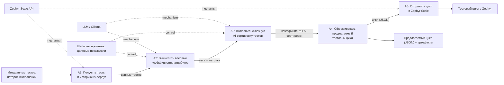

**Описание.** На данной диаграмме раскрыто внутреннее содержание функции A0, разбитой на пять последовательных подфункций. Метаданные тестов и история выполнений, образующие вход, сначала поступают в функцию A1 «Получить тесты и историю из Zephyr». Затем полученные данные тестов передаются в функцию A2, где для каждого теста вычисляются весовые коэффициенты атрибутов. Далее веса вместе с рассчитанными метриками поступают в функцию A3, которая выполняет сквозную AI-сортировку и присваивает тестам итоговые коэффициенты. После этого коэффициенты сортировки передаются в функцию A4, формирующую предлагаемый тестовый цикл; на этом шаге система выдаёт цикл в формате JSON вместе с артефактами. Наконец, сформированный цикл поступает в функцию A5, которая отправляет его в Zephyr Scale. Пунктирными стрелками отдельно показаны управление и механизмы: шаблоны промптов и целевые показатели управляют функциями A2 и A3, большая языковая модель служит механизмом для тех же функций A2 и A3, а программный интерфейс Zephyr Scale выступает механизмом для функций A1 и A5, через которые происходит обмен с внешней системой.

---

## 2. BPMN — процессы AS-IS и TO-BE

Назначение: сравнить процесс приоритизации до и после внедрения системы, обосновать целевые показатели (сокращение времени на 20–23%). Привязка к ТЗ: п. 2.2, 3.1, 4.1.

### 2.1. AS-IS — ручная приоритизация (без Triage)

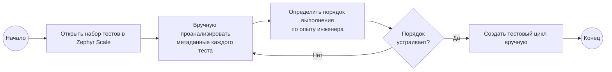

**Описание.** На данной диаграмме изображён процесс приоритизации в том виде, в котором он выполняется без разрабатываемой системы. Процесс начинается с начального события, после которого инженер открывает набор тестов в Zephyr Scale. Далее инженер вручную анализирует метаданные каждого теста и на основе собственного опыта определяет порядок их выполнения. После этого управление поступает на развилку, где инженер оценивает, устраивает ли его полученный порядок. Если порядок не устраивает, поток возвращается к повторному анализу метаданных, и шаг выполняется заново; этот возврат показан циклом. Если же порядок признан приемлемым, инженер вручную создаёт тестовый цикл, и процесс завершается конечным событием. Тем самым подчёркивается, что в исходном процессе вся аналитическая нагрузка лежит на человеке, а повторный анализ при неудовлетворительном порядке увеличивает затраты времени.

### 2.2. TO-BE — приоритизация с участием Triage

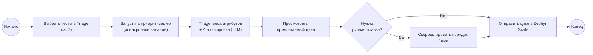

**Описание.** На данной диаграмме изображён тот же процесс приоритизации, но уже с участием разрабатываемой системы. После начального события пользователь выбирает в системе не менее двух тестов и запускает приоритизацию, которая оформляется как асинхронное задание. Далее управление поступает к системе, и она самостоятельно выполняет два этапа: расчёт весовых коэффициентов атрибутов и сквозную AI-сортировку средствами большой языковой модели. После этого пользователь просматривает сформированный предлагаемый цикл и на развилке решает, требуется ли ручная правка. Если правка нужна, пользователь корректирует порядок тестов или имя цикла, и поток переходит к отправке; если правка не нужна, к отправке переходят напрямую. На завершающем шаге цикл отправляется в Zephyr Scale, и процесс завершается. По сравнению с ручным процессом основная аналитическая работа здесь смещена на систему, а участие человека сведено к выбору тестов и при необходимости к точечной корректировке результата.

---

## 5. UML — диаграмма компонентов

Назначение: показать логическую архитектуру монолита — пять подсистем, их интерфейсы и зависимости, а также внешние системы. Привязка к ТЗ: п. 4.1; ПЗ разд. 3.2.

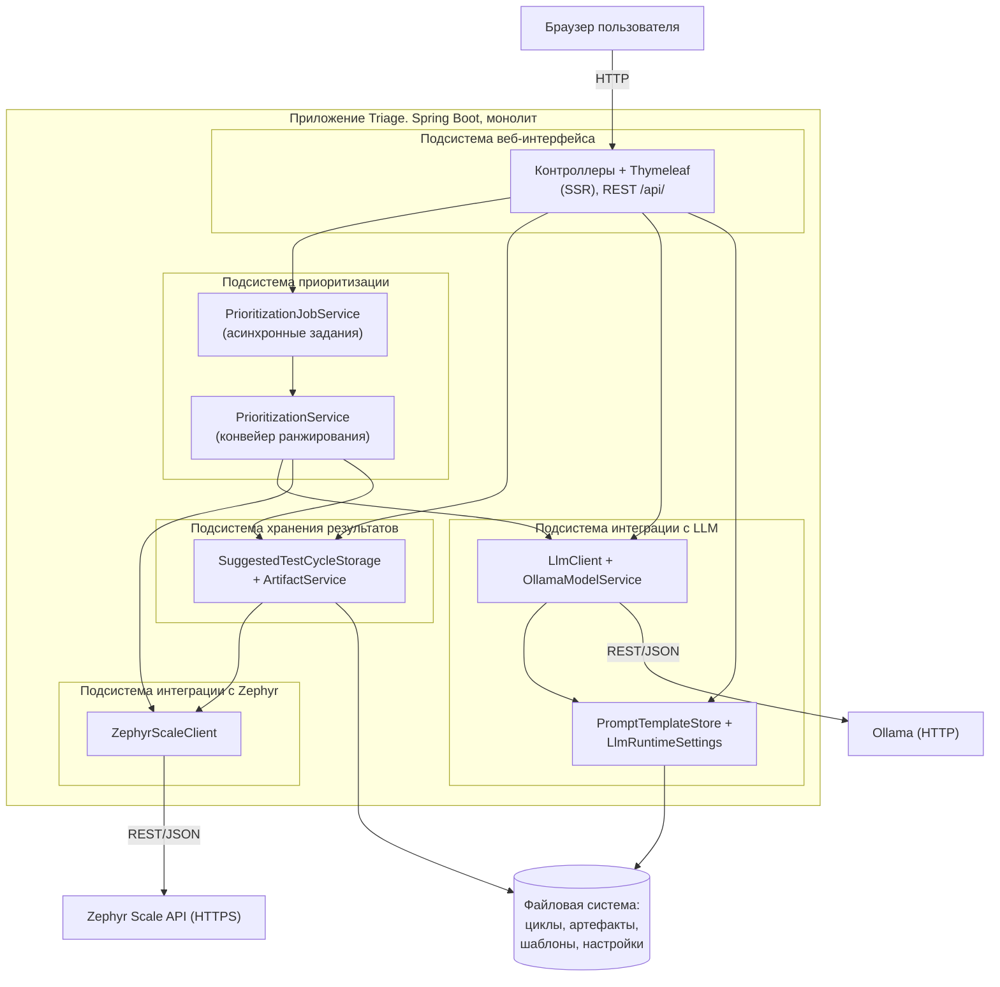

**Описание.** На данной диаграмме изображена логическая структура приложения, которое представляет собой монолит на Spring Boot, и показаны его пять внутренних подсистем. Сверху расположен браузер пользователя, от которого по протоколу HTTP запрос поступает в подсистему веб-интерфейса с контроллерами и серверным рендерингом страниц. Далее из веб-интерфейса управление расходится по остальным подсистемам в зависимости от запрошенной операции. При запуске приоритизации запрос поступает в подсистему приоритизации, где служба заданий передаёт работу службе конвейера ранжирования. Эта служба, в свою очередь, обращается к подсистеме интеграции с большой языковой моделью и к подсистеме интеграции с Zephyr, а полученный результат передаёт в подсистему хранения результатов. Подсистема интеграции с LLM по протоколу REST обращается к внешнему сервису Ollama и считывает шаблоны промптов и настройки, а подсистема интеграции с Zephyr по REST обращается к внешнему программному интерфейсу Zephyr Scale. Подсистема хранения и хранилище шаблонов записывают и читают данные из файловой системы, изображённой отдельным узлом. Тем самым показаны слабая связанность подсистем и направление зависимостей между ними и внешними системами.

---

## 8. UML — диаграмма последовательности

Назначение: раскрыть во времени двухэтапный асинхронный конвейер приоритизации — центральный сценарий работы системы. Привязка к ТЗ: п. 5.1 (п. 3), 6.1.

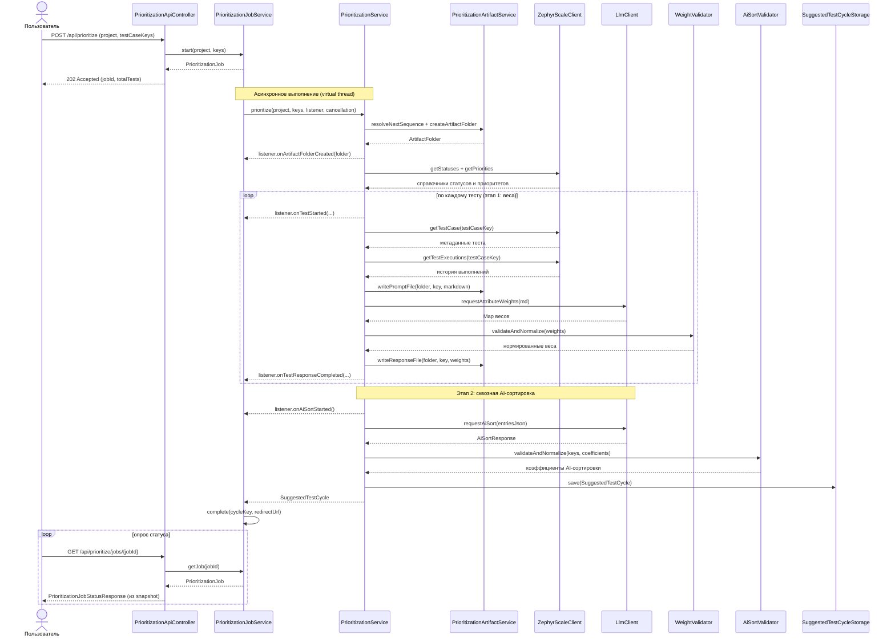

**Описание.** На данной диаграмме раскрыт во времени порядок взаимодействия объектов при выполнении приоритизации. Сначала пользователь отправляет контроллеру запрос на запуск с указанием проекта и списка ключей тестов. Контроллер обращается к службе заданий с вызовом запуска; та создаёт задание в состоянии RUNNING, ставит его в очередь виртуального потока и возвращает объект PrioritizationJob. Контроллер отвечает пользователю кодом 202 Accepted и передаёт идентификатор задания вместе с общим числом тестов. Далее служба заданий асинхронно вызывает службу конвейера ранжирования. Перед обработкой тестов служба конвейера через службу артефактов создаёт папку трассируемости и уведомляет задание через listener.onArtifactFolderCreated. Затем один раз запрашивает у Zephyr справочники статусов и приоритетов. На первом этапе для каждого теста служба конвейера сначала уведомляет задание о начале обработки через listener.onTestStarted, затем получает метаданные и историю выполнений из Zephyr, сохраняет промпт в папку артефактов, запрашивает у клиента LLM весовые коэффициенты (возвращается Map весов), валидирует и нормирует их через WeightValidator, записывает ответ в артефакты и по завершении обработки теста уведомляет задание через listener.onTestResponseCompleted. На втором этапе служба конвейера переводит задание в статус AI_SORT через listener.onAiSortStarted, запрашивает сквозную AI-сортировку, валидирует коэффициенты через AiSortValidator, сохраняет сформированный цикл в хранилище (метод save не возвращает значение) и возвращает объект SuggestedTestCycle службе заданий, которая переводит задание в состояние COMPLETED вызовом complete. Параллельно показан отдельный цикл, в котором пользователь периодически опрашивает контроллер о статусе задания; контроллер получает PrioritizationJob, формирует PrioritizationJobStatusResponse из snapshot и возвращает его клиенту.

## Presentation 2. Актуальность

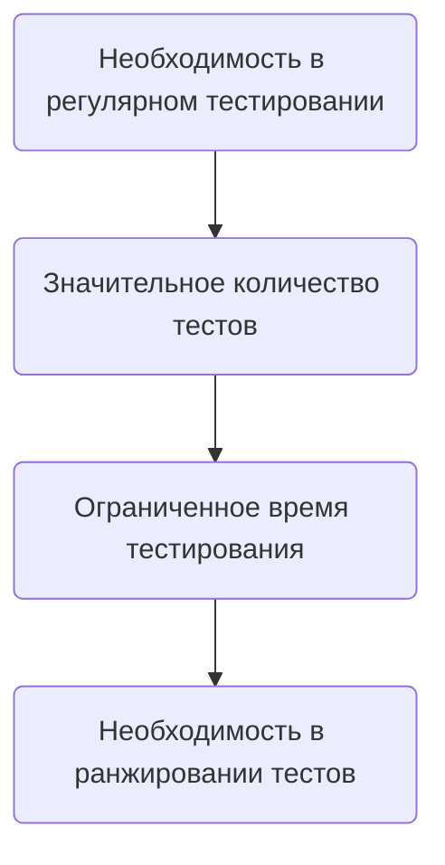

---

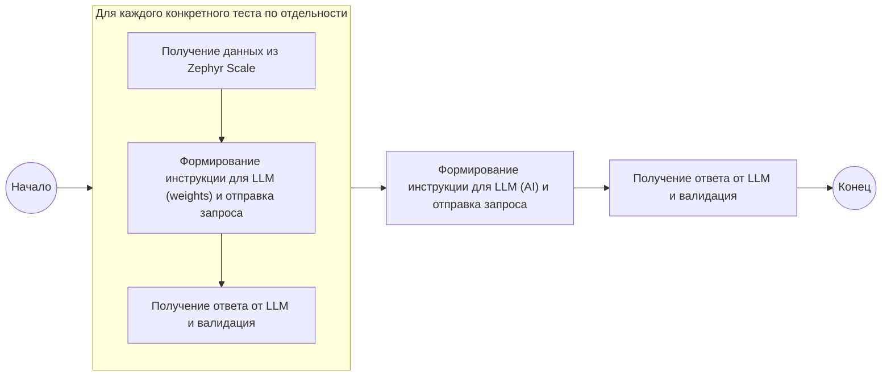

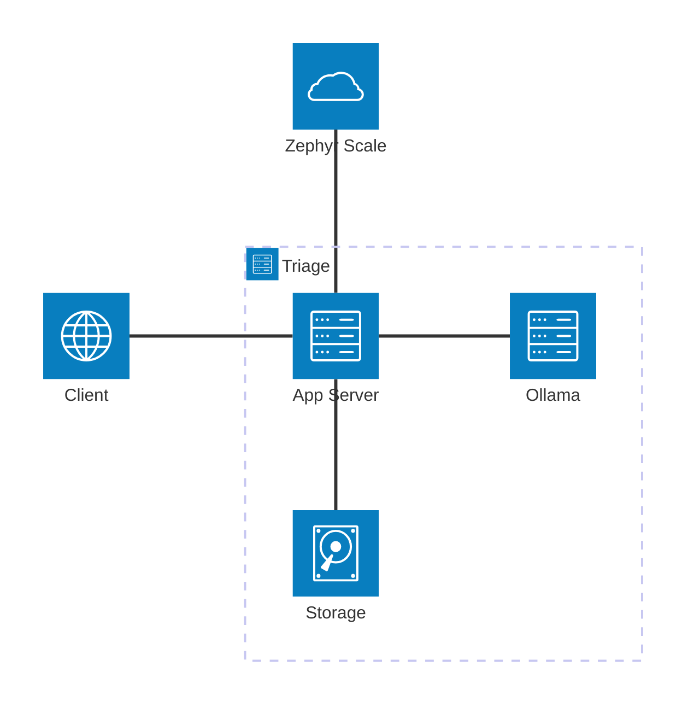

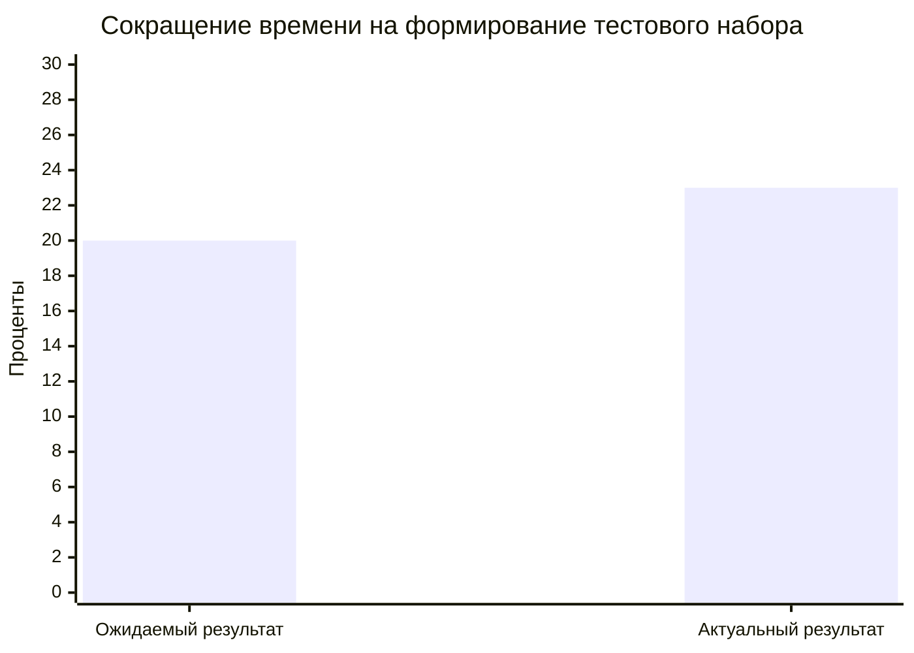

---

## 14. Эксперименты LLM — метрики ранжирования

Назначение: визуализировать результаты оценки качества LLM-ранжирования на фиксированном наборе из 5 smoke-тестов B2C (30 прогонов на модель, эталон — порядок по числу провалов в предыдущих выполнениях). Исходные данные: [experiment-qwen2.5-3b.md](../experiment-qwen2.5-3b.md) (циклы SQM-SR8…SR37), [experiment-qwen2.5-7b.md](../experiment-qwen2.5-7b.md) (циклы SQM-SR45…SR74). Пороги из ПЗ: Kendall τ > 0, LCS > 50%.

### 14.1. Kendall τ — qwen2.5-3b

Среднее τ = 0.287 (min −0.4, max 0.6, median 0.4); порог τ > 0 выполнен в 24 из 30 прогонов (80%).

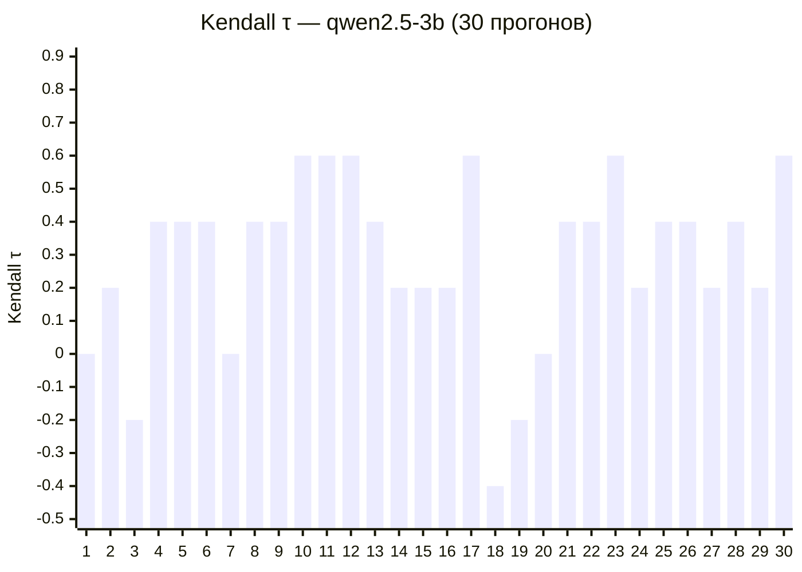

### 14.2. LCS % — qwen2.5-3b

Среднее LCS = 64% (min 40%, max 80%, median 60%); порог LCS > 50% выполнен в 28 из 30 прогонов (93.3%).

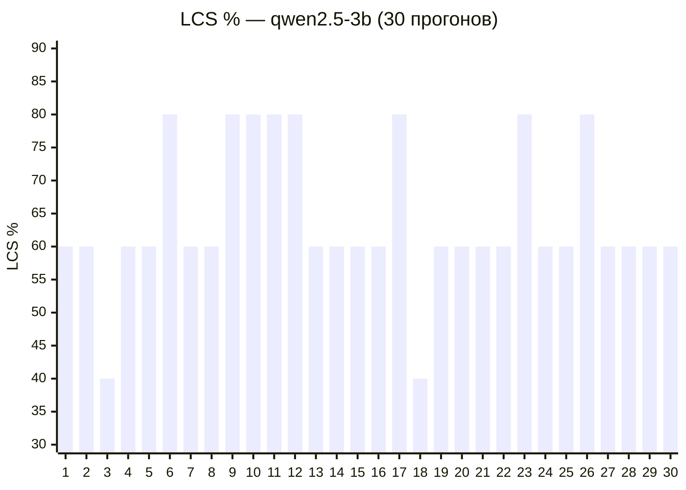

### 14.3. Kendall τ — qwen2.5-7b

Среднее τ = 0.453 (min 0.2, max 0.8, median 0.4); порог τ > 0 выполнен во всех 30 прогонах (100%).

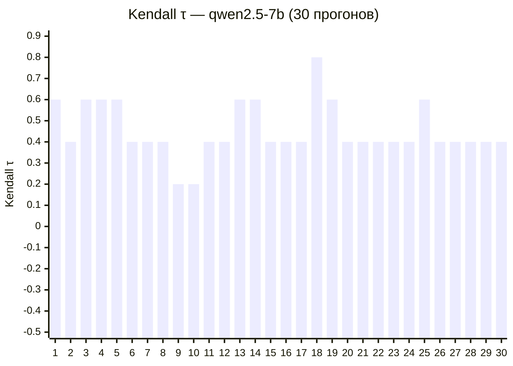

### 14.4. LCS % — qwen2.5-7b

Среднее LCS = 64.7% (min 40%, max 80%, median 60%); порог LCS > 50% выполнен в 29 из 30 прогонов (96.7%).

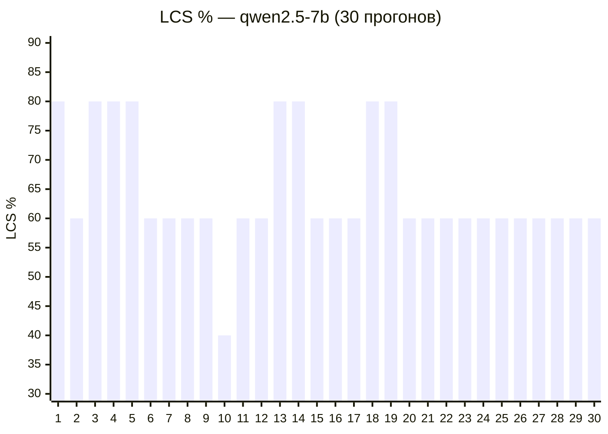

### 14.5. Сравнение Kendall τ: qwen2.5-3b vs qwen2.5-7b

Среднее значение Kendall τ по 30 прогонам: 0.287 (qwen2.5-3b) и 0.453 (qwen2.5-7b).

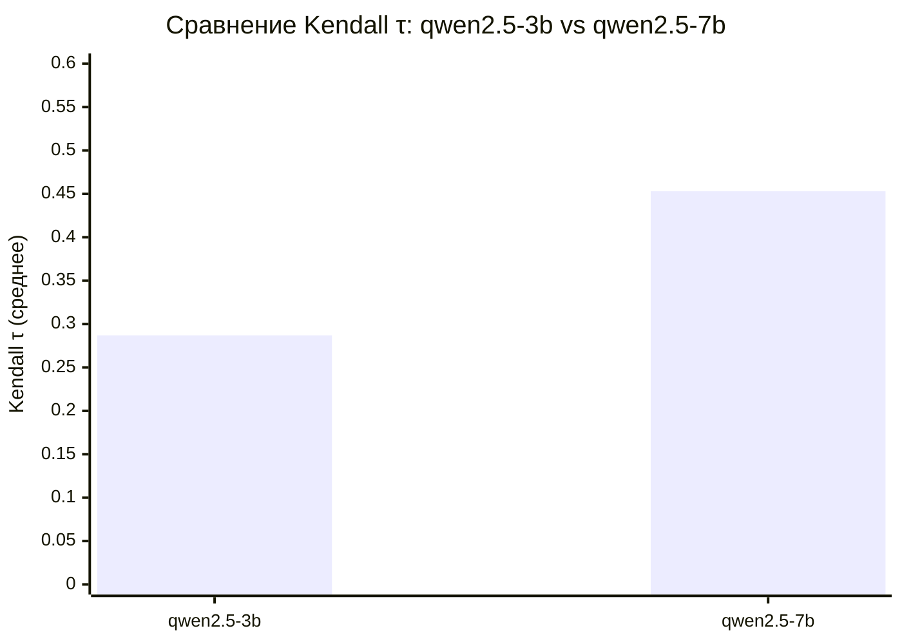

### 14.6. Сравнение LCS %: qwen2.5-3b vs qwen2.5-7b

Среднее значение LCS % по 30 прогонам: 64% (qwen2.5-3b) и 64.7% (qwen2.5-7b).

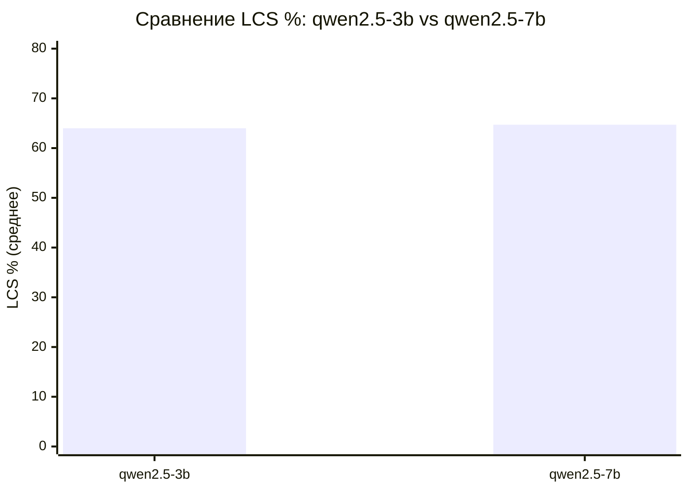