# Диаграммы системы «Triage»

Набор диаграмм для проектной документации и пояснительной записки ВКР рекомендательной системы ранжирования тестовых сценариев «Triage». Диаграммы выстроены как непротиворечивая иерархия моделей: от бизнес-процесса (зачем система нужна) к функциям, статической архитектуре и динамике поведения. Использованы общепризнанные нотации: IDEF0, BPMN 2.0 / IDEF3, DFD (Gane–Sarson) и UML 2.5.

Исходники диаграмм приведены в нотации Mermaid (рендерится в Obsidian и большинстве Markdown-инструментов; см. ПЗ п. 1.7). Для строгих нотаций IDEF0, DFD и BPMN Mermaid-представление является функциональным эквивалентом; при финальном оформлении ВКР эти три диаграммы рекомендуется перечертить в специализированном редакторе (draw.io / Visio / Ramus), сохранив структуру и подписи из настоящего документа.

Содержание:

1. [IDEF0 — функциональная модель](#1-idef0--функциональная-модель)
2. [BPMN — процессы AS-IS и TO-BE](#2-bpmn--процессы-as-is-и-to-be)
3. [DFD — диаграмма потоков данных](#3-dfd--диаграмма-потоков-данных)
4. [UML — диаграмма вариантов использования](#4-uml--диаграмма-вариантов-использования)
5. [UML — диаграмма компонентов](#5-uml--диаграмма-компонентов)
6. [UML — диаграмма классов](#6-uml--диаграмма-классов)
7. [UML — диаграмма развёртывания](#7-uml--диаграмма-развёртывания)
8. [UML — диаграмма последовательности](#8-uml--диаграмма-последовательности)
9. [UML — диаграмма деятельности](#9-uml--диаграмма-деятельности)
10. [UML — диаграммы состояний](#10-uml--диаграммы-состояний)

---

## 1. IDEF0 — функциональная модель

Назначение: показать систему как функцию, преобразующую входы в выходы под управлением и с помощью механизмов (нотация ICOM: Input, Control, Output, Mechanism). Привязка к ТЗ: п. 2.1, 5.1, 6.1.

### 1.1. Контекстная диаграмма A-0

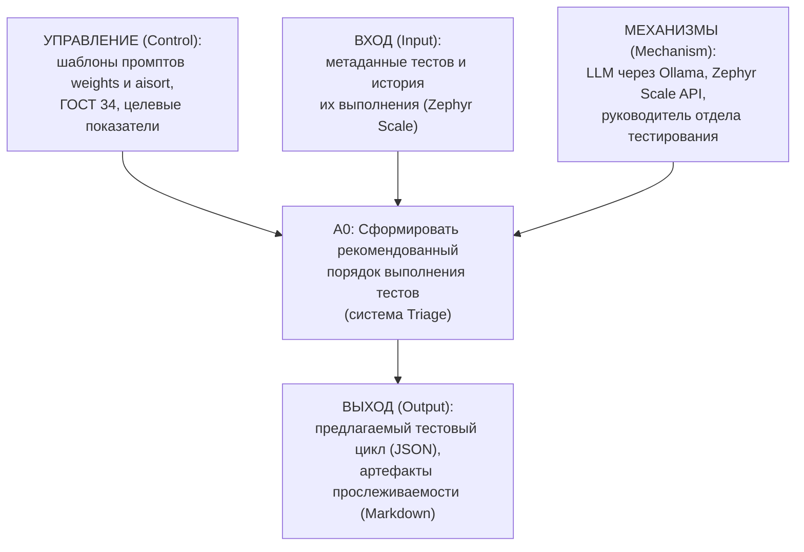

**Описание.** На данной диаграмме представлена вся система как единая функция A0 «Сформировать рекомендованный порядок выполнения тестов», помещённая в центральный блок. Метаданные тестов и история их выполнения, полученные из Zephyr Scale, представляют собой вход, который поступает в эту функцию слева. Сверху на функцию воздействует управление, в состав которого входят шаблоны промптов для расчёта весов и AI-сортировки, требования ГОСТ 34 и целевые показатели; управление задаёт правила, по которым функция обрабатывает вход, но само при этом не преобразуется. Снизу к функции подведены механизмы, которыми являются большая языковая модель через Ollama, программный интерфейс Zephyr Scale и руководитель отдела тестирования; перечисленные механизмы выступают исполнителями, силами которых функция реализуется. Справа из функции выходит результат, состоящий из предлагаемого тестового цикла в формате JSON и сопутствующих артефактов прослеживаемости. Таким образом, на верхнем уровне зафиксированы границы системы и показано, что именно она получает, чем управляется, с помощью чего работает и что выдаёт на выходе.

### 1.2. Декомпозиция A0

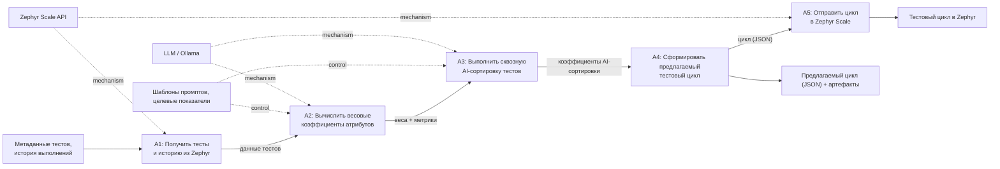

**Описание.** На данной диаграмме раскрыто внутреннее содержание функции A0, разбитой на пять последовательных подфункций. Метаданные тестов и история выполнений, образующие вход, сначала поступают в функцию A1 «Получить тесты и историю из Zephyr». Затем полученные данные тестов передаются в функцию A2, где для каждого теста вычисляются весовые коэффициенты атрибутов. Далее веса вместе с рассчитанными метриками поступают в функцию A3, которая выполняет сквозную AI-сортировку и присваивает тестам итоговые коэффициенты. После этого коэффициенты сортировки передаются в функцию A4, формирующую предлагаемый тестовый цикл; на этом шаге система выдаёт цикл в формате JSON вместе с артефактами. Наконец, сформированный цикл поступает в функцию A5, которая отправляет его в Zephyr Scale. Пунктирными стрелками отдельно показаны управление и механизмы: шаблоны промптов и целевые показатели управляют функциями A2 и A3, большая языковая модель служит механизмом для тех же функций A2 и A3, а программный интерфейс Zephyr Scale выступает механизмом для функций A1 и A5, через которые происходит обмен с внешней системой.

---

## 2. BPMN — процессы AS-IS и TO-BE

Назначение: сравнить процесс приоритизации до и после внедрения системы, обосновать целевые показатели (сокращение времени на 20–23%). Привязка к ТЗ: п. 2.2, 3.1, 4.1.

### 2.1. AS-IS — ручная приоритизация (без Triage)

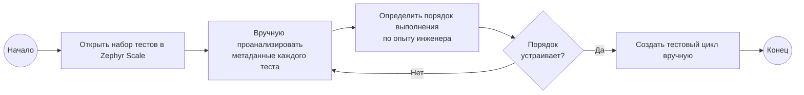

**Описание.** На данной диаграмме изображён процесс приоритизации в том виде, в котором он выполняется без разрабатываемой системы. Процесс начинается с начального события, после которого инженер открывает набор тестов в Zephyr Scale. Далее инженер вручную анализирует метаданные каждого теста и на основе собственного опыта определяет порядок их выполнения. После этого управление поступает на развилку, где инженер оценивает, устраивает ли его полученный порядок. Если порядок не устраивает, поток возвращается к повторному анализу метаданных, и шаг выполняется заново; этот возврат показан циклом. Если же порядок признан приемлемым, инженер вручную создаёт тестовый цикл, и процесс завершается конечным событием. Тем самым подчёркивается, что в исходном процессе вся аналитическая нагрузка лежит на человеке, а повторный анализ при неудовлетворительном порядке увеличивает затраты времени.

### 2.2. TO-BE — приоритизация с участием Triage

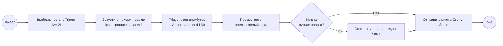

**Описание.** На данной диаграмме изображён тот же процесс приоритизации, но уже с участием разрабатываемой системы. После начального события пользователь выбирает в системе не менее двух тестов и запускает приоритизацию, которая оформляется как асинхронное задание. Далее управление поступает к системе, и она самостоятельно выполняет два этапа: расчёт весовых коэффициентов атрибутов и сквозную AI-сортировку средствами большой языковой модели. После этого пользователь просматривает сформированный предлагаемый цикл и на развилке решает, требуется ли ручная правка. Если правка нужна, пользователь корректирует порядок тестов или имя цикла, и поток переходит к отправке; если правка не нужна, к отправке переходят напрямую. На завершающем шаге цикл отправляется в Zephyr Scale, и процесс завершается. По сравнению с ручным процессом основная аналитическая работа здесь смещена на систему, а участие человека сведено к выбору тестов и при необходимости к точечной корректировке результата.

---

## 3. DFD — диаграмма потоков данных

Назначение: показать потоки данных между внешними сущностями, процессами и файловыми хранилищами (СУБД не используется). Нотация Gane–Sarson: внешние сущности — прямоугольники, процессы — скруглённые блоки, хранилища — цилиндры. Привязка к ТЗ: п. 6.2.

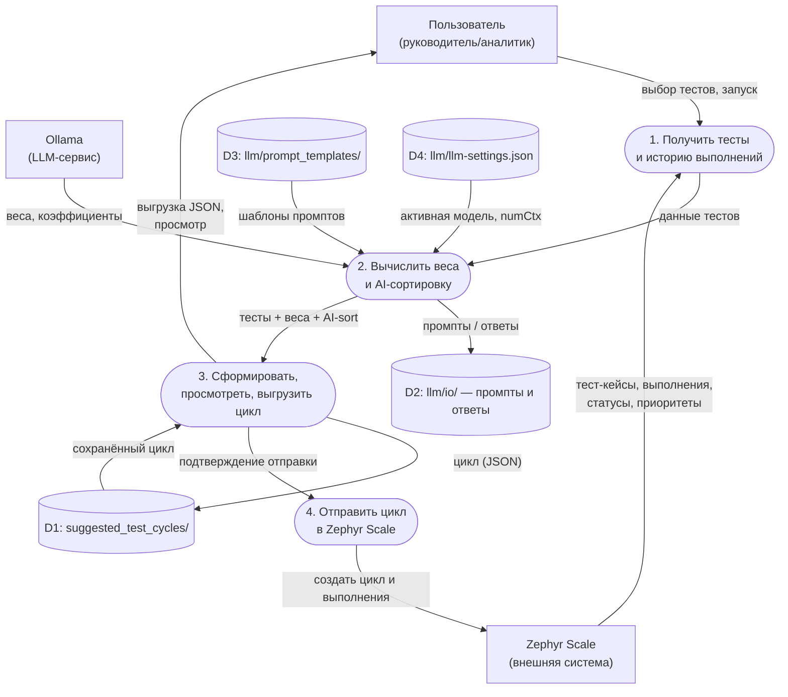

**Описание.** На данной диаграмме прослежено движение данных между внешними сущностями, процессами и файловыми хранилищами. Слева расположены внешние сущности: пользователь, система Zephyr Scale и сервис Ollama. Сначала пользователь передаёт в процесс 1 выбор тестов и команду запуска, а Zephyr Scale поставляет в этот же процесс тест-кейсы, выполнения, статусы и приоритеты. Далее собранные данные тестов поступают в процесс 2, который дополнительно считывает шаблоны промптов из хранилища D3 и параметры активной модели из хранилища D4. В ходе работы процесс 2 записывает отправленные промпты и полученные ответы в хранилище D2, а от сервиса Ollama получает рассчитанные веса и коэффициенты. После этого тесты вместе с весами и коэффициентами AI-сортировки передаются в процесс 3, который сохраняет сформированный цикл в хранилище D1 и при необходимости считывает его оттуда обратно. Из процесса 3 данные возвращаются пользователю в виде просмотра и выгрузки JSON, а также при подтверждении отправки поступают в процесс 4. Наконец, процесс 4 направляет в Zephyr Scale команду на создание тестового цикла и выполнений. Таким образом показано, что система не использует базу данных, и всё промежуточное и итоговое состояние хранится в четырёх файловых хранилищах.

---

## 4. UML — диаграмма вариантов использования

Назначение: формализовать функциональные требования и связь «актор — функция» (9 функций из ТЗ п. 5.1). Привязка к ТЗ: п. 4.2, 5.1.

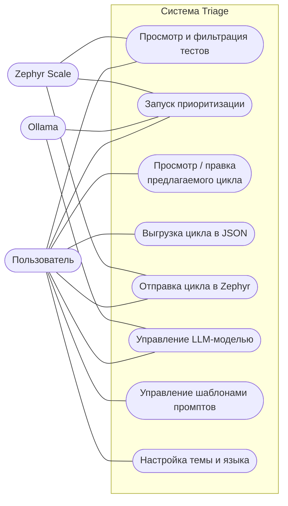

`<<include>>`: «Запуск приоритизации» включает обращение к Ollama (расчёт весов и AI-сортировка) и к Zephyr Scale (получение данных тестов).

**Описание.** На данной диаграмме функции системы изображены в виде вариантов использования и связаны с действующими лицами. Слева расположены основные акторы: руководитель отдела тестирования и аналитик. В центре в границах системы Triage помещены прецеденты, соответствующие функциям из технического задания: просмотр и фильтрация тестов, запуск приоритизации, просмотр и правка предлагаемого цикла, выгрузка цикла в JSON, отправка цикла в Zephyr, управление LLM-моделью, управление шаблонами промптов и настройка темы и языка. Руководитель отдела тестирования связан со всеми прецедентами, поскольку выполняет полный цикл работы с системой. Аналитик связан только с прецедентами просмотра, правки и выгрузки цикла, что отражает его роль наблюдателя за ходом и направлением тестирования. Справа размещены вторичные действующие лица, которыми являются Zephyr Scale и Ollama; они сами не инициируют работу, но участвуют в выполнении прецедентов. Система Zephyr Scale задействуется при просмотре тестов, запуске приоритизации и отправке цикла, а сервис Ollama задействуется при запуске приоритизации и управлении моделью. Тем самым показано, какие функции доступны каждому пользователю и в каких из них требуется обращение к внешним системам.

---

## 5. UML — диаграмма компонентов

Назначение: показать логическую архитектуру монолита — пять подсистем, их интерфейсы и зависимости, а также внешние системы. Привязка к ТЗ: п. 4.1; ПЗ разд. 3.2.

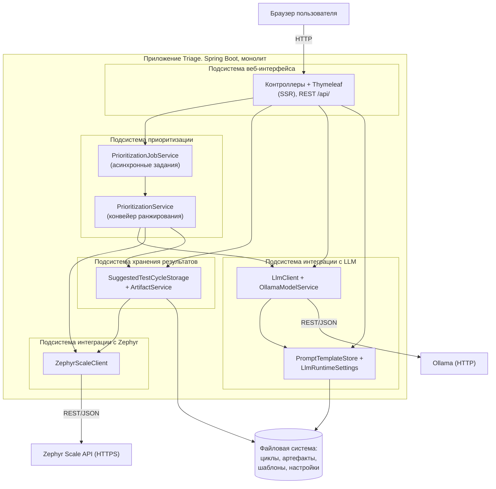

**Описание.** На данной диаграмме изображена логическая структура приложения, которое представляет собой монолит на Spring Boot, и показаны его пять внутренних подсистем. Сверху расположен браузер пользователя, от которого по протоколу HTTP запрос поступает в подсистему веб-интерфейса с контроллерами и серверным рендерингом страниц. Далее из веб-интерфейса управление расходится по остальным подсистемам в зависимости от запрошенной операции. При запуске приоритизации запрос поступает в подсистему приоритизации, где служба заданий передаёт работу службе конвейера ранжирования. Эта служба, в свою очередь, обращается к подсистеме интеграции с большой языковой моделью и к подсистеме интеграции с Zephyr, а полученный результат передаёт в подсистему хранения результатов. Подсистема интеграции с LLM по протоколу REST обращается к внешнему сервису Ollama и считывает шаблоны промптов и настройки, а подсистема интеграции с Zephyr по REST обращается к внешнему программному интерфейсу Zephyr Scale. Подсистема хранения и хранилище шаблонов записывают и читают данные из файловой системы, изображённой отдельным узлом. Тем самым показаны слабая связанность подсистем и направление зависимостей между ними и внешними системами.

---

## 6. UML — диаграмма классов

Назначение: показать ООП-структуру и разделение ответственности по слоям `controller → service → prioritization/llm/zephyr → storage/model`. Приведены ключевые классы пакета `com.qligent.triage`. Привязка к ТЗ: п. 4.1, 6.4.

```mermaid
classDiagram
    class TestCaseController {
        +testCases(project, filters, page) String
    }
    class SuggestedTestCycleController {
        +list(project, page) String
        +detail(cycleKey) String
        +saveSortState(cycleKey, request) void
        +sendToZephyr(cycleKey) SendToZephyrResponse
        +downloadCycleJson(cycleKey) Resource
    }
    class LlmManagementController {
        +listModels() LlmModelsResponse
        +setActiveModel(request) LlmModelsResponse
        +pullModel(request) LlmModelsResponse
        +getPrompt(type) PromptTemplateResponse
        +savePrompt(type, request) SavePromptResponse
    }
    class PrioritizationApiController {
        +startPrioritization(request) PrioritizeJobResponse
        +getJobStatus(jobId) PrioritizationJobStatusResponse
        +cancelPrioritization(jobId) ResponseEntity
    }

    class TestCaseService {
        +getTestCasesPage(project, query) TestCasesPageView
    }
    class SuggestedTestCycleService {
        +listPageForProject(project, page, size) SuggestedCyclesPageView
        +getByKey(cycleKey) SuggestedTestCycle
        +saveSortState(cycleKey, field, dir, name) void
        +sendToZephyr(cycleKey) String
        +getCycleJsonFile(cycleKey) Path
    }
    class PrioritizationJobService {
        +start(project, keys) PrioritizationJob
        +getJob(jobId) PrioritizationJob
        +cancel(jobId) PrioritizationJob
    }
    class PrioritizationService {
        +prioritize(project, keys, listener, cancel) SuggestedTestCycle
    }
    class PrioritizationArtifactService {
        +createArtifactFolder(projectKey, seq) ArtifactFolder
        +writePromptFile(folder, key, content) Path
        +writeResponseFile(folder, key, content) Path
        +deleteArtifactFolder(folder) void
    }

    class LlmClient {
        +requestAttributeWeights(md) Map
        +requestAiSort(json) AiSortResponse
    }
    class OllamaModelService {
        +listInstalled() List~ModelTag~
        +isInstalled(model) boolean
        +pull(model) OllamaPullResult
    }
    class LlmRuntimeSettings {
        +activeModel() String
        +numCtx() int
        +setActiveModel(model) void
        +setNumCtx(numCtx) void
        +resolveModel() String
    }
    class PromptTemplateStore {
        +listVersions(model, numCtx, type) List~String~
        +read(model, numCtx, type, version) String
        +saveNewVersion(model, numCtx, type, content) String
    }
    class WeightValidator {
        +validateAndNormalize(raw) Map
    }
    class AiSortValidator {
        +validateAndNormalize(keys, raw) Map
    }
    class ZephyrScaleClient {
        +getTestCases(projectKey, startAt, max) ZephyrPage
        +getTestCase(testCaseKey) TestCaseDetailDto
        +getTestExecutions(testCaseKey, startAt, max) ZephyrPage
        +createTestCycle(request) TestCycleDto
        +createTestExecution(request) void
        +resolveProjectKey(project) String
    }

    class SuggestedTestCycleStorage {
        +save(cycle) void
        +findByKey(cycleKey) Optional
        +update(cycle) void
        +findByProjectPrefix(projectKey) List
        +cycleJsonPath(cycleKey) Path
    }
    class SuggestedTestCycle {
        +String suggestedTestCycleKey
        +String suggestedTestCycleName
        +String suggestedTestCycleStatus
        +String projectKey
        +List~SuggestedTestCaseEntry~ tests
    }
    class SuggestedTestCaseEntry {
        +String key
        +String name
        +Map~String,Double~ weights
        +TestMetrics metrics
        +double aiSort
    }
    class TestMetrics {
        +int executionsCount
        +int failedExecutionsCount
        +double failedExecutionsRatio
        +String lastExecutionStatus
    }
    class PrioritizationJob {
        +String id
        +PrioritizationJobStatus status
        +snapshot() JobStatusSnapshot
    }
    class PrioritizationJobStatus {
        <<enumeration>>
        RUNNING
        AI_SORT
        COMPLETED
        FAILED
        CANCELLED
    }
    class Project {
        <<enumeration>>
        B2C
        B2B
    }
    class SuggestedTestCycleStatus {
        <<enumeration>>
        WAITING
        SENT
    }

    TestCaseController --> TestCaseService
    SuggestedTestCycleController --> SuggestedTestCycleService
    LlmManagementController --> OllamaModelService
    LlmManagementController --> LlmRuntimeSettings
    LlmManagementController --> PromptTemplateStore
    PrioritizationApiController --> PrioritizationJobService

    TestCaseService --> ZephyrScaleClient
    SuggestedTestCycleService --> SuggestedTestCycleStorage
    SuggestedTestCycleService --> ZephyrScaleClient

    PrioritizationJobService --> PrioritizationService
    PrioritizationJobService --> PrioritizationArtifactService
    PrioritizationJobService *-- PrioritizationJob
    PrioritizationJob --> PrioritizationJobStatus

    PrioritizationService --> PrioritizationArtifactService
    PrioritizationService --> LlmClient
    PrioritizationService --> ZephyrScaleClient
    PrioritizationService --> WeightValidator
    PrioritizationService --> AiSortValidator
    PrioritizationService --> SuggestedTestCycleStorage
    PrioritizationService ..> SuggestedTestCycle

    LlmClient --> LlmRuntimeSettings

    SuggestedTestCycleStorage ..> SuggestedTestCycle
    SuggestedTestCycle *-- SuggestedTestCaseEntry
    SuggestedTestCaseEntry *-- TestMetrics
    SuggestedTestCycle ..> SuggestedTestCycleStatus
```

**Описание.** На данной диаграмме изображены ключевые классы системы и связи между ними, сгруппированные по слоям. Для каждого класса приведены основные публичные операции или поля, отражающие его ответственность в коде; перечисления показаны только значениями. В верхней части находятся контроллеры, которые принимают запросы и делегируют работу службам: контроллер тест-кейсов обращается к службе тест-кейсов, контроллер предлагаемых циклов обращается к одноимённой службе, контроллер управления моделью обращается к службе моделей Ollama, настройкам времени выполнения и хранилищу шаблонов, а контроллер приоритизации обращается к службе заданий. Далее служба заданий приоритизации управляет конвейером ранжирования и службой артефактов, а также композиционно содержит объект задания, который, в свою очередь, ссылается на перечисление статусов задания. Служба конвейера ранжирования связана со службой артефактов, клиентом большой языковой модели, клиентом Zephyr, валидаторами весов и AI-сортировки и хранилищем циклов, а в результате своей работы создаёт объект предлагаемого цикла. Клиент большой языковой модели опирается на настройки времени выполнения. В нижней части показана модель данных: предлагаемый цикл композиционно состоит из записей о тестах, каждая запись содержит метрики теста, а сам цикл ссылается на перечисление своего статуса. Тем самым отражены разделение ответственности и направленность зависимостей от контроллеров к модели данных.

---

## 7. UML — диаграмма развёртывания

Назначение: показать физическое размещение компонентов и условия эксплуатации, в том числе вариативность размещения Ollama (локально или на удалённом узле). Привязка к ТЗ: п. 3.2, 6.5.

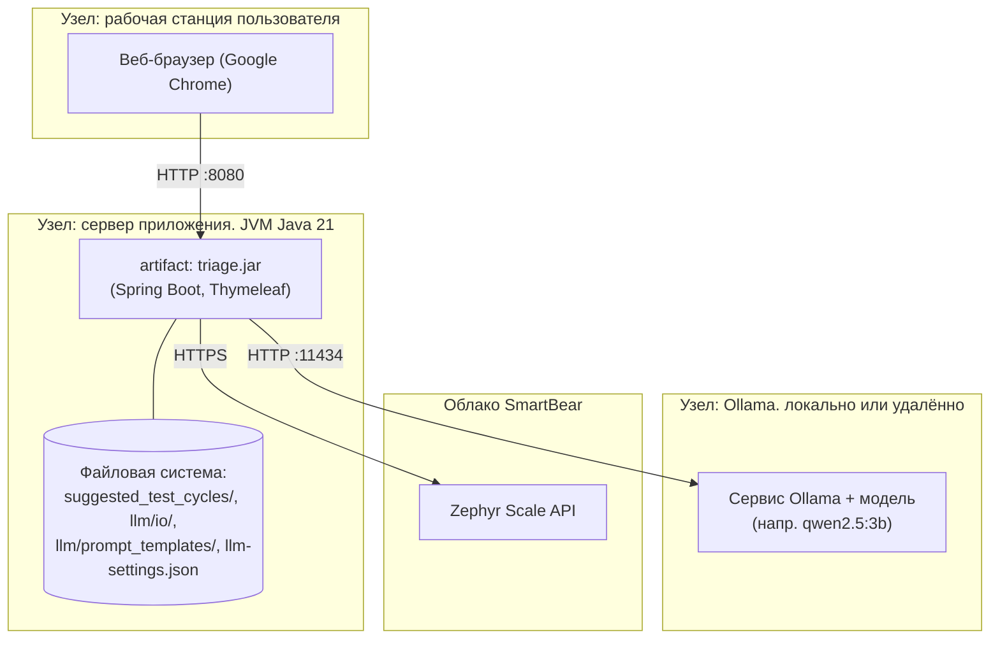

**Описание.** На данной диаграмме изображено физическое размещение системы по узлам и каналы связи между ними. На узле рабочей станции пользователя находится веб-браузер, через который осуществляется работа с системой. На узле сервера приложения развёрнут собранный артефакт triage.jar, исполняемый на виртуальной машине Java, и здесь же расположена файловая система, в которой хранятся предлагаемые циклы, артефакты запусков, шаблоны промптов и файл настроек. Браузер обращается к серверу приложения по протоколу HTTP через порт 8080. Сервер приложения, в свою очередь, обращается к узлу с сервисом Ollama по протоколу HTTP через порт 11434; этот узел выделен отдельно, поскольку Ollama может располагаться как на том же сервере, так и на удалённом устройстве. Кроме того, сервер приложения по защищённому протоколу HTTPS обращается к облачному узлу SmartBear, на котором размещён программный интерфейс Zephyr Scale. Связь сервера приложения с файловой системой показана как локальная, без сетевого протокола. Тем самым отражены условия эксплуатации системы и вариативность размещения сервиса большой языковой модели.

---

## 8. UML — диаграмма последовательности

Назначение: раскрыть во времени двухэтапный асинхронный конвейер приоритизации — центральный сценарий работы системы. Привязка к ТЗ: п. 5.1 (п. 3), 6.1.

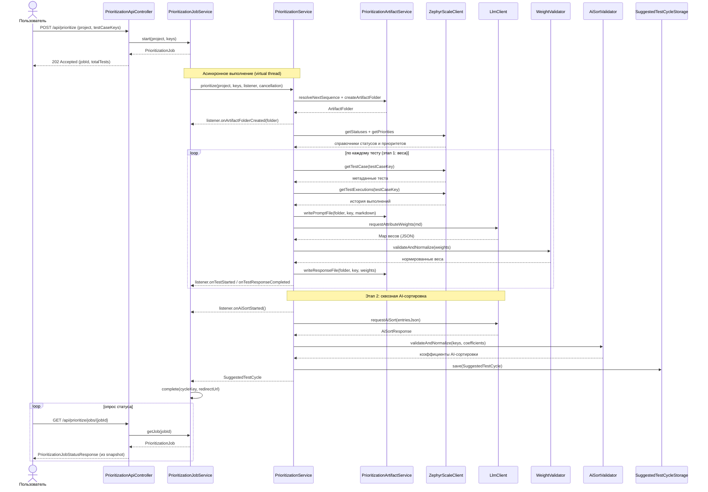

**Описание.** На данной диаграмме раскрыт во времени порядок взаимодействия объектов при выполнении приоритизации. Сначала пользователь отправляет контроллеру запрос на запуск с указанием проекта и списка ключей тестов. Контроллер обращается к службе заданий с вызовом запуска; та создаёт задание в состоянии RUNNING, ставит его в очередь виртуального потока и возвращает объект PrioritizationJob. Контроллер отвечает пользователю кодом 202 Accepted и передаёт идентификатор задания вместе с общим числом тестов. Далее служба заданий асинхронно вызывает службу конвейера ранжирования. Перед обработкой тестов служба конвейера через службу артефактов создаёт папку трассируемости и уведомляет задание через listener; затем один раз запрашивает у Zephyr справочники статусов и приоритетов. На первом этапе для каждого теста служба конвейера получает метаданные и историю выполнений из Zephyr, сохраняет промпт в папку артефактов, запрашивает у клиента LLM весовые коэффициенты, валидирует и нормирует их через WeightValidator, записывает ответ в артефакты и обновляет прогресс задания через listener. На втором этапе служба конвейера переводит задание в статус AI_SORT, запрашивает сквозную AI-сортировку, валидирует коэффициенты через AiSortValidator, сохраняет сформированный цикл в хранилище (метод save не возвращает значение) и возвращает объект SuggestedTestCycle службе заданий, которая переводит задание в состояние COMPLETED. Параллельно показан отдельный цикл, в котором пользователь периодически опрашивает контроллер о статусе задания; контроллер получает PrioritizationJob, формирует PrioritizationJobStatusResponse из snapshot и возвращает его клиенту.

---

## 9. UML — диаграмма деятельности

Назначение: показать алгоритм приоритизации с ветвлениями, обработкой отказов и отмены (очистка артефактов). Привязка к ТЗ: п. 4.4, 5.3.

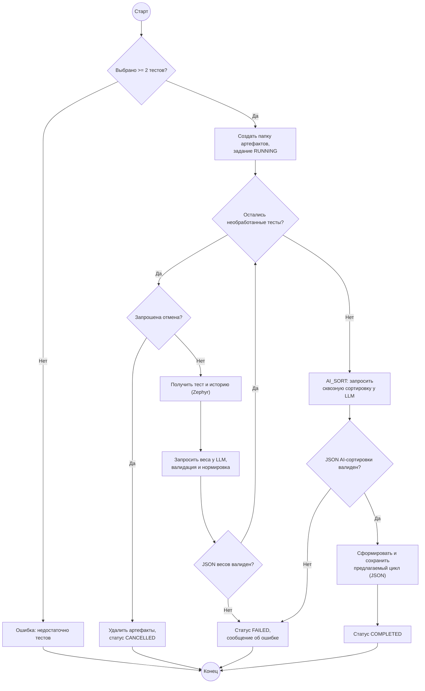

**Описание.** На данной диаграмме изображён алгоритм приоритизации как поток управления с ветвлениями и обработкой нештатных ситуаций. Поток начинается с проверки, выбрано ли не менее двух тестов; если условие не выполнено, происходит переход к выдаче ошибки о недостаточном числе тестов, и процесс завершается. Если тестов достаточно, создаётся папка артефактов, а задание переводится в состояние выполнения. Далее управление поступает в цикл обработки тестов, и на каждом витке сначала проверяется, не запрошена ли отмена. Если отмена запрошена, выполняется удаление артефактов, задание переводится в состояние отмены, и процесс завершается. Если отмены нет, для очередного теста запрашиваются данные из Zephyr, затем у большой языковой модели запрашиваются веса, которые проходят валидацию и нормировку. После этого проверяется корректность полученного JSON весов: при ошибке разбора задание переводится в состояние сбоя, при успехе управление возвращается к проверке оставшихся тестов. Когда необработанных тестов не остаётся, выполняется этап AI-сортировки с обращением к модели, и снова проверяется корректность ответа. При успешном разборе формируется и сохраняется предлагаемый цикл, а задание переводится в состояние завершения. Все три исхода, которыми являются отмена, сбой и успешное завершение, сходятся в конечном узле. Тем самым показано, как система реагирует на отказы внешних систем и на запрос отмены, обеспечивая очистку созданных артефактов.

---

## 10. UML — диаграммы состояний

Назначение: документировать жизненный цикл асинхронного задания приоритизации и статус предлагаемого тестового цикла; обоснование опроса статуса и операции отмены. Привязка к ТЗ: п. 4.1 (асинхронный режим), 5.3.

### 10.1. Состояния задания приоритизации (`PrioritizationJobStatus`)

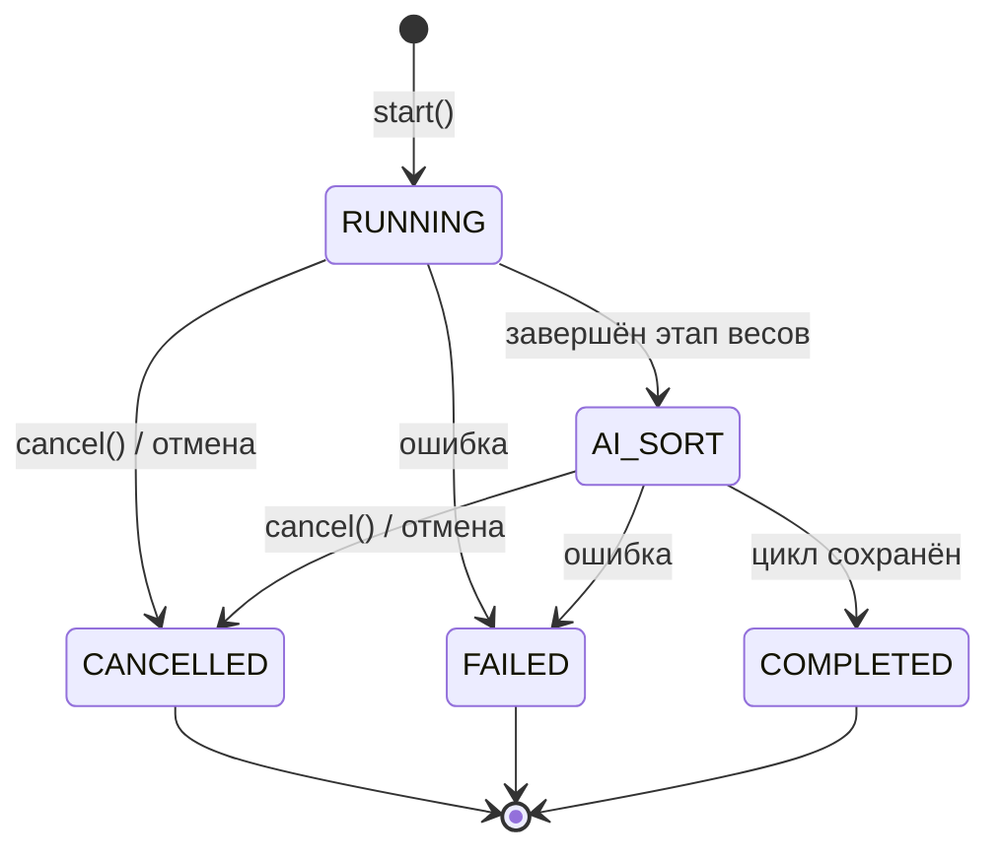

**Описание.** На данной диаграмме изображён жизненный цикл асинхронного задания приоритизации. После запуска задание входит в начальное состояние выполнения, в котором рассчитываются весовые коэффициенты тестов. По завершении этапа весов задание переходит в состояние AI-сортировки. Из состояния AI-сортировки при успешном сохранении цикла задание переходит в состояние завершения. Кроме того, из обоих рабочих состояний, то есть из состояния выполнения и из состояния AI-сортировки, задание может перейти в состояние отмены при запросе отмены либо в состояние сбоя при возникновении ошибки. Состояния завершения, отмены и сбоя являются конечными, после них работа задания прекращается. Тем самым показано, что отмена и сбой возможны на любом из двух рабочих этапов, что обосновывает необходимость опроса статуса и операции отмены.

### 10.2. Статус предлагаемого тестового цикла (`SuggestedTestCycleStatus`)

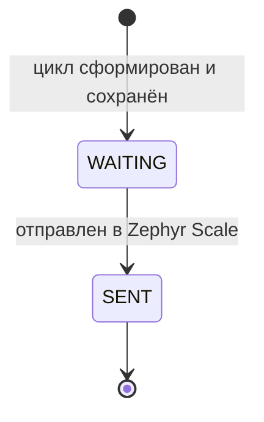

**Описание.** На данной диаграмме изображён жизненный цикл предлагаемого тестового цикла как результата работы системы. Сразу после того как цикл сформирован и сохранён в файловой системе, он входит в начальное состояние ожидания. В этом состоянии цикл доступен для просмотра, ручной правки и выгрузки. Далее, когда пользователь отправляет цикл в Zephyr Scale и там создаются тестовый цикл и выполнения, объект переходит в состояние «отправлен», которое является конечным. Тем самым показано, что предлагаемый цикл проходит всего два состояния и фиксирует факт передачи результата во внешнюю систему управления тестами.

---

## Что разрабатывать не требуется

- ER / IDEF1X (модель данных СУБД) — неприменимо: система не использует реляционную БД, хранение файловое (ТЗ п. 6.2). Структура данных при необходимости отражается UML-классами `SuggestedTestCycle` / `SuggestedTestCaseEntry` / `TestMetrics` (раздел 6).

## Минимально достаточный набор для защиты ВКР

IDEF0 (A-0 + A0), BPMN AS-IS/TO-BE, UML Use Case, UML Component, UML Sequence, UML Deployment. Остальные диаграммы (DFD, Class, Activity, State) — для полноты пояснительной записки.
